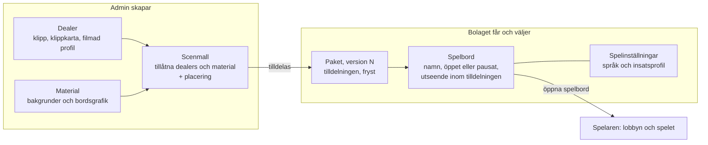

# Scoutgaming: ordlista

Vad orden betyder i produkten. Ett ord per begrepp i all text som vänder sig till användare; kodens namn står inom parentes en gång och byter inte namn för att ett ord byts i menyn. Ordlistan låser inga flöden: hur Admin ska se ut står i [målbilden](../../../docs/plans/ADMIN-FORENKLING.md), hur koden hänger ihop i [kablagekartan](../../../docs/plans/ADMIN-KARTA.md), arbetsstegen i [användarguiden](README.md) och de tekniska medieformaten i [runtime-referensen](../../../docs/LOCAL-PRESENTATION-RUNTIME.md). Uppdaterad 28 oktober 2026.

## Tre nivåer

| Nivå | Namn i produkten | Vem | Adress |
| --- | --- | --- | --- |
| 1 | **Admin** | Scoutgamings personal | `/admin` |
| 2 | **Partnerportalen** | bolagets personal | `/partner/<bolag>` |
| 3 | **Spelaren** | spelare hos ett bolag | `/lobby`, `/game` |

Regeln: **Admin skapar och tilldelar, bolaget väljer, spelaren spelar.** Allt ett bolag kan ändra är en delmängd av det Admin kan ändra, begränsat av tilldelningen och av personens roll. "Nivå 1, 2, 3" får användas som kortform i dokument; menyer och rubriker använder namnen.

## Så hänger det ihop

En **dealer** och **material** sätts ihop i en **scenmall**. Scenmallen tilldelas ett **bolag** och fryses i bolagets **paket** när den publiceras. Bolagets **spelbord** pekar på en av scenmallarna i paketet och har egna **spelinställningar**. Spelaren ser bara öppna spelbord och bara det som är publicerat.

**Ordet "bord" betyder tre saker** och används därför aldrig ensamt:

- **spelbord** (`room`): det spelaren går in i, till exempel "Loungen". Äldre text säger "rum".
- **bordsgrafik** (`table`): bilden av bordet i scenen, med boxar där korten landar.
- **delat bord** (`shared-table`): spelmotorns sätt att låta flera spelare sitta vid samma spelbord.

### Exempel: Johns Bet (preview)

| Sak | Antal | I exemplet |
| --- | --- | --- |
| Bolag | 1 | Johns Bet (preview) |
| Dealer | 1 | PAOW, med filmad profil |
| Bakgrunder | 3 | Studion, Salongen, Loungen |
| Bordsgrafik | 3 | Ljus ek, Johns Bet · Grön filt, Lila neon, alla ritade efter PAOW:s landningar |
| Scenmallar | 3 | Studion, Salongen, Loungen: PAOW, en bakgrund, en bordsgrafik och placering |
| Paket | 1 | version 17, med de tre scenmallarna |
| Spelbord | 3 | Studion (Casual), Salongen (Privé) och Loungen (High), alla på svenska |

Ska Johns Bet få ett fjärde spelbord som ser ut som Loungen, skapar Admin ett spelbord som pekar på scenmallen Loungen. Inget material laddas upp igen.

## Ytor

- **Admin** (`/admin`): personalens arbetsyta för dealers, klipp, tal, mallar, material, bolag och spelbord. Kallas i produkten **Scoutgaming Admin**. `apps/studio` är källkoden och `/studio` appens tekniska sökväg (basePath), inte en egen produkt; ordet Studio används inte i menyer.
- **Partnerportalen** (`/partner`): bolagets egen yta för sina spelbord, sitt team och sin integration.
- **Lobbyn** (`/lobby`): spelarens katalog över bolagets öppna spelbord. **Spelet** (`/game?game=…`) är det autentiserade spelfönstret.
- **Spelmotorn** (`services/game`, Render `croupier-v3`): äger kort, sko, regler, saldo och utbetalningar. Presentationen påverkar aldrig dem.
- **Delat bord** (`shared-table`, `CROUPIER_SHARED_TABLE_ENABLED`): flera spelare vid samma spelbord i spelmotorn. Från O03 är det den enda spelvägen.
- **Preview**: provbänken (tidigare staging) med syntetiska konton, som behålls efter O03 och deployas pinnat av orkestratorn; inget obligatoriskt steg före produktion.

## Det man skapar, tilldelar och publicerar

- **Dealer**: en person med eget klippbibliotek, egen röst och egna repliker. En dealer kan tilldelas flera bolag.
- **Bolag** (`operator`): spelbolaget, till exempel Johns Bet. Ett bolag är aktivt, avstängt eller i papperskorgen (`active`, `suspended`, `archived`).
- **Spelbord** (`room`): bolagets ingång till ett spel, med eget id, egen dealer, eget utseende och egna spelinställningar. Ett spelbord är **öppet** (`live`) eller **pausat** (`pending`); ett pausat spelbord syns inte i lobbyn och pågående rundor spelas klart. Äldre text säger "rum".
- **Mall** (`lane`, `presentationLaneId`; i adresser `composition`): placeringen av dealer, bakgrund och bordsgrafik i scenen, plus vilka dealers och vilket material den tillåter. Flera spelbord kan använda samma mall; en ändring i mallen påverkar alla spelbord som använder den. I menyn heter den **Scenmall**.
- **Tilldelning**: det bolaget får använda: spel, dealers, mallar, bordsgrafik, bakgrunder, godkända insatsprofiler och vilka val som är upplåsta. Bolaget får en **uppsättning** att välja bland, inte en enda låst dealer eller bakgrund. Tilldelningen lagras i bolagets paket.
- **Paket** (`operator package`, `operator_packages`): bolagets publicerade tilldelning och frysta material, med ett revisionsnummer som bara räknas uppåt. Spelet läser paketet, aldrig utkast. Undantag i dag: spelbordets namn och om det är öppet läses direkt ur Admins register; det fryses i paketet i målbildens steg D.
- **Version**: paketets revisionsnummer så som det visas för användaren ("Publicerad version 11").
- **Spelinställningar** (`room game config`, `roomGameConfigs`, `shared_table_configs`): spelbordets språk (`en`, `sv`), insatsprofil och tider (insats 20 s, beslut 15 s). De publiceras per spelbord och binds till paketets version.
- **Insatsprofil** (`limitPreset`): en namngiven uppsättning gränser och marker. I dag finns tre profiler med samma regler som bara skiljer sig i gränser, marker och påfyllning: **Casual** (1–500, sidoinsats 50, marker 1–100, påfyllning 500), **Privé** (5–2 000, sidoinsats 200, marker 5–500, påfyllning 1 000) och **High** (100–25 000, sidoinsats 1 000, marker 100–25 000, påfyllning 50 000). Admin bestämmer profilen; bolaget får byta bara om Admin låst upp det, och då bland profiler Admin godkänt.
- **Spelbordets utseende** (`branding`, `roomOverrides`): vald bakgrund, dealer och bordsgrafik per spelbord inom tilldelningen. Ändras som utkast, granskas och publiceras. Utkastet är i dag ett per bolag, inte per spelbord.
- **Utkast** och **live**: det sparade läget mot det publicerade. Spelaren ser bara live. Pågående rundor spelas klart på den gamla versionen; nästa runda får den nya.
- **Publicering**: tal godkänns, paketet publiceras och sist spelbordets spelinställningar. Målbilden samlar det till en knapp per spelbord med granskning och kvitto.
- **Demo** (**Skapa demo**): Admins guide som sätter ihop bolag, spelbord och dealer för en visning. Demolänken är avstängd tills API-nycklar knyts till bolag.
- **Bolagets eget material** (planerat): bakgrunder och bordsgrafik som bolaget skapar själv, genom uppladdning eller AI. Scoutgaming godkänner varje material med ett klick, och materialet syns bara på bolagets egna spelbord. Bordsgrafik ritas alltid efter dealerns landningsmall. Det kräver en ny tabell i databasen (migrering 021) innan det byggs.
- **Papperskorgen**: arkivering som går att ångra. Historik och källmedia raderas aldrig som bieffekt; permanent radering är ett eget steg.

## Scenen

- **Bakgrund**, **dealer** och **bordsgrafik** (`table`) är scenens tre lager; spelets kort, marker och knappar ligger överst. Bordsgrafik är bara bilden av bordet, aldrig ett spelbord. Ny bakgrund skapar varken ny dealer eller nytt spelbord. Ett lager som är inbakat i en dealerfilm kan inte bytas separat.
- **Material**: bordsgrafik och bakgrunder (`layerAssets`), uppladdade på ett ställe och tilldelade till bolag.
- **Placering** (`composition`): mallens skala och läge för dealer, bakgrund och bordsgrafik, separat för dator och mobil, samt kortens geometri. Publiceras med mallen.
- **Skon**, korten och dealerns händer sitter i dealerns filmade klipp, inte i något lager.
- **Filmad profil** (`packages/presentation/contracts/filmed-profiles/`): mätningen av en dealerfilm, med bildytans storlek, kortets storlek och var handen landar på plats 1–7 och hos dealern (**landningar**). PAOW har en filmad profil.
- **Landningsmall**: en bild med boxarna 1–7, dealerns kortplats och mobilens fönster med tre boxar, som bordsgrafik ritas efter. För PAOW är bordsgrafiken 1920 × 1404 px, och placeringen är bordsbredd 0,5 på dator och 1,58 på mobil, båda med y 0,35.
- **AI-material**: bakgrund eller bordsgrafik som Admin skapar med **Skapa med AI**. En AI-ritad bordsgrafik gäller en viss dealer och placering, och etiketten säger det ("AI · … · paow · <kod>"). Den spärras i en scenmall med annan dealer eller annan placering. Funktionen är avstängd tills servern har `CROUPIER_AI_IMAGE_ENABLED=1`.

## Varför finns det? Ord som ser onödiga ut

- **Scenmall** (`lane`): utseendet sätts i en mall och inte på varje spelbord, eftersom flera spelbord delar samma utseende. En ändring i mallen gäller alla spelbord som använder den. Mallen anger också vilka dealers och vilket material som passar ihop, så att ett bolag bara kan välja sådant som fungerar. `lane` är kodens namn och syns aldrig i menyer.
- **Sammansättning**: ett äldre menyord för scenmallen. I koden lever det kvar som `compositionId` (scenmallens id på ett spelbord) och `composition` (placeringen i mallen). I menyer heter det bara **Scenmall** och **Placering**.
- **Placering** (`composition`): dealerfilmen, bordsgrafiken och bakgrunden är tre separata bilder som måste ligga exakt rätt, så att bordsgrafikens boxar sitter där dealerns hand lägger korten i filmen. Placeringen anger skala och läge för var och en, separat för dator och mobil, och kortens och markernas läge per bordsgrafik (`blackjackTables`). Normalt rör ingen siffrorna: **Placera på detta bord** fyller i dem ur dealerns filmade profil.
- **Paket och version**: spelaren får aldrig se ett halvfärdigt utkast. Det publicerade fryses därför i ett paket med ett versionsnummer som bara räknas uppåt. En pågående runda spelas klart på den gamla versionen, och nästa runda får den nya.
- **Utkast och granskning**: man kan spara och prova utan att något når spelarna. Granskningen visar vad som ändras och vilka spelbord som berörs innan man publicerar.
- **Id**: varje sak har ett permanent id, så att länkar, historik och publicering pekar rätt även när namnet ändras. Admin skapar id:t av namnet automatiskt, och det visas bara under **Tekniska detaljer**.
- **Upplåsta val** (`operatorAdjustable`): det bolaget själv får byta på sina spelbord. Resten är låst och visas som "bestäms av Scoutgaming".
- **Filmad profil**: utan den finns inga landningar att rita bordsgrafik efter, och då gäller standardplaceringen.

## Klipp och tal

- **Klipp**: en videofil i dealerns bibliotek. **Klippkartan** ordnar klippen per situation i grupperna nedan, med ett standardklipp och varianter per situation. Tekniska poseversioner är inte varianter.
- **Vila** (`idle.ready`): basloopen och tysta beteendeklipp, som blickar och nickningar, som återgår till vila.
- **Spelhandlingar** (`deal.*`, `reveal.*`): utdelning till plats 1–7 (`box0`–`box6`), dealerns öppna kort (`dealer-up`), dolt kort (`dealer-hole`) och kortvändning (`reveal.dealer/dealer-hole`). Exakt matchning mot händelsen, ingen slump.
- **Övergångar** (`transition.shoe`): till och från skon (`to-shoe`, `from-shoe`), mellan poserna vila (`VILA`) och redo (`REDO`).
- **Replik** (`speak.<line>`): en situation där dealern talar, med språk och exakt text. Text, ljud och bild hör ihop.
- **Tagning** (`take`, `takeId`): en inspelning av en replik. En replik kan ha flera tagningar; en tagning är ogranskad, godkänd eller underkänd (`pending`, `approved`, `rejected`), och bara godkända, servermätta tagningar får spelas.
- **Talfack** (`speechSlots`): replikens plats i klippkartan; den valda tagningen är standard där.
- **Mätt speltid**: klippets exakta längd mätt på servern. Utan den kan klippet inte publiceras.
- **Godkännande**: klipp är ogranskade tills Admin granskat dem (`reviewStatus`). En dealer är **godkänd** när klipp och tal räcker för spel; först då kan den tilldelas ett bolag.
- **Röst och tal**: dealerns inspelade tal (`recordedSpeech`) och, när talkedjan är igång, genererat tal med läppsynk från chatten. **Dialogtest** är chatten mot dealern; **Svarsbiblioteket** är dealerns inspelade svar sorterade i kategorier. Talkedjan är pausad till efter O03 och byggs då lika för alla dealers.
- Tur och resultat avgör när ett klipp körs; de är inga egna kategorier. Automatik får välja bland kompatibla varianter men ändrar aldrig spelhandlingen eller utdelningspositionen.

## Vem väljer vad

Admin bestämmer per bolag vilka dealers, mallar, material och insatsprofiler bolaget får använda, och vilka val som är **upplåsta** (dealer, bordsgrafik, bakgrund, bordsspråk, insatsprofil, öppet/pausat). Insatsprofilen är låst som standard. Bolaget väljer inom det på sina spelbord; låsta val visas som "Låst av Scoutgaming". Spelaren väljer aldrig vad ett spelbord är, bara hur det visas för just honom eller henne (språk, ljud, sparade val). Ett bolag med ett spelbord och en mall behöver inga val alls.

## Konton och roller

- **Personal**: Admins konton (`croupier_auth.users`, roll `admin` eller `staff`). Bara personal når Admin.
- **Bolagets team** (`operator_memberships`): bolagets personer med en roll. Standardrollerna är **administratör** (`partner-admin`, alla behörigheter, utses bara av Admin), **redaktör** (`partner-editor`, ser och ändrar spelbord) och **läsare** (`partner-viewer`, ser allt i bolaget). Den sista administratören kan inte stängas av.
- **Behörighet**: kodens tolv namn (`overview.read`, `tables.read`, `tables.configure`, `presentations.read`, `presentations.configure`, `players.read`, `reports.read`, `integrations.read`, `team.read`, `team.invite`, `team.roles.assign`, `team.suspend`). En dold meny är ingen behörighet; servern avgör.
- **Spelare** (`players`): ett spelarkonto med saldo och historik. Efter O03 tillhör varje spelare exakt ett bolag.
- **API-nyckel** (`api_keys`): bolagets nyckel för att starta spelare från sin egen sajt; **testsession** är en start med demokrediter.
- **Journal** (`operator_audit_events`): bolagets händelser, synlig för Admin och för bolagets administratör.

## Lagring

Neon är produktregistret (bolag, paket, spelbord, klipp, konton) och Blob lagrar mediebytes; Git innehåller kod och text. Paketet är kontraktet mellan Admin och spelet. Detaljerna står i [BLOB-NEON](../../../docs/storage/BLOB-NEON.md) och [kablagekartan](../../../docs/plans/ADMIN-KARTA.md).

## Ord som utgår

| Gammalt ord | Använd |
| --- | --- |
| rum, spelrum, spelutbud, room, table (i svensk text), bj, game-tables | spelbord |
| bord (som scenlager), bordsbild, lagerfil, material-library, assets | bordsgrafik; material (bordsgrafik och bakgrunder tillsammans) |
| sammansättning, spelmall, gemensam mall, lane, game lane, presentation (substantiv) | mall (i menyn Scenmall) |
| operatör, kund, spelbolag, partner, company (utom som förklaring) | bolag |
| Operatörsportal, partnerportal, Spelbolag (som ytans namn) | Partnerportalen |
| bolagspaket, partnerpaket, lane-paket, paketversion, publiceringsrevision | paket; version |
| rumskonfiguration, spelkonfiguration | spelinställningar |
| insatsnivå, limit, tier | insatsprofil |
| branding, theme, design, appearance, "rummets val" | spelbordets utseende |
| grundloop, idle (i svensk text) | vila |
| take | tagning |
| forge, dealer-studio, Dealer Forge | Skapa material |
| speech, voice, probe, taldrift, talgranskning | röst och tal |
| OpenClaw, ai/models, dealer-agent, operator-chat | AI-agenter; Dialogtest |
| Dealerregister, Studio som egen produkt, Lab, labbet, Control, Backoffice, Croupier Admin, N1-session | Admin (Scoutgaming Admin) |
| Konton & åtkomst (för personal) | Scoutgamings personal |
