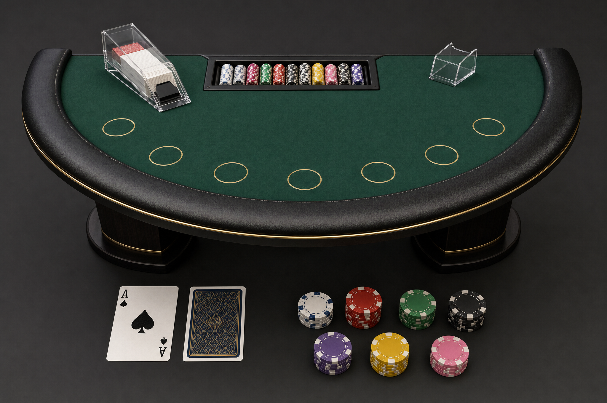
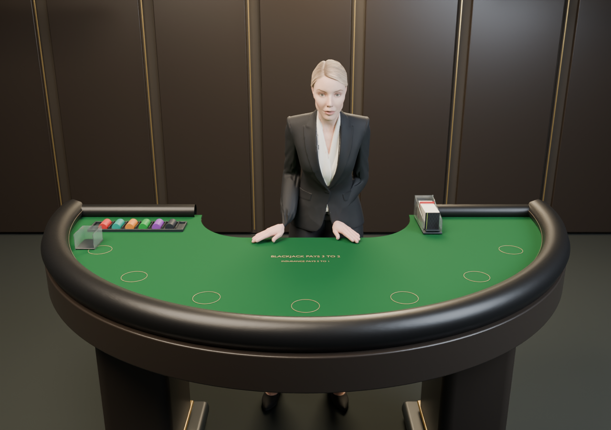

# Reference comparison and acceptance

The target is the photographic Astrid in the original casino reference.

The Higgsfield MCP table reference guides the green felt, compact clear shoe and leather rail.

The current editable 3D source uses real geometry and independent props. This baseline render predates final face/skin work and does not meet the photographic identity target.

The actual game recordings show server-issued cards, seven-seat support verified separately, reveal and collection. The two recordings contain no audio; they preserve the actual browser aspect ratio and waiting time.

- [Complete round with corrected skin contact](game-skin-contact-round-silent.webm)
- [Initial deal and insurance offer](game-initial-silent.webm)
- [Hit, dealer resolution and collection](game-decisions-silent.webm)

**Open visual differences:** head shape and texture resolution, fixed mouth/eyes, solid hair geometry, remaining shoe/card/skin contact review, contact shadows and subdued room depth. A material or UV projection pass must be compared in motion and from several angles before promotion.

See [the delivery notes](../../../docs/ASTRID-RIGGED-TABLE-REVIEW.md) for verification boundaries and source rebuild instructions.
