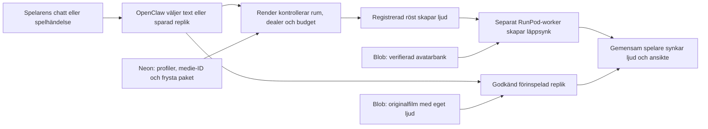
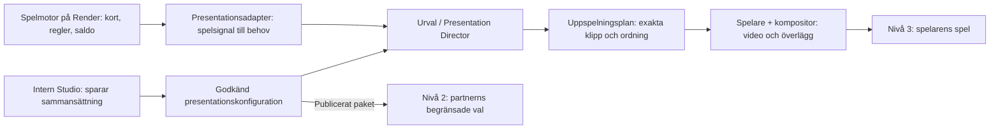

# Scoutgaming: nivåer, begrepp och presentationsruntime

## Tal och villkorade Idle-beteenden

Admin/intake exponerar inga `turn.player`-/`settle.*`-videofack. Dessa ID:n
behålls som spelhändelser i katalogen och i äldre sparade paket; inga filer
eller historiska kopplingar raderas. Nya skrivningar till dessa videofack
avvisas: tyst beteende använder `idle.ready`, tal använder exakt `speak.*`-fack.
Idle-editorns händelseval skriver vanliga `event.*`-triggers och en variant på
dealerns idlelinje i befintligt projektformat, högst 30 beteenden.

Spelaren observerar `turn`/`settle` från ett avslutat tabellkommando, en gång
per version och händelse. `/api/presentation/select` läser om spelarens
committade `native_presentations`; klientens kort, tillåtna drag och resultat
får aldrig ersätta kvittot. Stale version, fel hand och saknad händelse avvisas.
Endast `rules` väljer ett kopplat beteende. Svaret binds till version och
fryst rumspaket, löper ut efter 30 sekunder och erbjuds till samma idlecontroller
som redan hanterar kvot, talprioritet och klippgränser. Händelsen spelar ingen
egen reaktionsfilm. Publicering och typ-/mediekontroller använder samma format;
ingen databasmigrering krävs. Inspelat tals godkännanden och text/ljud/bild-par
ändras inte av denna indelning.

## Driftväljare: kontrollplan

<a id="driftvaljare-kontrollplan"></a>

`packages/presentation/contracts/moving-drift.mjs` definierar kommandot:
`expectedRevision`, `commandId`, `mode` (`off|saving|warm`), `profileId`
enbart för saving/warm och `durationSeconds` enbart för warm (1800/7200/86400).
Servern bestämmer sluttiden. Klienten får inte ange endpoint, pris, budget eller
workerstatus. `services/game/moving-drift-controller.mjs` ger serverklocka,
revision/operation, önskat läge, observerad status, vald/faktisk profil,
exakt release-/bankberedskap, capability/skälkod och kostnadsunderlag.
Saknad/gammal observation ger `unknown`; cached EXITED är ingen aktiv GPU.
`nextAction` är en intern plan, aldrig en genomförandekvittens.
Identiska kommandon jämförs fältvis så JSONB:s nyckelordning inte påverkar retry.
Null-kvitto tillåts bara för revision0/ursprungligt Av (min0/max1), aldrig för
senare aktivering. Observationens katalogfingeravtryck omfattar profil-ID,
endpoint, release och bank; ändrat underlag kräver ny komplett observation.
Visningsetiketter och profilernas ordning ändrar inte detta fingeravtryck.

`postgres-moving-drift.mjs` serialiserar en rad per miljö för alla profiler/rum,
använder databasklocka och kräver atomisk commit. SQL016 är valfri vid deployment;
modulerna startar ingenting och läser inga credentials. `applyStudioMigrations`
kan skjuta upp enbart kända deploymentOptional-versioner med `deferOptional`;
016 kan därmed installeras efter redan ledgerad 017. Installerad historik och fingeravtryck
verifieras fortsatt. Utgången varm period
övergår till Av vid nästa serveranrop/avstämning. Det bevisar återställning efter
omstart, **inte avstängning medan servern ligger nere**.

Admins befintliga catch-all registrerar GET/POST `/studio/api/admin/moving-drift`
(eller `/api/admin` enligt `apiBase`). N1, färsk session, exakt origin/CSRF och
konfigurerat environment/workspace kontrolleras före anrop. POST:s behörighetskontroll
och driftlagring delar samma produkttransaktion/anslutning; POST-rollback återställer
driftstate. GET autentiseras före en separat statustransaktion. Den kan initialisera
önskat Av eller markera en utgången önskad period som Av; den verkställer inget
GPU-stopp. Browserkontrakt/typer finns i `moving-drift-admin.mjs`/`.d.mts` under
`packages/presentation/contracts/`; interna `nextAction`, endpoints och hashunderlag
utelämnas. 200 bekräftar önskat läge, aldrig genomförd GPU-drift. Konflikter ger
409 med säker kod; saknad optional016 ger 503 utan SQL-detaljer.

För produktion krävs också att molnstartens explicita child-env för vidare
den validerade driftflaggan och exakt samma profilkatalog till spelprocessen.
En korrekt konfiguration i huvudprocessen räcker inte. Saknad katalog i
spelprocessen ska neka start; autentisering och fältgränser får inte kringgås.

Sparläge är verifierat först när en färsk ansluten executor har tillämpat
aktuell revision/operation och `admission.allowed=true` för `baseline`.
Kall min0-drift får ha `modelReady=false`; det är inget bevis på laddad bank
i en framtida worker. Av kräver nekad antagning, färsk observerad Av,
noll aktiva workers/öppna sessioner och ingen kvarstående intern åtgärd.
Okänt providerutfall behåller reservationen tills det kan avstämmas.

API:t är avstängt utan server-opt-in/profilkonfiguration enligt
[ENVIRONMENT-VARIABLES](ENVIRONMENT-VARIABLES.md#driftvaljarens-api).
`moving-drift-executor.mjs` kopplar endast Av/Sparläge till en befintlig,
verifierad min0/max1-endpoint. Konstruktion gör inga provideranrop; serverns
uttryckliga opt-in startar avstämningen. Samma katalog och databasscope används
i Admin och spelserver. En SQL-lease med fence och färsk observation krävs för
`connected:true`; processdöd/felande läsning stänger admission. Färskhet räknas
från insamlingsstart eller äldsta verifierade källtidsstämpel, inte från när
nätläsningen blir klar. Alla källsvar valideras fortfarande mot sluttiden. Ingen PATCH,
ny endpoint, varm keepalive eller automatisk betald retry ingår.

Den första admission-token följer hela prepare/session-försöket utan ompinning.
Journalens samma anslutning låser Studio → drift → speech och kontrollerar
token vid reserve/current/submit samt sist före POST. Därefter kan ett redan
tillåtet nätanrop vara på väg även om Av har sparats; inget kvitto på oskickat
arbete eller avstängning uppfinns. Privat bankhämtning tillåter uttryckligen
submission_started före attach-COMMIT med samma fence; vanlig voice/output
gör inte det. Astrids ursprungliga journal saknar denna optional moving-hook.

Intern nekansdiagnostik definieras av
[serverkontraktet](../services/game/moving-drift-diagnostics.mjs).
`moving_drift_guard_rejected` innehåller första fallande guardorsak och fas,
önskat läge/drain, observerad status/skälkod, ändliga ålders-/leaseklasser
samt booleska bindnings-/fence-/katalogmatchningar. Underlaget fångas från
samma låsta SQL-state och databasklocka som nekar. Journalen omsanitiserar
metadata genom felkloningen och emitterar först efter kvitterad rollback;
missad rollbackkvittens ger ingen sådan logg. Publik felkod och bankheader
är oförändrade. Inga token, UUID, hashvärden, URL:er eller råfel loggas.

`moving_drift_readback_timing` anger ändlig fas, success/failure och
hela läsvarvets tidsklass: fast ≤7,5 s, slow ≤15 s, overdue >15 s eller
invalid klocka. Snabba lyckade varv är tysta; långsamma lyckade varv är
success, aldrig failure. Vid fel fångas klassen före cleanup och emitteras
efter invalidationförsöket; fasen anger sista påbörjade steg, inte hur lång
tid just det steget tog. Loggerfel ändrar inte avslag eller återkallelse.
En pågående, senare lyckad läsning kan lämna föregående observation äldre än
15 s utan någon readback-fellogg. Pinnad bankhämtning använder dispatch;
busy ensam nekar inte den grinden. Loggarna förlänger ingen observation
och ett senare kvitto bevisar inte historiskt tillstånd vid ett tidigare403.

Av ligger kvar som drainkrav även vid snabb Av → Sparläge. Executor avbryter
endast ägda sessioner, återanvänder befintlig recovery och läser färsk release/
health. Jobs, aktiva och okända workers samt öppna journalposter blockerar
verifierat Av. Avbruten/osäker submission utan känt jobb kan därför stanna
i stopping och blockera nästa start; automatisk återhämtning hävdas inte.
Ingen budgetrad raderas eller återbetalas. Saving kan kallstarta utan att
påstå varm modell/bank: okända runtimehashar är null och readiness false;
känd mismatch spärrar. Befintlig exakt workerattestering krävs fortfarande.

Varm drift/profilbyte är spärrade i första runtimeetappen. Varm aktivering
kräver oberoende verkställd sluttid, reservation av hela perioden inklusive
avstängning och exakt release/bank. Beräknad kostnad är ingen faktura/reservation.
SQL017 är required;016 förblir deployment-optional, men behövs innan denna
runtime uttryckligen aktiveras. Ingen moln-/GPU-acceptans följer av kodproven.

Lokalt SQL-/omstartsprov: `node tools/studio-isolated-qa.mjs --moving-drift --download-postgres`
i Linux/WSL med game-paketets låsta beroenden. Verktyget använder en tillfällig
localhost-databas, kontrollerar oförändrade källfiler och stänger/rensar sin klusterprocess.

Rena projekt-, media- och browserkontrakt ägs av `packages/presentation/contracts/`.
Studio och spelserver använder samma validering och typer. Den explicita listan
`packages/presentation/public-modules.mjs` bevarar äldre publika moduladresser
samt kanoniska paketadresser; privata projektseed/schema och serverfabriker
serveras inte. Statiska frontendkopior skriver om relativa importer från samma
kanoniska källa. Registrerade idle-regler får appens befintliga
`prepareDecision` uttryckligen, utan ändrad urvalslogik.

Kanoniskt målkontrakt för klippens fack, pose, namn, kontrollerad Kevin-import,
Neon/Blob och gemensam talworker: [storage-guiden](storage/BLOB-NEON.md).
Den uppdaterades 17 oktober som en plan; den aktiverar inte funktioner.
Befintliga implementationer och daterade prov nedan behåller sina avgränsningar.

## Runtimekontrakt efter Neon-migreringen, 16 oktober 2026

Den nya runtimekoden har **Neon som enda källa för registermetadata**.
`runtime_media_catalogs` innehåller layout, Blob-index, presentationsmanifest
och de publika JSON-originalens exakta text, under miljö och arbetsyta.
Katalogrevisionen är SHA-256 över det validerade, kanoniska innehållet.
`speech_reply_records` lagrar svarsbibliotekets metadata per miljö, arbetsyta,
dealer och UUID; kategoriändringar kontrollerar sparad revision.
Privat Blob lagrar registrerade spelmediers bytes. Hash, storlek, åtkomst och exakta identiteter
kontrolleras fortfarande; saknad eller felaktig Neon-katalog ger fel utan
lokal filreserv eller tyst tomt register. Astrid använder samma lagringsväg
som de övriga registrerade dealerna.

Dekorativa lobbyfilmer under `apps/studio/client/lobby/public/videos/` är
UI-resurser i Git och ingår inte i spelregistret.

`media/layout.json`, `media/blob-index.json`, `media/catalog/presentation.json`
och `media/catalog/legacy.json` är endast källor för uttryckligt authoring- och
importarbete. De läses inte som produktens runtime-register och skickas inte
med som metadatareserv i deploypaketet. `ops/neon-studio/runtime-media-import.mjs`
skiljer förberedelse, läsande plan och uttrycklig apply med mål-/scope-/revisions-
kontroll. Äldre Blob-JSON för svar importeras uttryckligen; runtime läser inte
dem som alternativ metadata. Import ändrar inte inspelade bytes eller godkännanden.

**Leveransgräns:** kodkontraktet kräver migration 012. Enligt huvudagentens
molnkvitto 16 oktober 18:38 UTC är 012 tillämpad och katalog samt 12 sparade
svar importerade och återlästa. Katalogen innehåller 760 layoutposter,
542 indexposter, 51 bankklipp och 18 JSON-original; 514 Blob-objekt är
fullständigt hashverifierade. Samtliga 79 medieposter och tre dokument är
oförändrade. Detta återger huvudagentens kontroll, inte ett nytt prov.
Uppgifterna ovan är det daterade migrationskvittot, inte dagens deployversion. Följ
[CLOUD-MIGRATION](CLOUD-MIGRATION.md) och [JOHN-HANDOFF](JOHN-HANDOFF.md)
för aktuell leveransstatus. Daterade äldre indexkrav nedan beskriver den
tidigare implementationen och ersätts av detta kontrakt.

Vanlig `node apps/studio/start.mjs` öppnar den publicerade `/lobby`; `--no-open`
skriver bara adressen och `--product` är ett uttryckligt alias. Endast
`--offline` startar ett isolerat, temporärt serverpar utan externa tjänster.
`--skip-build` hör till den fixturen. `--cloud-storage`, `--astrid-camera`
och `--check` avvisas; de startar inte längre en ansluten lokal produkt.
Sparade lokala arbetsfiler bevaras som källor eller återhämtningsdata.

## Rörligt tal: verifieringsgränser, cache och källor — 18 oktober 2026

Rörligt tal betyder att ansiktet genereras för **samma källfilm och bildruta som
kroppen visar**. Dragan-bankens karta binder varje klipp-ID och SHA-256 till
dess exakta poolrutor, ansiktsrektangel, latentdata och mask. Talplanen och
workerattesteringen binder tillsammans text, PCM, profil, bank och workerrelease. Bakgrund och bord läggs på
efter dealerlagrets komposition; scenens skalning och grönbakgrundsnyckling får
inte ändra dessa källidentiteter. Ändrade originalbytes kräver ny verifierad
bankbindning. Ändrad scenplacering behöver inte i sig en ny bank.

Vanlig chatt använder vila. Tal under nästa utdelning använder serverns nya
utdelningssekvens. En kort replik kan vara slut innan dealerns eget kort delas;
ett lyckat viloprov eller första munrörelse bevisar därför inte självutdelning.
Minsta rörelseprov ska använda ett utpekat utdelningsklipp, verkligt genererade
ansiktsdata, rätt ljud och den gemensamma spelaren. Ett isolerat sådant prov
verifierar inte automatiskt produktionsserverns antagning, kort eller saldo.
Aktuella resultat och deras gränser finns i [handoffen](JOHN-HANDOFF.md#dragan-talstatus).

Genererad OpenClaw-text får en gemensam radbrytningsnormalisering före
förhandsvisning, TTS och hashning; inspelade repliker behåller originaltexten.
`services/game/moving-speech-timing.mjs` räknar PCM-gränsen från workerens
24 kHz/24 fps, 220 ms förmarginal, 530 ms eftermarginal och högst 600 rutor.
Sista giltiga ljud är 582 999 samples (24,291625 s), med oförändrad avrundning.
Nästa sample avbryter insamlingen före render-dispatch; redan gjord TTS eller
GPU-förberedelse är inte kostnadsfri och ingen tidigare bildacceptans utökas.

Spelaren lämnar begränsade klienttider i den tillfälliga `playbackReceipt`:
socketöppning, första hashverifierade PCM, komplett svar (`reply_ready_ms`),
ljudets `play()` och första renderade talruta. Tiderna räknas från spelarens
socketanslutningsförsök; de omfattar inte tidigare Director-/TTS-förberedelse.
`reply_ready_ms` mäter mottaget och validerat `done`, inte GPU-rendering separat
från providerfinalisering. Ljudenhetens faktiska hörbara start och visuell
läppsynk kräver fortfarande ett inspelat/observerat prov. Kvittot innehåller
varken repliktext, transportticket eller ett visuellt godkännande.

`test/moving-speech-deal-integration.mjs` driver verklig blackjack-commit och
beständig presentation i ett eget SQLite-minne vidare till talets WebSocket.
`test/microphone-openclaw-integration.mjs` kopplar mikrofonkontroll, WAV,
transkriptions-API, Director, NDJSON, röstadapter och moving-runtime i loopback.
De skyddar kort-/saldobehörighet, isolering, originalspråk och avbrott men
använder syntetiska enheter, modell, TTS, GPU och mediebytes. De ersätter inte
ett inspelat prov av den registrerade Dragan-banken och hela livekedjan.

Det finns flera olika former av varm/kall lagring och beräkning:

| Del | Faktiskt beteende |
| --- | --- |
| Blob/Neon | Beständiga källbytes och register; ingen lokal runtime-reserv. |
| RunPod-container/image | Skalning till noll kan ge kö och imagehämtning före jobbstart. En EXITED-worker eller cachepost är inte en aktiv GPU. |
| Bankarkiv | Hashad temporär `/tmp/croupier-moving-banks`; träffar återverifieras. Försvinner när containerns lagring försvinner. |
| Bankextraktion/modell | Cacheleveransen verifierar bank och modeller för varje jobb men återanvänder en exklusiv motor efter fullständig normal avslutning i samma SDK-worker. Färsk 30-fps-mätning görs även vid träff. Den publicerade cacheimagen har verifierats med kallt/varmt jobb, avbrott och omladdning på RTX4090; exakt release, appdrift och produktionsprov redovisas separat i handoffen. |
| Spelarens buffert | Hela komprimerade repliken och verifierat `done` krävs före ljudstart; högst 4 MiB komprimerat och 48 avkodade ansiktsrutor. Detta är uppspelningsskydd, inte modellcache. |

Serverns antagning av en varm worker är separat från modellcachen. Den nya
moving-vägen kan återanvända exakt en egen ledig worker när samma beständiga
lease fortfarande gäller. Beviset måste komma från serverns färska RunPod-
läsning (högst 15 s): exakt image-digest/template/version, ingen kö eller
pågående uppgift, inga okända/ohälsosamma workers och högst en aktiv GPU.
Kontrollen upprepas under journalens SQL-lås och precis före provider-POST.
Generiska taljobb och återhämtning behåller sitt krav på verklig drain.
RunPods `ready` räknar separat Flashboot-/cachekapacitet; en körande worker
kan ha `running=1, ready=0`. Värdet får därför varken krävas för en verifierad
aktiv worker eller användas som bevis för en varm modell. Se
[RunPods egen CLI-referens](https://github.com/runpod/runpodctl#waiting-until-a-resource-is-usable).

Endpointen ska vara exklusiv för denna journal: en extern API-användare kan
annars starta arbete mellan GET och POST. `workersMin=0`, `workersMax=1` och
högst 60 s `idleTimeout` gäller. Den möjliga betalda tomgången ingår tillsammans
med 540 s jobb-TTL i den ursprungliga reservationens 720 s; leaseförnyelse
förlänger inte betalningsfönstret. En färdig uppgift betyder inte att GPU:n
redan är avstängd. Osäker submission hålls reserverad utan automatisk omkörning.
Kod/testbevis och aktuell driftsättning ska avläsas separat i handoffen.

24 timmars varm drift är inte aktiverad eller verifierad. Både provider- och
kapacitetskontrollen avvisar `workersMin=1`; aktuellt prov använde en 720 s
guard. Modellcachen har ingen egen TTL eller jobbgräns men kan försvinna med
containern, och identitetsbyte, fel eller avbrott avvecklar den. Ett längre
varmtest behöver ett separat, avgränsat drift-/kostnadsfönster med bevarade
antagnings-, avbrotts- och städskydd; det ingår inte i tvåreplikskvittot.

### Budgetens tre nivåer

`MOVING_TRIAL_BUDGET` anger teknisk total kapacitet 150 USD och runtime-dygn
60 USD (dygn 20 → 40 USD den 19 oktober och kapacitet 45 → 150 USD samt dygn
40 → 60 USD den 21 oktober 2026 på Jakobs beslut; providertäckningen är
250 USD). Dygnets effektiva tak är fortfarande det lägsta av koden och den
sparade policyraden `gpu_budget_policies`, som bara ändras med
`amendBudgetPolicy` och dess uttryckliga bekräftelse; schemats CHECK-gränser
följer migration 017/018/019. Det separata initiala beloppet 13,2 USD används bara för ett tomt
Dragan-budget-ID. Därefter gäller det lägsta av runtimekapaciteten och
journalens varaktiga beviljade tak. En explicit finansierad amendment måste
matcha tidigare tak, reserverat belopp, antal reservationer och färsk
provideravstämning för att höja det. Varken migration 015, ett nytt kodtak
eller ändrat initialvärde höjer ett befintligt beslut. Reservationen är
fortsatt 1,2 USD per försök och historiken bevaras även efter avslut.
015 är verifierat applicerad i produktion 18 oktober 21:24:12 UTC: enbart
tre CHECK-gränser ändrades, inte befintligt beviljat belopp. Denna leverans
gör 015 obligatorisk i readiness, Studio och båda importörerna. Handoffens
daterade appdriftkvitto avser PR262 före denna slutleverans; den beskriver
även det exakta migrationskvittot och verifieringen av denna ändring.

Jakob har 19 oktober satt det sammanlagda taket till 45 USD; det är inte
45 USD extra. Den nya migrationen 017 höjer enbart de tre CHECK-gränserna
40→45 USD och lämnar tillämpad 015 samt historiska ledgerbevis orörda.
017 är först `deploymentOptional`: produktionens SQL, readiness och separat
finansierad amendment måste återläsas innan den högre budgeten används och
017 görs obligatorisk. Initialbelopp, dygnstak och försöksreserv är oförändrade.

Faktisk leverantörsdebitering, kvarhållna providerreserver och SQL-journalens
reservationer är skilda redovisningar. Summera inte journalen som faktura.
Tomma eller fördröjda billing-rader bevisar ingen slutlig nollkostnad.
Aktuella belopp och verifierade prov finns i handoffen; beloppen ovan
beskriver tekniska kontroller, inte ett nytt mänskligt kostnadstak.

Workern kör ett uttalande åt gången, 24 fps, 220 ms inledande och 530 ms
avslutande ljudutfyllnad, med 12-rutorspaket och kvittens. Både worker och
spelserver kräver minst 30 uppmätta uppvärmningsrutor/s. Uppvärmningen använder
syntetisk tystnad och är ingen garanti för nätverk, faktiskt klipp eller
webbläsarens bildtakt. Mät kö/image, bank, modelluppstart, första färdiga paket,
hela replikens produktion, överföring, verklig ljudstart och bildtapp var för sig.
Fullbankens 2479 stycken 1080×1920 YUV420-kroppsrutor motsvarar cirka 7,18 GiB
host-RAM, utöver modeller, masker och buffertar. GPU-minne och host-RAM är olika
krav. En GPU-modell eller ett pris ensamt är inget prestandakvitto.

Emils export är en versionsbunden referensleverans, inte produktens register.
Den egna workern har pinnade modell-/kod-/pakethashar, verifierad bank, isolerad
process, autentiserad jobbkoppling, avbrott och tester. Tekniken ska bedömas på
dessa kontroller och uppmätt kvalitet, inte på att ursprunget är en ZIP eller
Python. Den levererade modellcachen har exklusiv lease bunden till release,
dealer, källmängd, bank och kvitto. Generationsbundet IPC och avslut av alla
kompositionsfutures förhindrar att föregående jobb arbetar vidare efter
återlämning. Bankbyte, fel, avbrott eller osäker slutkvittens avvecklar motorn.
Ingen återanvändning av PCM eller ansiktsrutor mellan repliker tillåts.
Isolerat prov gav 71,245 s kallt och 6,954 s varmt för olika repliker; det är
inte en mätning av produktionslatens eller samma texts hastighetsförhållande.
Automatisk varaktig lagring av moving-resultat är fortsatt en produktlucka.

Prioritering efter optimeringsunderlaget den 18 oktober: behåll samma workerimage
under jämförbara produktionsprov. Separata Docker-lager för pinnade modellfiler
kan förbättra bygg- och distributionscache; det är inte samma sak som en redan
laddad modell i GPU-processen. Gör en sådan ändring som egen förseglad release
med före/efter-mätning. Mät nätverk och kö innan region, GPU, precision eller
samtidighet ändras. Önskade p95- och samtalsmål är ännu inga verifierade SLA;
varken två repliker eller de uppmätta minnestopparna etablerar statistisk
latensgaranti eller minsta möjliga maskinkonfiguration.

Behåll originalfilmer i befintlig privat Blob och deras identiteter i Neon.
Git innehåller kod, kontrakt och läsbara kvitton, inte alla genererade filmer.
Emils ZIP bevaras separat som referens. Härledda renderingar, ljud och
sanerade proveniensmanifest hör till staging/granskning och är inte nya
original eller godkända talrepliker. `/admin/clips` registrerar riktiga MP4/WebM
med explicit funktion; ZIP, bankarkiv och råa mun-/maskpaket ska inte läggas där.
Att en film finns i klippbiblioteket aktiverar eller publicerar den inte.
De 50 befintliga Dragan-källorna behåller sina exakta bytes och använder samma
runtime. De två första privata, hashbundna Blob-manifesten bevarar referens-ZIP,
bankrefs, ljud, ansiktspaket och granskningsmedia. Ett tredje bevarar det historiska
enskilda produktionssvarets medieström (T3). Ett fjärde, fullåterläst manifest
bevarar T4:s komplett fångade medier och 62 passiva JPEG-prov. Det femte,
fullåterlästa manifestet bevarar T6:s två kompletta mediesvar, sanerade kvitton
och 79 unika JPEG-bilder med 82 tidsreferenser. Bevarandet omfattar 94 unika
objekt och skapade inga Neon-/Admin-klipp.
Exakta sökvägar och bindningar finns
i [handoffen](JOHN-HANDOFF.md#dragan-talstatus). Ett samlokaliserat filnamn
bevisar inte härledning; det krävs SHA-bundet capture-/transkodningskvitto.
Omkodade jämförelser är inte originalbytes. Visuellt godkännande gäller bara
den exakta godkända filhashen, aldrig efterföljande cache-/replayresultat.
T4:s `captureComplete=true` gäller den verifierade medieströmmen; glesa
skärmbilder bevisar inte varje visad ruta eller läppsynkens kvalitet. Mottaget
PCM ska inte beskrivas som inspelat systemljud. T3 och T4 saknar andra submit.
T6 verifierade däremot två efterföljande vilorepliker i produktion, 57/57 och
51/51 mottagna rutor med fullständig capture, samma A40-worker och cachemiss
följd av cacheträff. Detta prövade inte produktions-DEAL, insats eller saldo,
och överför inget visuellt godkännande från den äldre rörelsefilmen.

Spelaren hanterar naturligt ljudslut från både ljudklockan och DOM-händelsen
med samma slutkontroller; manuell paus utan `ended` avbryter. En plan med
66 kroppsrutor och observerad slutruta 65 är inte bevis för 66 visade rutor:
faktiska bildcallbacks måste redovisas separat. Den nya B-replayen observerade
63 unika kroppsrutor och slutfördes tekniskt; äldre godkänt prov observerade 66.

## Astrid som legacyreferens och gemensam molnkälla, 16 oktober 2026

Jakob har beslutat att Astrid ska behållas som **legacyreferens**, med tydlig
märkning att hon saknar trelagersversionen. Hennes befintliga tal-/OpenClaw-
flöden kan användas som referens. Dragan är den ordinarie dealern. Märkningen
är en produktavgränsning, inte ett nytt godkännande av läppsynk eller genererat
tal. Radera inte den gemensamma taltransporten för att en sökväg heter Astrid.

Produktionsinställningarna kontrollerades 16 oktober: Vercels native Admin
och Neon-policy är aktiva i `production/croupier`, medier använder privat
Blob och spelbackend är `croupier-v2.onrender.com`. Spelmotorn kör på Render;
Vercel är webb-/Admin-ingången. Det aktuella molnspåret behöver inte läsa
originalfilmer från Jakobs dator. Neon-registret ignorerar de gamla lokala
upload-/klassificeringsfilerna. Videobytes hämtas från Blob och kontrolleras
mot exakt identitet, hash och storlek; tillfällig cache är disponibel.

**Historisk migrationsgräns före runtimebytet ovan:** `createNeonVideoRegistry` kombinerade
Neon-rader med en oföränderlig deployad bank. `media/catalog/presentation.json`,
`legacy.json`, layout och Blob-index var katalogauktoriteter i
deploypaketet. Den inventeringen var inget bevis för att alla register redan
fanns i Neon. Även Dragan passerade den gemensamma katalogkontrollen.
En dealerradering slutförde inte metadataflytten.

## Gemensam ägare för fullfile-tal, 17 oktober 2026

`packages/presentation/server/generated-speech-runtime.mjs` äger den befintliga
modul-lokala tjänsten, journalreferenserna, konfigurationsnyckeln och WeakMap för
exakta providerfunktioner. Studio och game lämnar samma ursprungliga repository-root
via sina egna kompositioner. Samma modulgraph får samma getter och tjänst; skilda
processer/modulgrafer har eget minne. Ingen global eller ny HMR-persistens införs.
Game behåller SQL-journal, Blob-artifacts och sessionsbootstrap; Studio aktiverar
ingen separat journal eller betald provider. Rootgräns, lease/reservation, hashkontroller,
request-idempotens och cancellation följer samma implementation och regler.

`speech-package` och `astrid-voice-profile` är rena kontrakt i `packages/presentation/contracts`.
Deras gamla publika URL:er och kanoniska paketadresser serverar samma källor;
server-/journalmodulerna ingår inte i den publika allowlisten. Innehåll, ID:n,
mediahashar, ursprunglig proveniens och godkännanden har inte ändrats.

## Dragan: första gemensamma molntalvägen, 17 oktober 2026



Schemat beskriver kodens avsedda flöde. Worker och budget antas och verifieras
före röstgenerering; faktisk molnacceptans redovisas separat i handoffen.

Jakob godkände den 17 oktober Emils bildrutebundna ansiktskomposition efter
jämförelse med levererade `lappsynk-export-fe1b55e.zip` (SHA-256
`949443c1084ab3f515792fe66c5e2d381e985f9bdc743e792e5fbca36a9240a3`).
Zipens `LAPPSYNK-RUNPOD.md` beskriver MuseTalk-genererade ansiktsrutor med
färg/alfamask i H.264 256×512 och exakt `tagning`, `ruta`, `rect` samt 220 ms
ljudförskjutning. De centrala motorfunktionerna är AST-identiska med vår
importerade motor; `rorlig.py` är byteidentisk. Browserkompositionen följer
samma maskprincip men har inte visats vara pixelidentisk med Emils WebGL.
Detta är ett uttryckligt undantag från äldre förbud mot påklistrade munlager:
fristående, felmatchade eller oberoende tidsatta munanimationer är fortfarande
otillåtna. Källjämförelsen är inte ett godkännande av läppsynkens synliga kvalitet.

Spelvyns `Voice off` gäller mikrofonlyssningen. Textchatt kräver ingen mikrofon.
Dealerns uppspelning, sparade talprofil och serverns driftkoppling är separata
kontroller; ett aktiverat uppspelningsreglage bevisar inte att GPU-tal fungerar.

`CROUPIER_MOVING_SPEECH_ENABLED=1` väljer den nya, separata workern för Dragan.
Aktivering kräver verifierad image, bank, schema013, talprofil och ett valt
testrum. En sparad flagga eller profil startar inget GPU-prov i sig; endpointens
kapacitet och kostnadsvakt styr det betalda testfönstret.

Två driftprov 17 oktober 2026, på PR203 `9e533e7b` och PR208 `a0876f71`,
nådde RunPods jobbkö från riktig bordschatt. Inget fick en worker före
uppstartstidsgränsen, även med A40 och A6000 tillåtna i andra provet.
Jobben avbröts och tillfälliga endpoints/templates togs bort av guarden;
se [handoffens kvitto](JOHN-HANDOFF.md#dragan-talstatus).
Draganprofilen är därefter avstängd. En ny endpoint måste bindas till rätt
runtime-behörighet, template och image före nytt prov. Den borttagna
testendpointens miljöreferens är inte fungerande drift. Kodprov, en slutförd
förberedelsepost och en tom fakturarad är inte kvitto på spelad läppsynk.

Proven nådde inte workerintyget eller TTS och gav inget verifierat resultat
från Python-renderaren. De styrker därför inte fel på röst eller filmunderlag.
Ett separat startup-only-prov 16:13–16:28 UTC verifierade därefter exakt
imagehämtning och RunPod SDK 1.12.0:s startbanner på A40 i EU-SE-1.
Första starten tog cirka 296 s från guardstart. Inga jobb skickades och
talprofilen var av; modell-/bankladdning och läppsynk är fortsatt oprövade
i molnet. Endpoint och template gav 404 och workerlistan var tom vid
oberoende kontroll 16:30:58 UTC. En 150 s startfrist räcker inte för den
observerade kallstarten. `services/game/moving-speech-limits.mjs` ger därför den
separat verifierade moving-vägen 450 s callbackfrist, 480 s absolut session
och 540 s provider-TTL. Själva workerexekveringen är fortsatt högst 180 s.
Banktoken följer återstående sessionstid och återkallas vid avbrott; sen
submit nekas före POST så job-TTL ryms inom befintlig budgetreservation.
Båda chattlagren behåller pending-lås 600 s och släpper direkt vid avbrott;
en krasch kan därför lämna låset kvar fyra minuter längre. Astrids
exekverings-/callbackstandarder är oförändrade. Dessa kodgränser är lokalt
provade men utgör inte ett nytt verifierat molntalprov.
RunPods [uppstartsbeskrivning](https://docs.runpod.io/serverless/development/optimization)
skiljer imagehämtning från modellstart. Tjänsternas olika roller och env-profiler
beskrivs i [miljöguiden](ENVIRONMENT-VARIABLES.md#läsande-jämförelse-17-oktober-2026).

`services/game/moving-speech-runtime.mjs` använder samma OpenClaw-beslut och registrerade
röst som övrig dealerchatt. Neon fryser exakta källreferenser och reserverar
budget före GPU-anropet; TTS följer först efter workerintyg. PCM24k, textens
hash, bankens hash och bildruteplan är en sammanhållen talhändelse.

Vanlig chatt håller bankens uttryckliga vila under talet och använder
24fps-läppbilder inne i dealerlagret före komposition. Talgrinden placerar
det mellan kortsekvenser. Valet **Svara under nästa utdelning** reserverar
i stället en ny, serverbestämd öppningssekvens. Spelaren skickar dess version;
servern läser kortföljden från sitt eget kvitto och väljer exakta publicerade
filmer. Redan spelade sekvenser återanvänds inte. Ljud, kropp, ansikte och
kortkontakt följer samma klocka; ändrad ägare eller revision avbryter.
Kort tal låter den återstående kroppsrörelsen avslutas; långt tal fortsätter
i bankens uttryckliga vila efter sekvensen. Detta är ingen fri omplanering
mitt i en redan pågående utdelning. En inspelad replik behåller sitt eget ljud.
Kodens teststatus och faktisk molnverifiering redovisas var för sig i handoffen.

Originalens kropps- och vilorutor läses från hashkontrollerad, progressiv AVC/MP4
med en CFR24-videoström och högst 600 källrutor per fil. Tidsstämplar och
bildindex måste stämma exakt; rotation,
icke-kvadratiska pixlar, klippning och andra format stoppas. WebCodecs-ytor
kopieras och frigörs direkt för att undvika att Chrome får slut på decoder-
ytor i 1080p. Högst 24 kroppsrutor buffras. Ingen fristående videoklocka,
närmaste-bild-sökning eller omskrivning av originalfiler används.
Vilan avkodas som en enda deklarerad källruta och kopieras till en fristående
canvas; ingen spelande HTML-video används för att fånga den bilden.
Alla använda komprimerade källfiler hämtas och verifieras före ljudstart,
med en gemensam gräns på 96 MiB. Senare avkodning behöver därmed inte vänta
på nästa nätverkshämtning. En ny serverversion återkallar reservationen
och avbryter aktivt även en worker som inte skickar fler chunks. Efter
varje asynkron kontextkontroll återkontrolleras reservationen synkront.

Bankarkiv och kvitto lagras privat i Blob under
`croupier/media/dealers/dragan/runtime/moving-bank/`. Den låsta manifestreferensen
är deploymentkonfiguration för en härledd workerartefakt; registrerade filmer
och deras identiteter hämtas fortfarande från Neon. Originalen skrivs inte om.
Banken förladdas och verifieras på Render, sedan får endast det antagna jobbet
kortlivade URL:er för exakt arkiv/kvitto. Ingen Blob-nyckel lämnar produktservern.
Klientens engångsbiljett och workerns capability är separata. Kvittenser per
chunk begränsar buffertarna och avbrott når providerjournalen.

## Dragan: källkvitto från 15 oktober 2026

Färsk GitHub-läsning: `kevin` är
`60e984b4380deaa28a0069d4fb3185839f75b212` (samma källträd som `315cfc5`),
och `kevin-staging` är `ae9fedc54a2ef4f26a507eb98134f88f6011cc89`.
Det fastställer inte Kevins körande serverversion. KEVI-POD-EMIL:s avgränsade
källkvitto bekräftar att de 129 lokala Draganfilmerna fortfarande matchar
`kevin`; ingen branch eller ny medieuppsättning importerades.

Huvudagentens mediaagent har jämfört den uttryckligen angivna lokala mappen
`C:/Users/jakem/.codex/visualizations/2026/10/13/01a135e1-7727-7812-973a-fd8c559f5929`:
alla 36 filmer i det frysta Dragan v4-paketet matchar storlek och SHA-256
(52 564 262 byte). Med två separata lagerresurser är paketet 58 575 526 byte.
De 35 giv-/vändfilmerna matchar den aktiva `kevin-dragan-f15b2af1`-profilen.
Det lokala talarkivet med 18 klipp är däremot fryst på `5134d927`; fyra klipp
skiljer sig från aktuell staging: `blackjack_4`, `win_1`, `greeting_1`, `bust_1`.
Hashlikhet är proveniens, inte ny visuell eller läppsynksmässig acceptans.

Rörligt genererat tal är fortfarande inte aktiverat från dealerchatten.
Kevins staging skickar `karta`, `ljud_id`, `fran_ruta` och PCM 24 kHz,
och tar emot `lapp`-metadata samt rå H.264 för färg/mask. Vår gatewayrelay
accepterar ett annat start-/svarsformat (`stream`/MP4, `done`, `error`).
Kevins rektanglar är källpixlar; `web/moving-speech-plan.mjs` kräver
normaliserade koordinater i sin servermatchare. Den nya webbläsarkonsumenten
nedan använder i stället protokollets källpixlar direkt och kontrollerar att
rektangeln ryms i originalbilden. Den aktiva talvägen använder ännu verifierad
referensbild. Att byta endpoint räcker inte.

### Registerbundet bankunderlag, 17 oktober 2026

`tools/prepare-moving-speech-sources.mjs` läser det befintliga Neon-registret
och privata Blob-filer genom samma tjänster som spelet. Kör med explicit
molnkonfiguration och en ny lokal utdatakatalog:

```sh
node tools/prepare-moving-speech-sources.mjs --dealer dragan --output /private/dragan-input
python tools/build-moving-speech-bank.py --sources /private/dragan-input --output /private/dragan-pool
```

Exporterade filmer behåller originalens byte. ID, SHA-256, byteantal,
faktiska bildrutetidsstämplar, 24 fps och 1080×1920 kontrolleras. Filnamn och
etiketter används inte för matchning. Endast aktiva rörelse-/idleklipp tas
med; inspelade repliker behåller sitt befintliga flöde. I Dragan-läsningen
var 50 klipp kompatibla och två äldre idle-poster 30 fps. Dessa lämnas
oförändrade och listas uttryckligen som uteslutna. Variabel bildfrekvens,
fel geometri eller för många rutor konverteras inte automatiskt.

`sources.json` är ett hashbundet authoring-manifest. Tagningen
`clip-<media-UUID>` avser alltid exakt det registrerade originalet.
VILA pekar på profilens explicit valda källfilm och bildruta, aldrig en
gissning från filsortering. Ett film-ID-byte ändrar bankidentiteten även
när filernas byte är lika. Exportkatalogen får inte redan finnas;
`sources.json` skrivs sist efter en ny registerkontroll.

Pythonbyggaren återanvänder Emils `takes.json`-/poolformat men slår bara ihop
exakt identiska fullständiga avkodade YUV-bildrutor. Poolen kodas förlustfritt.
Standardkörningen använder CPU och skriver `status: pool-only`. Det är
**inte** en GPU-färdig avatar och ger ingen visuell acceptans.
I en separat, verifierat egen modellmiljö kan `--prepare-with` peka på den
granskade worker-katalogen med Emils `rorlig.py`. Den befintliga
`forbered`-funktionen skapar latenter, masker och färgkorrektion. Byggaren
kräver alla ansiktsrutor innan TAR och hashkvitto skrivs. Modeller,
workerinstallation, GPU-resurser och uppladdning provisioneras inte av verktyget.

CPU-kvittot innehåller SHA-256 för pool, bildrutekarta och källmanifest.
GPU-steget kan därför återanvända just dessa tre filer utan ombyggnad eller
register-/Blob-nycklar på GPU:n. Spara kvittots SHA-256 separat på källdatorn:

```sh
python tools/build-moving-speech-bank.py --pool /private/dragan-pool --output /private/dragan-prepared --prepare-with /workspace/worker --expected-receipt-sha256 <sha256-fran-kalldatorn>
```

Överför hela poolkatalogen inklusive `bank-receipt.json`. Verktyget kontrollerar
kvittot, samtliga filer, medie-ID:n, bildruteindex och explicit vila innan modellen
importeras. GPU-resultat skrivs i en ny katalog. Ett äldre kvitto utan filhashar
måste först kompletteras efter lokal kontroll; det accepteras inte automatiskt.
Färdigt TAR-kvitto betyder fortfarande inte visuell läppsynkacceptans.

Separat modellprov 17 oktober 2026 verifierade hela Dragan-banken på en RTX
A6000: 2 479 bildrutor, 0 saknade ansikten, 744,6 sekunders beredning.
Arkivets SHA-256 är `5dcf0f323f707ad6fa58f740a560a1aa62a73b1a6ebeaa916b6b026f6a47f14c`;
alla sju filer verifierades igen efter nedladdning. En 89-rutors replik med
befintligt inspelat ljud gav 45,9 rutor/s och första bit efter 496 ms i varm
motor; kall modell-/bankladdning och uppvärmning tog 57,3 sekunder.
Detta verifierar ett isolerat modellprov, inte hela spelets latens eller
visuell läppsynk. Testpodden är avvecklad och produktionens filmer/profiler
är oförändrade. Källmanifestets identitet bevisar heller inte att äldre
filmer har rätt etiketter eller är senaste tagningarna; de valen kräver
separat innehållsgranskning innan aktivering. Se aktuellt GPU-kvitto i handoffen.

`web/moving-speech-bank.mjs` binder källmanifestet till våra befintliga
`prepareMovingSpeechPcmInput` och `createMovingSpeechTransport`.
Den serverinterna `createRegisteredMovingSpeech.prepare` tar den
autentiserade sessionens frysta kontext från
`createFrozenDealerPresentationContext.resolve` och dess auktoritativa
`{videoId, frame}`-tidslinje. Den kontrollerar aktuellt register och
publicerade medie-ID:n/hashar före och efter bankverifikation. Stillbildsvila
kräver `still: true` och exakt den deklarerade vilorutan. Okända filmer,
30-fps-klipp, arkivering, utbytta byte eller saknad publicering stoppas;
det finns ingen närmaste-tagnings- eller längdmatchning.

`verifyBank` måste verifiera både arkivbyte och vilken bank den egna workern
faktiskt laddat. Denna betrodda koppling, sessionsadmissionen, tidsplaneringen
och spelarens ljudklocka är ännu inte installerade i produktionsflödet.
Det nya bankunderlaget ersätter inte dessa kontroller och aktiverar inte
rörligt tal från chatten. Originalfilmer, frysta publiceringar och sparade
talprofiler ändras inte av authoringverktygen.

### Avkodning i dealerlagret, 15 oktober 2026

Scoutgamings befintliga Blob-resurser, Neon-register, frysta publiceringspaket
och Admin-arbetsflöden är fortsatt auktoritet. Anpassa workeradaptern till dem;
importera inte Kevins filregister, BO, nyckellagring eller katalogstruktur som
ny runtime. Protokollets `tagning` är en explicit mappning till vår verifierade
medieidentitet, aldrig en alternativ sökväg för att hämta valfri fil.

`web/public/moving-speech-frame-layer.mjs` avkodar workerns Annex-B H.264
med WebCodecs: 256×512, färg överst och grå alfamask underst, högst tolv
bildrutor per bit. Protokollreferens är `public/lip-layer.js` på staging-SHA:n
ovan. Planens digest kontrolleras med samma binding, tidslinje och `fran_ruta`
som `prepareMovingSpeechPlan`. Detta kontrollerar descriptorintegritet;
servern måste fortfarande verifiera filernas och avatarbankens faktiska byte.

`createLayerComposition.setMovingSpeechLayer(layer)` är den explicita
kopplingspunkten. `renderFrame(video, presented)` kräver aktuell binding,
planhash, tagning, verklig visad kroppsruta, källfilens hash samt en spelande
ljudklocka. `audioTimeSeconds` är position i slutligt PCM utan inledande tystnad;
workerns 220 ms läggs till en gång när kartans ruta väljs. Pausat ljud, fel
revision, annan källa eller en sen/saknad ruta lämnar originalkroppen synlig.
Ingen närliggande munruta väljs. Exakt matchning kan därför visa färre
munrutor än Kevins toleranta sökning; detta behöver mätas i ett riktigt prov.

Färg och mask sammanfogas på källbilden **före** dealerbeskärning och keying.
Bakgrund, bord och serverägda kort behåller sina befintliga lager. Byte av
komposition, borttagning av tallagret och stängning frigör bildrutorna;
borttagning återställer också en eventuell kvarhållen kropp utan munbild.
Inkommande byte, kö, antal lagrade rutor och avkodningstid är begränsade.

Konsumenten är nu kopplad till den uttryckligen aktiverade Dragan-talvägen
ovan, med autentiserad spelarsession, budgetjournal, publicerade källor och
ljudklocka. Modulen startar inget GPU-jobb själv. Generell omplanering mitt
i en pågående utdelning ingår inte; ny version avbryter det bundna talet.
Verklig molnuppspelning och läppsynkskvalitet återstår att verifiera enligt
handoffen; lokala codec- och kontraktsprov innebär ingen visuell acceptans.

Riktade tester verifierar identiteter, revisioner, alfamask, pixelplacering,
avbrott, buffertgränser och oförändrad kortgeometri. Opt-in Chrome-provet i
`test/moving-speech-frame-layer.mjs` avkodar och målar ett lokalt syntetiskt
H.264-exempel två gånger. Det kräver befintlig Playwright via
`CROUPIER_BROWSER_FIXTURE_MODULE`, valfri `CROUPIER_BROWSER_FIXTURE_CHANNEL`
och ffmpeg på PATH. Inga personfilmer, sparade inloggningar eller externa
providers används. Detta är codec-/kompositionsbevis, inte läppsynksacceptans.

### Isolerad workertransport och serverless-versionsgrind

`web/moving-speech-transport.mjs` kopplar vår hashbundna PCM-/bildruteplan
till `services/astrid-gpu-worker/gateway/moving-transport.mjs`. En unik
callbackadress `/lipsync-moving/<slump-id>` med eget engångstoken tar emot
en worker för äldre Paow/Dragge eller en uttryckligen attesterad egen avatar.
Adressen är en serverhemlighet, aldrig en
spelarlänk eller loggfält. Den innehåller ingen RunPod-nyckel och återanvänder
inte Emils podtoken. Fel avatar, token, återanslutning och webbläsar-Origin
nekas. En ny plan kräver en ny transport; ingen worker återanvänds här.

Adaptern installerar ingen HTTP-route och startar inget GPU-jobb. Anroparen
måste först äga en budgetreservation. `authorize` kontrollerar vår aktuella
ägare/session, profilrevision och publicerade paket; vid `send` ska den
bekräfta accepterat jobb och lämna ett färskt `release`-kvitto. Senare
kontroller måste behålla samma jobb-ID. Ingen PCM skickas före dessa steg.
`finalize` ska vara bunden till just den redan gjorda reservationen genom
anroparens closure. Den frigör reservationen/avslutar just vårt jobb genom
den befintliga journalen; fel från städningen finns i factory/`run`/`cancel`/`closed`.
Första `authorize(prepare)` omfattas redan av väntetidsgräns, total livstid
och avbrott. Samtliga authorize-anrop får en AbortSignal. Avslag, exception,
timeout eller avbrott före färdig prepare rensar PCM och finaliserar en gång;
ett sent behörighetssvar återupplivar inte försöket. `owner` är då null och
`binding` identifierar försökt plan, inte en autentiserad användare.
`release` är null om versionskvittot inte kunde valideras. Finaliseringen
får därför inte gissa reservationsägare från dessa fält.
Detta är injicerade serverkontrakt, inte implementerad produktionsadmission.

`handleUpgrade` returnerar false för andra sökvägar. Integrationen måste
använda en gemensam explicit upgrade-dispatcher: den gamla Astrid-relayn
avvisar annars okända sökvägar. Lägg inte två konkurrerande listeners på
samma server. Astrids `/lipsync-worker` och `/speech-stream` är oförändrade.

`pong` måste ange rätt avatar, minst 30 rutor/s, 0,22 s ljudförsprång och
tolv rutor per del. `lapp` paras med exakt nästa binärmeddelande. ID, revision,
ordning, tagning och kroppsruta kontrolleras innan `onChunk` levererar till
den autentiserade mottagarens befintliga bildruteadapter. Rektanglarna behåller
källpixlar; webbläsaren kontrollerar dem mot bildens verkliga dimensioner.
Dubletter, blandade repliker, för stora meddelanden, kööverskridande,
onormal frånkoppling och timeout avbryter. Normal WebSocket-close 1000
dränerar mottagna svar under befintliga gränser även om en behörighetskontroll
eller mottagare väntar. Bara ett verifierat `done` fullbordar transporten;
EOF mitt i metadata/binärpar eller utan `done` är fortfarande ett fel.
`end` avslutar PCM-inmatning; avbrott
skickar `avbryt` och kasserar ljud/plan. `onChunk` måste respektera sin
AbortSignal och göra mottagarens egen samtidiga ägar-/revisionskontroll.
Slutförd workertransport betyder inte att varje munruta visats i spelaren.
Efter lyckad transfer äger anroparen fortsatt uppspelningsljudet och
bildrutorna: vid uppspelningens slut/avbrott ska den anropa `input.cancel()`
och tallagrets `close()`. Transportens `cancel` efter slutförd transfer
upprepar inte jobbfinalisering och ersätter inte spelarens resursstädning.

Den äldre versionsgrinden kräver en full SHA i image-taggen och ett högst 60 sekunder
gammalt internt kvitto från RunPods endpoint- och workerlistor. Alla listade
workers måste matcha imagen, endpointversionen och vara icke-stale. Ett nytt
kvitto krävs efter callback, före PCM; ändrad version stoppar försöket.
Metadata verifierar inte körande image-digest eller avatarbankens filhashar.
Äldre `pong` saknar sådan attestering; den får inte uppfinnas från ett motornamn.

Tillägg 17 oktober: egen `ghcr.io/jakeminator123/moving-gpu-worker@sha256:<digest>`
kräver dessutom serverägd `attestationBinding`. Den binder schemaVersion 1,
releaseSha256, dealerId, workerAvatar, profileRevision, sourceSetSha256,
avatarSha256, bankReceiptSha256, sessionId, attemptId och färsk nonce.
Workerns `pong.attestation` måste vara exakt samma objekt plus det jobb-ID som
vår färska admission bekräftat. Först därefter skickas `bind`, start och PCM.
Releasehashen gäller filmanifestet i imagen; den ersätter inte OCI-digesten.
Fel bindning finaliserar försöket utan att skicka ljud. Planen måste täcka
motorns 220 ms inledande och 530 ms avslutande tystnad exakt, och `done`
godtas bara efter alla planerade rutor. Dragan-bankens avatar heter `dragan`.
Vid 24 kHz mono s16le och 24 fps är antalet
`floor((pcmBytes / 2 + 18000) / 1000)`; beräkna inte via decimalsekunder.
Upprepade vilorutor avser samma källruta 0. Ingen saknad planruta får ersättas
med en implicit fryst sista ruta.

Källor och byggrecept finns i `services/moving-gpu-worker/`.
OpenClaw levererar fortsatt dynamisk text genom den befintliga talvägen;
workern utför bara läppsynk på serverns exakta ljud och frameplan. Förinspelade
repliker behåller sitt separata ljud/video. Det ursprungliga workersteget
omfattade inte produktadmission eller spelaren; de kopplingarna är nu levererade
genom PR199/201/203 och migration013. Containerbygge och CPU-prov passerade
17 oktober. Den publicerade imagen har digest
`56b779142cad6d3c0152f53942f6703a0b6f6e74a6b7110c1ea34f69facc3b34` och
release `57376d50620f75ad0c546742787f5885117ec3801e2d2ebcc7a19874da1966e8`.
Verklig tal-/läppsynksacceptans återstår efter det misslyckade molnprovet ovan.
[Storage-guiden](storage/BLOB-NEON.md) skiljer importunderlag från applicerade
registerändringar; [handoffen](JOHN-HANDOFF.md) anger aktuell fortsättning.

Read-only-kontroll 15 oktober: endpoint `mq7eiwanda72fg` och samtliga fem
listade idle-workers angav image
`ghcr.io/emacodehero/croupier-lipsync-worker:6c80fe50806979d902a6457f43ec74ca8ee5d421`,
endpointversion 13 och `isStale=false`. Detta skiljer sig från Emils
överlämnade `fe1b55e971b1236fadd445ff6ce94970719b5d72`. En separat läsning av
RunPods podlista gav 200: både `croupier-lipsync-pod1` och
`croupier-lipsync-pod5` har exakt denna nyare image i `imageName` och
`desiredStatus=RUNNING`. Skillnaden gäller alltså serverless kontra de
dedikerade demopoddarnas konfiguration; den motsäger inte Emils överlämning.
Podmetadata är inte nytt prestanda-/runtime-/avatarbevis. Byt inte imagen på
hans endpoint för att få grinden grön. Ordna vår egen isolerade körväg för
avsedd release och verifiera avatarproveniensen. Den här versionsgrinden är
byggd för serverless-kvitton; en framtida egen dedikerad pod behöver egen
versions- och budgetadmission, inte ett fabricerat serverless-kvitto. Befintlig
RunPod-nyckel fungerade för metadata; en ny Cartesia-nyckel löser inte denna
versionsskillnad. Ingen pod, env, deployment eller GPU-körning ändrades.

`test/moving-speech-transport.mjs` använder riktiga lokala WebSockets och
syntetisk worker/PCM/avkodning. Två på varandra följande försök, Paow och
Dragan med worker-avatar Dragge, matar den befintliga dealerlagersadaptern.
Testerna täcker också återkallad åtkomst, releasebyte under uppstart,
felaktig meddelandeordning, avbrott och begränsade köer/tider. Dessa prov är
transport-/kontraktsbevis, inte verklig worker-, röst- eller synkacceptans.

### Emils uppdaterade överlämning och isolering — historik 15 oktober

Emil anger worker/image `fe1b55e971b1236fadd445ff6ce94970719b5d72`, privat
repo `EmaCodeHero/croupier-lipsync-worker` och releasen `avatarer` med
`avatar-<id>.tar`. Repo-läsning med Jakobs konto gav fortfarande 404 vid
denna kontroll. Överlämningen beskriver avatarbankerna men innehåller inte
deras byte eller verifierbara hashar. Anna behöver ett eget förberett paket;
Paows eller Dragges paket får inte användas för henne.

Enligt Emil kör demot nu dedikerade `croupier-lipsync-pod1` och
`croupier-lipsync-pod5`. **Ändra dem inte och anslut aldrig vår worker till
staging med dess token.** En egen worker får endast ansluta till vår isolerade
spelserver med egen token, efter separat uppsättning. Cartesia är TTS och ger
inte åtkomst till worker-koden eller avatarpaketen; Paow/Dragge använder
ElevenLabs enligt de tidigare dokumenterade röstvalen. Ingen env, pod,
workerinställning eller extern tjänst ändrades i denna implementation.

### Verifierad zip-export och minsta integrationsförslag, 16 oktober 2026

**Aktuell inriktning:** Jakob vill återanvända Emils teknik med egna filmer
från `main`, inte koppla in Emils färdiga avatarbanker. Den daterade export-
granskningen och dess jämförelseunderlag bevaras. Skrivbordskopiering
är uttryckligen uppskjuten. QA, produktionskoppling och läppsynkaktivering
är fortsatt utanför leveransen; Admin-agentens checkout är orörd.

Exportgranskningen började på main `d064dce232caa9a8c7423fb23b33ca910488f5ae`.
Den lokala editorn utgår från verifierad aktuell main
`4fa35ab9db90682fcad50e6de84940a28a74621f`, införlivad i egen featurebranch.

Underlag: `lappsynk-export-fe1b55e.zip`, 145 846 625 byte, SHA-256
`949443c1084ab3f515792fe66c5e2d381e985f9bdc743e792e5fbca36a9240a3`.
Zipens fem poster och tre inre arkiv kontrollerades före extraktion för
traversal, absoluta/Windows-osäkra sökvägar, namnkonflikter, länkar och
specialfiler. Inga sådana poster hittades. Endast källkod och JSON extraherades
privat utanför Git utan överskrivning. Inga medföljande scripts kördes och
inga modell-/picklefiler laddades. Ingen privat konfigurationsfil upptäcktes;
det är inte en fullständig hemlighetsskanning.

| Del | Klassificering och verifierade byte |
| --- | --- |
| `croupier-lipsync-worker-fe1b55e.tar.gz` | Källkod/byggfiler, 29 016 byte; SHA-256 `63bf9fc1723235747dd4ca392080a9ff968c5839853b53bb4e609b6462197fc9`. |
| `avatar-paow.tar` | Referensbank, 75 141 120 byte; SHA-256 `0f1f3d9d98b0b795d6b920507af3459d574b3b2ced989ca86e0148486eb80425`. Används inte i editorn. |
| `avatar-dragge.tar` | Referensbank, 76 052 480 byte; SHA-256 `0280261fa6a9b4f9007fe461f9dd88e5d1e6b7c1bccbb0c593541349bfb5ce33`. Används inte i editorn. |
| `LASMIG.md`, `LAPPSYNK-RUNPOD.md` | Underlag, inte körmandat. Podstartaren har staging-default och använder `RORLIG_POD_TOKEN`; den importeras inte. |

Källarkivets PAX-comment anger `fe1b55e971b1236fadd445ff6ce94970719b5d72`.
Git-objekt/signatur saknas: commitkopplingen är exporterad metadata, inte
oberoende verifierad Git-proveniens. Sju Pythonfiler syntaxparsades utan import.

Byggflödet anger separat korrekt referens
`ghcr.io/emacodehero/croupier-lipsync-worker:fe1b55e971b1236fadd445ff6ce94970719b5d72`.
Emils agent uppger från Actions run `38582924436` manifest-digest
`sha256:14899b962350b934693b9536ef9b03717b116c2be7a66c7b3b2866a8a2a93edb`
och config-digest
`sha256:e15461f2a39356621ee0e9833c631ae241ae9a213e8f7aef89205bb1b2b8515f`.
Detta är tillskrivet agentens svar: GHCR gav 401 och vår Actions-läsning 404;
OCI-manifest/imageinnehåll är inte oberoende verifierade. Bygget hämtar
föränderliga releasefiler, MuseTalk/vikter och opinnade beroenden. Ett eget
bygge får egen digest och kan inte lovas ha identiskt innehåll. Egen byggning
kräver inte åtkomst till Emils privata image, men måste pinna egna ingångar.

`worker/motor.py` delar `AVATARS` på blanksteg och väljer befintliga banker;
saknade namn ignoreras tyst. Både handler och pod använder funktionen.
Fyra avatarer i imagen är fortfarande en uppgift från Emil. Exporten har två.
Bankerna har vardera 56 tagningar, 24 fps och 1080×1920: Paow 796 poolrutor/
3 095 referenser, Dragge 751/3 192. Index/längder är kontrollerade.
`paketera.py` läser endast MP4, använder likhetstolerans `LIKA=0.9` och väljer
sista rutan i första `-v`-tagningen som vila. Här är det `pos1-v`, källruta 38,
poolruta 432/416; `vila.png`, `redo.png` och `meta.json` används inte.
Det är inte en generell kalibrering för våra andra filmer.

Emil uppger att lokala byggkällor motsvarar Paow
`74e91b149347c6cc8d4fb8c70920ad42a6f2ec6c` och Dragge
`1d1a3129e35cbe7376348f7bc802c8a553954c55`, under
`kevin/croupier-scoutgg/public/media/dealers/{paow,dragge}/v2/`.
Vi har kontrollerat Git-träden och samtliga 112 MP4-byte mot Git-blob-ID och
beräknat SHA-256. Alla 59 trädfiler per dealer är oförändrade fram till
`kevin-staging` `3ab8bea854156ec2fd96d9735c3a0be6876bc1ac`.
Paows sex tidigare skillnader stämmer med svaret. Källmanifestens SHA-256 är
`36505866fa5ae50f94a340bb28fa607bafef5db8e44eda1c0b2ba0a5b1929b60`
respektive `59a2991d70e54442e5122e99e500f15ccf735a21a481a13d9148d9c2fcfe4f8b`.
Den historiska kopplingen till själva bankbygget är fortfarande Emils uppgift;
Paow byggdes enligt honom före första commit av `paketera.py`. Inget av dessa
klipp eller bankbundna testdata importeras till produkten eller editorn.

Den fristående lokala Git-filmvisaren är pensionerad. Aktuella registrerade
original granskas i **Admin → Klippkarta**, med rätt dealer och situation.
Original, ZIP-proveniens, bankmanifest och exakta acceptanskvitton ovan
bevaras; den äldre filmvisaren gav ingen produktions- eller läppsynkacceptans.
Tidigare tillfälliga localhost-länkar till visaren används inte längre.

Aktuellt tal använder den publicerade produktens Neon-/Blob-identiteter,
serverägd spelkontext, ljudklocka och budgetjournal.
[Användarflödet](../apps/studio/docs/README.md#dragan-prova-publicerad-chatt-och-tal)
och [aktuell handoff](JOHN-HANDOFF.md#post-lipsync5-produktionsprov) anger
start, stopp och vad som fortfarande behöver provas. Den daterade
exportgranskningen skapar inga nya provantal eller aktiveringskrav.

## Kevins Dragan/Paow: filmurval och rörligt tal, 13 oktober 2026

Jakob vill använda de filmer som Kevins spel faktiskt refererar till för
Dragan (Kevins ID `dragge`) och Paow. Importera inte hela mediemappar som
likvärdiga val. Källbasen är `kevin` på
`f15b2af16ea7113d451f5c5da14fda031901392a`; rörlig läppsynk granskas separat på
`kevin-staging` `315cfc554330f1d5541a7ed3bb84044877a6b992`.
Dealerfilmerna och deras kortspår är byteidentiska mellan dessa två versioner.
Detta bevisar källinnehåll, inte vilken release Kevins server kör eller visuell
acceptans. Ingen av Kevins brancher ska mergas i sin helhet för denna integration.

### Kevin bekräftar demokällan, 14 oktober 2026

Kevin uppger att [demon](https://croupier.scoutgg.dev) kör commit
`315cfc554330f1d5541a7ed3bb84044877a6b992`, utan opushade ändringar.
Färsk GitHub-läsning bekräftar att både `kevin` och `kevin-staging` pekar
dit. Offentlig HTTP-läsning gav 200 för startsidan; `/dealers.js` och
`/lip-layer.js` är byteidentiska med denna commit. Detta verifierar dessa
klientfiler, inte serverns körande commit, worker-release eller visuell synk.
Den tidigare exporten från `f15b2af1` nedan är ett historiskt materialkvitto.

Kevins aktiva urval, bekräftat i `public/dealers.js`, är per Paow/Dragge
`public/media/dealers/<dealer>/v2/` med `meta.json` och `vila.png`,
`idle-v2/` samt `repliker/`. Bakgrunden är
`public/media/dealers/rooms-v2/darkhall.png`. Kevin anger Dragges
`green/`, `idle/`, `startbild.png`, `room.png` och `timing.json` som
äldre material. De ska inte erbjudas som likvärdiga nya importval; uppgiften
är inget tillstånd att radera delade filer, historik eller pågående arbete.
`public/dealers.js` bestämmer det aktiva urvalet; mapptillhörighet ensam
bevisar inte att varje fil används.

En korrigering till Kevins beskrivning: `public/dealer-card-tracks-*.js`
innehåller spår för **kortens ytor**, enligt generatorns kommentar och
konsumenterna `card-face-projection.js`/`card-table-layout.js`. De är inte
människans ansikts-/munspår. Munplaceringen kommer i workerns
`rutor[].rect` via `rorlig-lipsync.mjs` till `lip-layer.js` och
`dealer-layer.js`. Avatarbankens förbehandling och ansiktsunderlag måste
fortfarande verifieras med Emil; kortspåren ersätter inte dessa.

### Exakt urval och poseövergångar

Det kodbundna materialpaketet `kevin-active-dragan-paow-f15b2af1.zip` innehåller
274 källfiler: 258 videor och 16 stöd-/bildfiler. Per dealer är 108 filmer
klassade som normal runtime, 10 som preview och 11 som förladdning. 146 filer
utanför kodurvalet är uteslutna. Manifestet binder repositoryPath, Gitblob,
SHA-256, dealer, språk, funktion, fack och orsaken till varje referens.
Paketet och verifieringskvittot finns privat utanför Git i chattens materialexport;
det är källunderlag och ingen publicerad import eller visuell acceptans.

Urvalet kommer från `public/dealers.js`, `server/shared-table.mjs`
(`readyTimeline`), `server/media-registry.mjs`, `public/shared-table.js`,
`public/dealer-remarks.js` och `public/media/manifest.json` under
[`kevin/croupier-scoutgg`](https://github.com/Jakeminator123/scoutgaming/tree/f15b2af16ea7113d451f5c5da14fda031901392a/kevin/croupier-scoutgg).
Bibliotek, preview och förladdning är skilda användningar; de ska inte skapa
extra slumpmässiga spelval. Behåll exakta referenser och deduplicera bara bytes,
aldrig klippets funktion eller posemetadata.

- `idle-v2`: breath, glance och smile, med vikter 40/12/4.
- `v2/vila.png`: vilopos; `v2/meta.json`: tagningarnas tider, landningsrutor
  och poseegenskaper. Porträtt och dealer-card-tracks har andra roller.
- Givtagningarnas suffix är semantiska. `i` går från VILA till REDO före
  given; `u` avslutar tillbaka i VILA. Serverplanen kan också välja
  `v`/`iv` enligt metadata. De får inte läggas i samma slumpmässiga fack.
- `readyVariant` använder serverns explicita variant. På en äldre plan utan
  den informationen väljer Kevin `iu`, inte en godtycklig kortare tagning.
  `variantOffset` justerar kortlandningen för den tillagda inrörelsen;
  flip/restStart måste behandlas enligt respektive metas regel.
- Tal väljs med exakt replik-ID och språk, även namnhälsningar och sociala
  repliker. Ingen matchning på ungefärlig längd eller lån av annan dealers röst.

Våra nuvarande importfack bevisar inte stöd för denna variantschemaläggning.
Innan givfilmer publiceras måste adapter, kortlandning och VILA/REDO-kedja
verifieras i den gemensamma spelaren. Bakgrunder, dealer och bord är fortfarande
separata lager och identiteter; ett mediebyte får inte ändra spelmotorns beslut.

### Gemensam uppspelning för Kevins givningsprofil

Dragan-profilen kevin-dragan-f15b2af1 innehåller 35 exakta filmhashar och källspår. Ingen ungefärlig fil-/längdmatchning görs. Varje film måste finnas i sin sparade händelserad; dealerSets registrerar inte uppspelning. Givningsrader kan ha 16 alternativ, andra fem. Runtime v17 spärrar skrivning till äldre runtime innan Blob eller SQL påverkas.

Planeringen använder hela den serverbekräftade händelselistan. Vid act normaliseras endast den visuella ordningen: double-tal, spelarens kort, vändning, dealerns kort och resultat. En saknad exakt posevariant stoppar hela filmkedjan och behåller auktoritativa kort i 2D. Förflyttning av bildutsnitt publiceras innan kortspåret binds; ändrat bord, format eller storlek återgår till statisk kortvisning. Kort och saldo förblir serverägda. Ett chattbesked får inte avbryta pågående givning eller vändning.

Källans clearFrame är en landningsgräns, inte ett visuellt intyg om att fingrarna släppt kortet. Projektion mot ett annat bord måste granskas i verklig uppspelning, särskilt kvarvarande fysiska rekvisitakort och händer vid förflyttningen.

Tidsättning per tagning (K04, från Kevins `readyTimeline` i `server/shared-table.mjs:114-135` @ 5aa7ed10): `packages/presentation/runtime/filmed-deal-timeline.mjs` ger varje planerat steg `startMs`/`endMs` ur profilens bildantal (24 fps), fogar REDO→REDO-tagningar rygg mot rygg, lämnar 80 ms mellan tagningar som inte fogas och öppnar 700 ms efter kommandot (1500 ms när planen öppnar på vändningen). Spelets fönster (`startAt + leadMs + draws·cardMs`, `material-revision.mjs`) flyttas aldrig: planeraren rapporterar `deviationMs` och en `fit`-takt (högst 2×) när kedjan skulle gå över fönstret. Den delade spelaren (`shared-room-presentation.mjs`) räknar tiderna själv ur den publicerade planen och profilen, inga nya fält i payloaden: ett steg startar på sin egen tid på bordsklockan, ett sent steg söker in i fas (över 0,15 s), ett steg vars tid är slut visar sitt committade kort utan film, nästa exakta tagning förbereds i det dolda elementet och överlämningen sker på de sista 1,5 bildrutorna (`local-film-player.mjs`). Tal har ingen publicerad längd, så en filmkedja efter tal ankras där den börjar. Återanslutning återställer fortfarande auktoritativa kort utan omspelning.

recordedSpeech v1 binder dealer, replik-ID, tagning, språk, exakt text, video-/audio-/indexhash, fps, bildantal, ljudförskjutning, start-/slutpose och kalibreringsrevision. Inspelningsbevis och ljud-/bildgodkännande måste båda referera till samma tuple. Sparad variant-UUID väljer take och språk. Vanligt/fryst spel stoppar pending/rejected eller ändrad identitet. En serverägd inställning enbart i den autentiserade isolerade Studio-previewn tillåter verified-recording med pending review. Ingen klientflagga ger det undantaget. Originalets eget ljud spelas en gång, utan talvideo på loop eller byte till en annan replik som reserv. ASR och filhashar ersätter aldrig visuell/hörbar acceptans.

### Publicering av större filmurval

Den frysta sammansättningen ska behålla samtliga valda filmer, hashvärden och händelsekopplingar. Gzip används fortsatt när paketet ryms inom den äldre 6 500-teckensgränsen. Större paket kan använda Brotli i samma serverägda fält, högst 7 400 tecken; total branding är fortfarande begränsad till 8 000 byte. Kanonisk JSON, SHA-256 och en begränsad expansion på 256 KiB kontrolleras vid läsning. Den nya packningen kräver runtime v18 före skrivning; äldre gzip-paket fortsätter vara läsbara. Material-/dealer-/rumslivscykel krävde också v18 för denna packning; den aktuella bordsprofilen höjer skrivkravet till v19 enligt avsnittet nedan. Efter en Brotli-publicering måste rollback använda en läsare som stöder formatet eller återställa ett tidigare kompatibelt paket genom ordinarie publiceringsflöde.

Vid privat native-underhåll på Render: SSH-processen kan köra som root medan appen kör UID/GID 1000. Kör mediaimport som appens användare innan Blobcache eller journal skapas. Att en film finns i Blob/Neon innebär inte att appen kan skriva i en felägd lokal cache. Ändra inte original eller kringgå TLS för att reparera detta.

### Så fungerar den rörliga läppsynken i Kevins stagingkod

[`server/rorlig-lipsync.mjs`](https://github.com/Jakeminator123/scoutgaming/blob/315cfc554330f1d5541a7ed3bb84044877a6b992/kevin/croupier-scoutgg/server/rorlig-lipsync.mjs)
bygger med `kartaFor` en karta över exakt tagning, första bildruta och antal
rutor vid 24 fps. Kartan följer den serverägda givplanen, hållna slutrutor och
vilopos. Ljudet börjar 220 ms efter kartans början. GPU-workern får antingen
exakt inspelad replik eller svarets PCM, mono s16le 24 kHz.

Workern returnerar halva sekunder med H.264 Annex B, 256×512: övre halvan är
genererad munbild och undre halvan en gråmask. Varje ruta har
`tagning/ruta/rect`; delarna har tal-ID, versionsnummer och bildruteintervall.
[`public/lip-layer.js`](https://github.com/Jakeminator123/scoutgaming/blob/315cfc554330f1d5541a7ed3bb84044877a6b992/kevin/croupier-scoutgg/public/lip-layer.js)
avkodar med WebCodecs. `dealer-layer.js` blandar resultatet på rätt kroppsbild
innan green-screen-friläggningen. Detta är nya, ljudbundna GPU-bildrutor,
inte återanvända munrörelser från en annan inspelning.

En ny giv under pågående tal ändrar kartan. Föregående versions svar förkastas;
hela ursprungsljudet återanvänds med `fran_ruta` för återstående bildrutor.
På en worker med rapporterat flerlane-stöd kan koden återanvända dess ljudcache.
Gamla delar får inte överta den nya versionen. Detta är inte bevis för att
GPU-arbetet faktiskt avbryts; se avbrottskontraktet nedan.
Den granskade koden kör en GPU-lane åt gången, prioriterar närmaste
bilddeadline och kräver rapporterad kapacitet på minst 30 rutor/s.
Kevins klient tillåter sökning ±48 rutor kring talets klocka när kroppen halkar
efter. Det är upp till två sekunder och måste bedömas hörbart/visuellt;
det är inte en godkänd synktolerans för vår produkt.

Kevin rapporterar den 14 oktober att munbilden ibland kommer upp till cirka
fyra sekunder sent i början av chattsvar, att kallstart tar tid och att två
samtidiga repliker var långsammare än en lane per GPU. Detta är hans
observation, inte en egen mätning. Fyrasekundersfelet ska inte förväxlas med
klientens ovanstående tvåsekunders sökfönster eller 220 ms protokollförskjutning.
`PaowPratarOchDealar.mp4` hänvisas till som exempel men har inte granskats här.

Mät separat TTS-tid, worker-kö/kallstart, första färdiga bild, faktiskt ljudstart
samt synk under hela svaret. Nästa implementation ska prova begränsad gemensam
startbuffring och samma uppspelningsklocka: korrekt ljudbunden bild ska vara
klar när motsvarande ljud spelas. Ett fast extra dröjsmål på fyra sekunder
är ingen generell lösning. Vid överskriden väntetid eller sena rutor behövs
en verifierad reservväg/avbrott, aldrig gamla munrutor. Budget och
GPU-acceptans före TTS gäller även när förberedelser överlappar.

Rösterna i `server/dragge-voice.mjs` är:

| Dealer | ElevenLabs voice-ID | Modell och inställningar |
| --- | --- | --- |
| Dragan/Dragge | `7f95xPL4S3ySZ4OS1pw8` | `eleven_multilingual_v2`; stability 0.5, similarity 0.85, style 0.15, speaker boost |
| Paow, svenska | `WZVEBKUreb9jAKojf0QF` | `eleven_v3`; stability 0.5, similarity 0.85, speaker boost |
| Paow, övrigt | Samma röst-ID | `eleven_multilingual_v2`; stability 0.38, similarity 0.8, style 0.3, speaker boost |

Röst-ID är ingen API-nyckel. Vårt serverägda röstval ska fortfarande verifiera
att rätt ElevenLabs-konto har tillgång till rösten.

Kevins `draggeVoice` normaliserar därefter mono s16le PCM vid 24 kHz via
`server/loudness.mjs`: mål −16 LUFS med en fast förstärkning per replik,
ingen kompressor, och toppgräns −0,5 dBFS. Toppgränsen kan innebära lägre
slutnivå än målet; tystnad eller material under ett 400 ms analysblock lämnas
oförändrat. Detta är källkodens beteende, inte ett nytt uppmätt ljudkvitto.
Vid integration ska samma slutliga normaliserade PCM bindas till ljudhash,
worker och uppspelning. Prova tystnad, korta repliker och starka toppar samt
att normaliseringen inte ändrar antal sampel eller tidslinje. Kopiera inte
normalisering till bara ena sidan av ljud-/bildkedjan.

### Anslutning till Scoutgaming och återstående acceptans

OpenClaw fortsätter leverera svaret. Befintlig session, publicering,
dealeridentitet, budget, avbrott och text-/ljudbindning ska styra arbetet.
Det behövs inte en ny OpenClaw-instans för varje dealer. Kevins rörliga worker
använder samma image för flera avatarer men separata dealersessioner; detta
är inte bevis för att vår nuvarande stillbildsworker kan utföra samma jobb.

Den naturliga kopplingspunkten är den exakta dealerbilden före
`web/public/presentation-composition.mjs` och dess gemensamma compositor.
Bakgrund och bord behåller sina egna lager. Bind även delar till dealer,
tal-/ljudhash, mediehash, session och kartrevision. Släpp fel version, fel
tagning, fel ruta, fel språk och avbrutet tal. Klippbyte eller dolt/stängt
fönster måste frigöra GPU-jobb och avkodade bildrutor. Använd VILA/stillbildens
befintliga talväg som uttrycklig reserv när rörlig worker eller avkodning saknas.

Kevins `server/server.mjs` väljer en separat RunPod Serverless-endpoint via
`RORLIG_ENDPOINT_ID`, annars `mq7eiwanda72fg` (`croupier-lipsync-staging`).
Detta är Kevins stagingkonfiguration, inte ett nytt reglage i vår runtime.
En driftsatt container på RunPod kan finnas även när GitHub-källan inte går
att läsa. Nästa driftkontroll är konto/endpoint → template → exakt image och
digest → avatarbank och worker-kontrakt; inga jobb behöver startas för att
läsa konfigurationen. Endpointen ensam bevisar inte tillgänglighet, rätt
version eller hållbar kapacitet. Dedikerad GPU-drift är ett separat senare
kapacitetsbeslut och ska inte läggas in som krav på en GPU per dealer.

Den separata rörliga workern anges i källan som
`EmaCodeHero/croupier-lipsync-worker`, med kontrakt i `worker/motor.py`.
De senaste `kevin`/`kevin-staging`-träden kontrollerades även för incheckad
worker, Dockerfile och Python-implementation: de innehåller klient/relay men
inte denna worker. `emil` på `01b5aa490e1aa43938bceab9d49dfc7d931fefeb`
innehåller den äldre `services/astrid-gpu-worker`, inte `worker/motor.py`.
GitHub-läsning med Jakobs konto gav 404 den 13 oktober. Konfigurationen på
RunPod verifierades därefter enligt nedan; källkoden och image-digesten är
fortfarande inte åtkomliga. Vår
`services/astrid-gpu-worker` kommer från en annan, äldre källrevision och
generiska dealerprofiler förbereder fortfarande en stillbild. Denna leverans
aktiverar inte rörlig lipsync, ändrar inga providerinställningar och importerar
inga nya mediefiler till produktionen.

Innan aktivering återstår verifierad worker-release och hashbunden avatarbank,
variantschemaläggning i vår spelare, auktoriserad relay med befintlig budget/
avbrottshantering och faktisk GPU-verifiering. Källåtkomst är inte ett tekniskt
krav för att anropa den befintliga endpointen; den behövs för full granskning,
reproducerbar byggning och eget underhåll. Cartesia-inloggning är ingen
ersättning för worker-/avatarverifieringen. Annas separata integrationssteg
och testplan finns i [roulettereferensen](games/roulette/TEKNIK.md#anna-tal-och-rörlig-läppsynk-14-oktober-2026).
Kör sedan två på varandra
följande talprov i den riktiga rehearsalspelaren för båda dealers, inklusive
giv/omplanering mitt i talet, avbrott och reservväg. Kontrollera röst, läppar,
kortkontakt, masker och lager visuellt/hörbart. Tidigare Paow-godkännande
följer inte automatiskt med nya film-/ljudhashar. Rörligt tal är öppet tills
dessa kontroller passerar; källpaketets checksumma ersätter dem inte.

### Bildruteavtal och historiskt källunderlag

Providerobservationerna nedan är från 14 oktober och beskriver Emils
dåvarande miljö. Den egna Dragan-workerns aktuella koppling beskrivs högst
upp i dokumentet och dess verifieringsstatus i handoffen.

RunPods läs-API bekräftar endpointen `mq7eiwanda72fg`, namnet
`croupier-lipsync-staging` och template `61hsh8i4r0`. Imagen är
`ghcr.io/emacodehero/croupier-lipsync-worker:6c80fe50806979d902a6457f43ec74ca8ee5d421`.
Detta är en observerad tagg, inte en verifierad digest eller källcommit.
Hälsokontrollen svarade 200 med fyra redo/inaktiva workers och ingen kö vid
kontrollen; det är inte ett talprov eller bevis på rätt avatarer. ElevenLabs
GET voice svarade 200 för båda angivna ID:n och namnen Paow respektive
Dragge med samma lokala nyckelfil; ingen TTS-generering utfördes.
Den lokala, Git-ignorerade `.env.emil` gav fungerande API-åtkomst; dess
angivna endpoint-ID gav däremot 404. Ingen nyckel eller driftinställning
ändrades. Registret gav 401 anonymt och 403 vid manifestläsning med befintlig
GitHub-inloggning. Ingen GPU beställdes. Template har min 0/max 4 workers,
180 s idle timeout och ingen kopplad nätverksvolym. Det bevisar inte var
avatarbanken ligger eller att workern levererar rätt rutor.

`web/moving-speech-plan.mjs` definierar bildruteavtalet:

- Den tar en redan auktoriserad serverbindning (dealer, worker-avatar,
  session, tal, revision, röstprofil och text-/ljud-/avatarhashar), exakta
  publicerade källklipp och en explicit tidslinje av källrutor vid 24 fps.
  Dragan kan bindas till worker-avatar `dragge` utan att dealer-ID ändras.
- Den bygger Kevins `karta` och PCM-start/slutmeddelanden med 24 kHz,
  `fran_ruta` för omplanering och 220 ms ljudförskjutning. Hållna slutrutor
  blir egna runs; vilobilden är uttryckligen `vila`, inte en gissad film.
  Planen begränsas till 600 rutor (25 s), inklusive förtid före ljudet.
- `matchFrame` kräver samma plan, dealer, session, röst/ljud, exakta
  källbytes, tagning, kroppsruta och talruta. Ingen sökning ±48 rutor görs.
  Felaktiga, avbrutna eller gamla svar ger inget renderingsunderlag.
  Resultatet pekar endast på dealerbilden före beskärning och keying;
  bakgrund, bord och auktoritativa kort förblir separata.

Modulen verifierar formen på tillförda hashar, inte ensam mediebytes eller
provideråtkomst. `moving-speech-runtime.mjs`, bankkontrollen och transporten
binder den till server och spelare med admission före TTS och verifierade
källbytes. Metadata paras med rätt avkodad bild. Avbrott måste nå både lokal
plan och ägt RunPod-jobb. Den nya vägens egna tids-/budgetgränser får inte
ersättas med historiska Astrid- eller stagingvärden. En renderingsbeskrivning
är inte visuell synkacceptans.

`test/moving-speech-plan.mjs` körs i full pre-commit och provar Paow,
Dragan/dragge, vilobild, hållna rutor, fel media/röst/session, omplanering,
avbrott och maskgränser. Dessa är kontraktsprov, inte bevis för den
driftsatta workerns eller det synliga talets kvalitet.

### Färsk worker- och källkontroll, 14 oktober 2026

Läsande API-kontroll 16:40 UTC visar att staging-endpointen mq7eiwanda72fg fortfarande använder template 61hsh8i4r0 och image-taggen 6c80fe50806979d902a6457f43ec74ca8ee5d421. Två körande dedikerade pods, croupier-lipsync-pod1 och pod5, använder däremot ghcr.io/emacodehero/croupier-lipsync-worker:fe1b55e971b1236fadd445ff6ce94970719b5d72. Det är observerade image-namn, inte verifierade container-digests eller avatarhashar. Health svarar 200; inga jobb skapades eller resurser ändrades. Befintlig SSH-nyckel nekades på pod1. Worker-repot svarar fortsatt 404 för Jakeminator123.

Färsk kontroll av den uttryckligen anvisade .env.emil gav HTTP 200 för Cartesia, Dragges exakta ElevenLabs-röst och Gemini-modellistan. RunPod-nyckeln fungerar, men filens RUNPOD_ENDPOINT_ID ktyp76r668wdjm ger 404. Filen innehåller inga GitHub- eller SSH-uppgifter. Variabelnamnen är lästa, inga hemliga värden har dokumenterats eller ersatts; staging-endpointen får inte okritiskt användas som ersättning för den gemensamma talmotorns endpoint.

Talfackens sparade standarder använder befintliga variantbindningar: speak.other får högst 14 reserverade .slot-<situation>-ID:n plus äldre standard och fyra alternativ. Runtime projicerar bara standarden för den exakta källrepliken innan regler, skuggläge och reservval. Välkomsthälsning kan därmed inte bli blackjack-reserv. Uppladdning eller biblioteksordning väljer aldrig standard. Befintliga goodluck/insurance/double-ID:n behålls. Capability v20 krävs endast när aktivt/arkiverat projekt eller fryst paket innehåller de nya bindningarna; orelaterad livscykel behåller tidigare krav. Ingen SQL-migration och inget inspelat klipp godkänns av detta.

Kevin-staging 5134d9274fdaa9d09dd3f3cf40f02ecd95716afe har stöd för dedikerade pods, flera workers per dealer och tillfällig undvikning av timeoutande workers. Klienternas lip-layer.js/dealer-layer.js och Draggens v2-/idle-v2-filer är oförändrade jämfört med 315cfc55, men inspelade repliker har ändrats. För de fyra svenska alternativen som finns i vårt bibliotek är win_1 ny (SHA-256 8a0d160a69e30c0dcb908421c9355a4731cc947b0a8b9f54ef71f15d7ef31529); goodluck_1, insurance_1 och double_1 är samma bytes. Nytt material är granskningsunderlag, inte accepterat tal.

Källanalys efter Jakobs uttryckliga tillstånd: Gemini med hög upplösning transkriberar insurance_1 som ”Ess synligt. Vill nån ha försäkring?” och nya win_1 som ”Grattis till vinnarna.” Försäkringsklippet bedöms preliminärt följa talet; win_1 flaggas för sena munrörelser, ungefär 0,5 s efter talets slut. Detta är modellobservationer, inte uppmätt eller accepterad produktsynk. Den första analysens påstående om frusna bilder har förkastats: lokal ansiktsgranskning visar tydliga munrörelser. Båda klippen behåller granskningsstatus och publicerades inte. Råresultat och källhashar sparas endast privat i uppdragets steglogg.

Nästa aktivering behöver den valda workerns exakta release och avatar-/källklippsmanifest, autentiserad adapter till vår sessionsägare, verifierat avbrott/jobbstopp, avkodning samt gemensam ljud-/bildstart. Källåtkomst eller motsvarande verifierbart workerunderlag saknas ännu. Kopiera inte Kevins permanenta podanslutningar eller kostnadsmodell som en genväg. Tillgång till en endpoint eller ljudfil ersätter inte dessa kontroller. Uttal, läppsynk och återgång till grundloop bedöms för den berörda ändringen när visuell granskning behövs; inget fast antal talprov krävs.

### PCM och egen WebSocket-anslutning, 14 oktober 2026

Kevin uppger att Paows och Dragges avatarbanker finns inbakade i den gemensamma
worker-imagen, inte i spelrepot. Sessionsbeställningen anger `avatar: paow`
respektive `dragge`. Det behöver verifieras mot workerns exakta release och
källklipp; en fungerande endpoint eller ett avatar-namn är inte det beviset.

Scoutgaming har redan en WebSocket-ingång i
`apps/speech/service.mjs`: `/speech-stream` för klienten och
`/lipsync-worker` för workeråterkoppling. Render äger session och GPU-jobb;
den publika speech-tjänsten förmedlar anslutningen. Befintliga
`web/generated-speech-session.mjs` skickar `op: session`, `ws_url`,
`ws_token`, `worker_id` och `ttl` till RunPod. Workern ansluter tillbaka
till vår publika, autentiserade `wss://`-adress. Emils dator eller Kevins
WebSocket-server behöver inte stå på för vår integration. RunPod-workern
och vår egen callback måste däremot kunna nå varandra.

Den nuvarande Astrid-handshake:n och det rörliga protokollet är inte visade
utbytbara. Koppla en explicit adapter till vår sessionsägare; ersätt inte
Astrids endpoint eller autentisering med stagingvärden. Behåll befintlig
sessionsbudget (540 s), 60 s idle-gräns och ägarbunden stängning. Kevins
cirka 55 minuter är inte en beslutad sessionslängd för Scoutgaming.

**`end` betyder färdig ljudinmatning, inte avbrott.** Källan på `315cfc55`
skickar `start`, alla PCM-bitar och därefter omedelbart `end`, innan resultatet
är klart. Den installerar `avbryt` endast för en worker som rapporterar minst
två lanes. En lokal timeout, borttagen lyssnare eller `plan.cancel()` bevisar
inte att GPU-arbetet stoppats. Verifiera workerns stöd för avbrott, `bye` och
ägarens RunPod-jobbcancel innan livekoppling. Den rapporterade en-lane-driften
får inte antas ha samma avbrottskontrakt som flerlane-koden.

`web/moving-speech-pcm.mjs` förbereder överföringen åt runtime-adaptern.
Den kräver slutligt normaliserad mono s16le PCM vid
24 kHz, kopierar och verifierar dess SHA-256 mot talplanen och kräver att
kartan täcker hela ljudet plus 220 ms förtid. Samma ägda bytes kan lämnas
till uppspelning och worker. Överföringen är engångsbruk: `start`, jämna
binära meddelanden på högst 32 768 byte och `end`. Omplanering skickar hela
PCM-ljudet med ny kartrevision och `fran_ruta`; ingen längdgissning eller
omklippning av ljudet sker.

Avbrott under överföringen eller tidig iteratorstängning ogiltigförklarar
planen och rensar dess privata ljudbuffert. Efter överföringen äger anroparen
fortfarande planens livscykel och måste anropa `cancel()` vid byte/stängning.
Transporten måste vänta på begränsade socket-skrivningar och
avsluta sitt faktiska RunPod-jobb vid behov. Modulen normaliserar inte ljud,
auktoriserar inte sessioner och avkodar eller spelar inte bildrutor. Använd
den först efter befintlig admission, GPU-acceptans och färsk profilkontroll.

Plan-/PCM-testerna skyddar fel ljudhash/format/längd, ägarisolering,
omplanering, inputslut och avbruten överföring. Detta är kontraktsprov,
inte hörbar eller visuell läppsynksacceptans. Inget fast antal talprov
ersätter verifieringen av den faktiskt ändrade kedjan.

Separat obetald leverantörskontroll läste uttryckligen den Git-ignorerade
`.env.emil`: rörliga endpointens health och båda ElevenLabs-rösternas GET
gav 200. Avvikande ärvda RunPod/ElevenLabs-nycklar användes inte. Efter att
Jakob lagt till Cartesia gav även GET voices 200 med filens Cartesia-nyckel.
Varje kontroll verifierade att `.env.local` och `.env.emil` var oförändrade
under provet. Inga TTS-/GPU-jobb startades och ingen produktionsinställning
ändrades. Cartesia är ett separat alternativ; Paow/Dragge använder fortsatt
de uttryckligen valda ElevenLabs-rösterna. Enhetsprov använder testdata och
läser inte privata nyckelfiler automatiskt.

## Aktiva ytor och kompatibilitetsgräns

Roulettens [klippkarta och signaler](games/roulette/KLIPPKARTA.md) skiljer
registrerade filer, lokal VILA-preview och kommande spelkoppling. Samma
dealeridentitet kan användas i båda spelen; rörelse-/talbankerna är separata.
Bakgrunder delas. Bord har oföränderligt `game: blackjack|roulette` i
LayerAsset, med runtimekapabilitet v13 (`tableGame: immutable-game-v1`).
Äldre omärkta bord är endast blackjack; kända designhashar kan inte märkas om.
Native upload, projekt-/paketvalidering och publika bytevägar kontrollerar
speltypen. Ingen SQL-migration eller automatisk ommärkning ingår.

Roulettefacken kan registrera MP4/WebM med exakta roulette-metadata.
VILA-PNG provas bara lokalt, eftersom native dealerlagring inte stöder PNG.
VILA prioriteras i editorpreview, annars första tillgängliga roulette-idle
för samma person. Detta skapar ingen fryst dealerbindning. Publicerad
blackjack-`idle.ready` exponeras inte för roulette.

Fortsatt UI-utveckling sker i `/admin` och `/lobby`; `/partner` är bolagens
arbetsyta. `apps/studio/` är den aktiva applikationens källmapp och `/studio` dess
tekniska basePath för befintliga API:er och tillgångar. Äldre `/control`-länkar
är kompatibilitetsadresser: många omdirigeras till `/admin` med sidkontexten
kvar. `/play` och spelstarter behåller sina autentiserings- och paketkontrakt.
Detaljerade äldre adresser och daterade verifieringar nedan beskriver dessa
implementationer, inte en uppmaning att bygga nya gränssnitt där.

Den kanoniska adress- och slugglistan finns i
[användarguiden](../apps/studio/docs/README.md). Produktionskontrollen 14 oktober 2026
skiljer dokumentomdirigeringar från efterföljande inloggning: `/control` går
till `/admin`, `/studio` via `/control/clips` till `/admin/dealer-studio` och
utloggad intern åtkomst till `/studio/login?returnTo=...`. N1 når även
partner- och spelarytorna med samma konto; ett byte av yta ändrar inte rollen.

`CROUPIER_STREAM_LANE=lissabon-stream-lane` är ett befintligt
kompatibilitetsvärde i `ops/cloud/config.mjs` och `web/server.mjs`;
kvarvarande konsumenter behöver verifieras före ändring. Astrid behålls som
markerad legacyreferens utan trelagersversion. Hennes verifierade media,
talhistorik och fungerande OpenClaw-/talflöden kan användas som referens,
med registermetadata i Neon och mediebytes i Blob. Detta kräver inte att
parallella lokala register, lokala startprofiler eller äldre implementationer
bevaras. Exakta mediaidentiteter och godkännanden gäller fortfarande.

`web/storage/studio-game-policy.mjs` skiljer modern rumsadministration från
historiska rum och sektioner som `tiers`, `pitboss` och `tournaments`.
Moderna rum kräver inte dessa sektioner. Om de finns valideras de strikt;
historiska rumsposter behåller sina äldre krav. Läsning och sparning hittar
inte på gamla defaults eller migrerar sparade data.

## Dealerimport och samtalskontroll, 13 oktober 2026

### Skonövergångar i filmsekvensen, 21 oktober 2026

`transitionClipsForDealer` läser varje riktnings exakta sparade standardval
(eget fack-ID eller äldre baseline). Biblioteksklipp och alternativ väljs inte
automatiskt. `filmedDealSelection` använder den redan auktoriserade inventeringen:
i ett publicerat rum kommer både valen och filmhasharna från det frysta paketet.
Klippändringen behöver därför publiceras i rummet efter sparning.
Klienten annonserar `shoeTransitions:true`; äldre flikar behåller sina
sammanhängande i/v/iv-klipp även när servern redan har uppdaterats.

Planeraren lägger Till skon före en REDO-start och Från skon efter ett REDO-slut
vid filmsekvensens gränser. Mellan REDO-klipp spelas ingen extra övergång.
Dolt kort och vändning behåller sina inbakade VILA-rörelser. Utan sparad
övergång behålls profilens tidigare i/v/iv-tagningar. Stödet gäller den
registrerade filmprofilen; det ändrar inte genererad talutdelning eller dealers
utan sådan profil. Inget nytt spel-/Director-event eller databasschema krävs.

Spelaren använder samma hashkontrollerade filmägare för övergång och kortfilm,
men bara kortfilmen får kortspårets callbacks. Avbrott stoppar hela kedjan;
sen chattstädning får inte avbryta pågående övergång. Serverkort och saldo
förblir oförändrade. Fokuserade prov täcker fryst publicering, båda riktningar,
inbakade rörelser, saknade/obundna klipp och avbruten uppspelning.

### Klippnamn och deklarerad poskedja, 19 oktober 2026

`packages/presentation/contracts/clip-naming.mjs` är den enda tolkningen av
filnamn till fack. `parseClipFilename(name,{type})` ger kandidatfack,
poskedja, språk och tagning; `clipNamingGuide()` listar mönster per fack och
filtreras i importkatalogen mot den sparade kartans faktiska fack. Tolkningen
täcker idle, båda skövergångarna, box0–box6, öppet/dolt dealerkort, vändning,
alla 17 standardrepliker, `turn.player`, `settle.*` och VILA/REDO-bilder.
Reaktioner kräver prefix (`settle`, `reaktion`, `reaction`, `resultat`) så att
replikordet `blackjack` inte blir tvetydigt; flera platser i ett namn ger ingen
mappning. Filnamnet är rådgivning och kan aldrig skapa fack, dealers eller media.

Kevins suffix tolkas som en förflyttning av fackets grundkedja: utdelning och
öppet dealerkort är REDO → REDO, dolt kort REDO → VILA, vändning VILA → VILA;
`-i`/`in` sätter starten till VILA, `-v`/`-u`/`ut` slutet, `-iv`/`-iu` båda.
Det motsvarar tagningarna i `kevin-dragan-f15b2af1.mjs` (`hole:i` = VILA → VILA).
Utan suffix nämns fackets vanliga kedja i förslagets text (confidence `medium`)
men ingen pose skrivs; med suffix eller för övergångar är förslaget `high` och
kedjan följer med som `poses` på raden.

`video.schema.json` tillåter nu `startPose`/`endPose` = `REDO`. `validateClipPoses`
i `video-intake.mjs` godtar paret endast för `kind:'action'` på `deal.*`,
`reveal.*` och `transition.shoe`, kräver båda fälten, VILA/REDO, och binder
övergångarnas kedja (till skon VILA → REDO, från skon REDO → VILA). Roulettes
`WHEEL`/`unverified` förblir roulettens. Klientens `importClassification`
skriver paret från radens val eller filnamnet; övergångsfack får alltid sin
fasta kedja. Ett klipp med deklarerad kedja är den nya mediefunktionen
`clipPoses` (`dealer-media-features.mjs`) och kräver spelserverns kapabilitet
**v22 `clipPoses:'vila-redo-v1'`** före grant, Blob och SQL; posefält på
roulettemärkta poster är fortsatt `rouletteMedia` (v12). Readiness-läsaren
tillåter nu 2048 byte eftersom v22-svaret är 1046. Deklarationen är authoringmetadata: spelarens filmade
utdelningssekvens använder fortfarande den verifierade profilens SHA-bundna
tagningar (`filmed-deal-selection.mjs`) och läser inte dessa fält. En framtida
generisk profil kan härledas ur dem först efter egen verifiering per klipp.

### Rumsutkast i administrationsdokumentet, 22 oktober 2026

J08 sparar rummets spelinställningar som `roomGameConfigs` i administrationsdokumentet.
Äldre strikta läsare godtar inte fältet och nekar då hela dokumentet (503), både i
Studio och i spelserverns sparade policy. Därför kräver varje skrivning av ett
administrationsdokument med fältet, även tomt, spelserverns kapabilitet
**v23 `roomGameConfigs:'administration-drafts-v1'`** före SQL. `room-game-config`
deklarerar fältet i sin mutationsbeskrivning så att kontrollen sker före låsen; med
äldre spelserver nekas sparningen med det vanliga beskedet och formulärets utkast
består. Spärren skyddar mot versionsglapp mellan Vercel och Render. Den gör inte en
återställning säker: när ett utkast väl är sparat kan äldre kod inte läsa dokumentet,
så en återställning förbi denna version kräver att fältet först tas bort ur
`croupier_studio.documents`. v23-svaret är 1091 byte, inom readiness-gränsen.

`/admin/clips` har en importassistent mot Studios registrerade dealers och
exakta fack. Den anslutna klippkartan och servicesidorna från PR #55 behålls;
importen ersätter inte den riktiga kartan med ett designexempel.
Internchatten på `/admin/ai/chat`, importvyn och bubblan använder samma
Studioassistent och rådgivar-API. Äldre `/control` behåller sin
`/studio/api/chat`-väg och Gateway-konfiguration.
Operatören väljer och bekräftar en befintlig dealer, väljer högst tio filer,
ger kontext, granskar förslag, rättar fack och godkänner sammanställningen.
Alla importer registreras som alternativ via befintlig privat Blob-upload;
ingen standard, grundloop, sammansättning eller publicering byts automatiskt.
Varje fil får eget resultat. Ett oklart registerkvitto kräver återläsning,
inte automatisk omkörning. Hela batchen är inte en gemensam transaktion.
En känd formatbegränsning stoppar däremot hela importlistan före sparning:
endast MP4/WebM får ingå. Osparade bild-/ljudposter, även med tidigare fel,
måste tas bort ur listan innan någon video kan laddas upp. De kan först
granskas lokalt och få rådgivande fack; samtal och val behålls. Kontrollen
görs både före granskning och på nytt före sparåtgärdens första API-anrop.

En bubbla nere till höger i `/admin` öppnar samma assistent som chattsidan
på `/admin/ai/chat` och importvyn på `/admin/clips?tool=import`. Den anslutna klippkartan är
standard utan `tool=import`. Dealer, bolag, rum, sammansättning och spel
behålls i länkkontexten. En gemensam monterad instans behåller dealer, filer,
samtal och godkännanden när man växlar vy eller minimerar. Första öppningen
av importen laddar dess katalog; en oöppnad bubbla gör inga
rådgivningsanrop. Öppning, stängning och vybyte sparar inget. Assistentpanelen
är monterad även på adminstartsidan före första Studio-besöket.
Klippkartan är ett separat barn som monteras först vid klipp-, rum- eller
dealerbesök och sedan behålls. Spelarens
samtalsorb är en separat yta och delar inga administrativa behörigheter.
Lokala förhandsvisningar pausas när vyn döljs. Panelen avmonteras inte vid
minimering; pågående anrop och resultat finns kvar. Besökta servicesidor och
Studio-utkast behålls också monterade. Både importens och Studios veto
kontrolleras vid intern navigation och bakåt/framåt. Intern SPA-navigation
behåller utkastet, medan fullständiga sidbyten och externa länkar varnar
för osparade filer även när panelen är stängd. Pågående anrop spärrar
navigationskommandon och länkar; webbläsarens omladdning har sitt eget
innan-lämna-skydd.

`GET/POST /studio/api/dealers/import-proposal` kräver aktuell N1-session och
rätt scope. POST kräver samma origin och läser om både användare och katalog
efter rådgivningen. Filnamnsregler stöder bland annat pos1–7 → box0–6,
pos6b som alternativ, till/från skon, skilda utdelnings-/vändningsklipp och
exakta talfack. Okända eller motstridiga namn lämnas för manuellt val.
AI-läget är separat och uttryckligen opt-in, utan verktyg eller skrivmandat;
se [miljövariabler](ENVIRONMENT-VARIABLES.md#dealerimportens-begränsade-rådgivare-13-oktober-2026).
`intent: mapping` använder `gpt-5.6-sol` med `high` för placeringsförslag;
utelämnad intent är mapping för bakåtkompatibilitet. `intent: chat` använder
`gpt-5.6-luna` med `medium` och returnerar enbart text, aldrig nya placeringar.
Vanlig chatt kan användas utan dealer; kartläggning och import kräver vald,
bekräftad dealer i gränssnittet. En dealer som skickas till API:t måste finnas
i den aktuella katalogen även vid chatt. Servern väljer modell och
resonemangsnivå; klienten får inte ange egna modellparametrar. Chatt behåller
manuella fack, granskning och godkännande även vid fel. Samtalet och osänd text
finns kvar när man växlar mellan ytorna. Chatt skickar högst fyra tidigare
lyckade fråge-/svarspar, högst 3 000 tecken per meddelande och 12 000 totalt;
aktuell fråga är separat och högst 2 000 tecken. Samma historik kan följa med
till Sol när man begär kartläggning. Historiken är opålitlig
indata, inte instruktioner eller bevis för sparade ändringar. Rådgivaren får
en begränsad projektion av verklig dealer-/fackkatalog, inga ekonomi-, drift-
eller rumsregister. Den måste skilja allmänna råd från tillgängliga Studiouppgifter.
Utan modell används tydligt märkta filnamnsregler för mapping. Chatt rapporterar
otillgänglig AI; den kör inte filnamnsregler eller applicerar rader som ett svar.
Kartläggningens 60-sekunderstimeout ryms i routens 75-sekundersgräns. Ingen
automatisk modellväxling eller omkörning görs vid fel eller avbruten begäran.

VILA/REDO-bilder visas endast lokalt som referenser. Bildrutor och media skickas
inte till modellen. Grundposebyte och inspelning/läppsynk går fortsatt via
befintliga Control-flöden och deras acceptanskrav; denna import genererar
inga filmer. Grön bakgrund kräver operatörens bekräftelse. Frilagda alfaklipp
kan förhandsvisas lokalt men blockeras i denna importassistent tills dess
förkontroll har verifierats. Den gemensamma medievägen stöder nu alfa enligt
#65; ett formatval bevisar inte avkodad alfa eller fungerande kanter i spelaren.
Automatisk rums-/bakgrundsproduktion och koppling till spelbolag återstår.
Importkatalogen tar endast med fack för stödda projekthändelser. Kommande
roulettefack utanför dessa ignoreras, så att en gemensam katalogutökning inte
stoppar blackjack eller vanlig chatt. Det innebär inte stöd för rouletteimport.

Blackjack- och ljudmetadata använder inga `game/action/startPose/endPose`-fält;
dessa är reserverade för roulette och avvisas i blackjackfack. Vanlig grön video
behåller sina befintliga runtimekrav. Databasens registrerade 001-kontrakt
tillåter däremot bara `video/mp4` och `video/webm` i `media_records`.
MP3/WAV/PNG kräver separat schemastöd; godkänd v12-förkontroll eller en
skrivning i minnespoolen bevisar inte att PostgreSQL godtar dem. Ljud- och
bildimport får inte öppnas innan detta stöd har verifierats. Ingen migration
eller produktionsskrivning ingår i assistentändringen. Den gemensamma skrivvägen
kräver exakt v12 med `mediaAlpha=png-vp9-v1` och
`rouletteMedia=action-pose-slots-v1` för de utökade medietyperna. Kontroll sker
före uppladdningsbehörighet och på nytt i registreringens transaktion.
Ett 503-fel om runtimeuppdatering behåller importfilen och dess fackval,
markerar raden som fel och återställer slutgodkännandet. Inget automatiskt
återförsök eller alternativt sparflöde används; andra batchrader får fortfarande
ett första försök. En fil som redan nått Blob kräver avstämning mot biblioteket.

Spelarens föreslagna blågula samtalsorb levereras separat från assistenten.
Den har tydliga kontroller för ljud, mikrofon, kamera och röstlogg med samma
samtycke, men kräver två följande uppspelningar i den faktiska gemensamma
rehearsalspelaren före merge. Kontrollerna ändras inte av assistentleveransen.

## Central Studio: teknisk inventering, 13 oktober 2026

Produktmodellens enda källa är [TERMINOLOGI.md](../apps/studio/docs/TERMINOLOGI.md).
Det här dokumentet beskriver teknisk lagring, format, uppspelning och
övergångsbegränsningar. Det föreskriver ingen meny eller produktmodell.
Den äldre inventeringen nedan
lästes i produktion utan skrivningar på `main`
`a5441feb1fd1761ca95d12b4f51beed2f689c57b`; `/control` och frysta
paket fortsätter fungera medan `/admin` utvecklas.

### Materialidentiteter

Kanoniska nya material finns i `packages/presentation/contracts/material-catalog.mjs`: design-ID
och exakt filhash knyter
ihop namn i admin, partner, lobby och spel. Katalogen registrerar eller
publicerar aldrig ett operatörsrum. Bibliotekets lager-UUID är separat från
design-ID:t; en identisk etikett är inte bevis för identiska bytes.

Fem oförändrade PNG-original är registrerade i det privata produktionsbiblioteket
och återlästa/avkodade efter omladdning. Det verifierade registret har sju bord,
inklusive två äldre. Alla fem tillförda bord är separata designer: Jakob
korrigerade uttryckligen att de inte är grundbord och variationer av varandra.
Ingen variantkoppling eller blinksekvens har skapats.

| Kanoniskt namn / design-ID | Lager-ID i det privata biblioteket | Originalmått |
| --- | --- | --- |
| Blackjack · grön filt / `blackjack-green-felt` | `ca96f462-9dcd-4160-bb11-e898c2feb934` | 1672 × 941 |
| Blackjack · svart filt / `blackjack-black-felt` | `a9ccb310-dfa5-4e05-860e-b6d8e3b9eabd` | 1672 × 941 |
| Blackjack · Oak / `blackjack-oak` | `f00be01d-fe7c-4a43-85b9-952e378f7331` | 1672 × 941 |
| Blackjack · Purple Rain / `blackjack-purple-rain` | `257e6711-9152-49f2-83ae-6127ce3bc420` | 1672 × 941 |
| Blackjack · Back to Basic / `blackjack-back-to-basic` | `073ed70c-d764-4902-860c-6a56300abfaf` | 1774 × 887 |

Källhashar, storlek, MIME och alpha finns i samma kanoniska materialkatalog.
Registreringen gav inga tilldelningar eller publiceringar. Back to Basic valdes
senare i PAOW · Studio; det är ett separat sammansättningsval. Alpha och mått
är verifierade, medan placering och spelgeometri behöver visuell acceptans.
Isolerad QA använder separata lager-UUID som inte är produktions-ID:n.
Originalfiler och privata ursprungssökvägar bevaras utanför Git.

### Framtida bordsekvenser

Ett framtida blinkande bord får bestå av en uttryckligen vald grunddesign och
en ordnad följd bildrutor med angiven längd i frames samt fast bildfrekvens.
Upprepningar och återgång till grundbilden ska vara uttryckliga. Variationerna
måste dela godkänd geometri, dimensioner, placering och speltyp med grundbordet;
visuell likhet eller ett närliggande namn är inte tillräckligt. Endast
bordslagret växlar: bolag, rum, bakgrund, dealerklipp och serverns kort-, sko-
och plånbokstillstånd behålls. Nuvarande statiska bilder har ingen automatisk
blinksekvens. Sekvensmodell, redigerare och uppspelning är framtida arbete.

`packages/presentation/contracts/presentation-material-game.mjs` kontrollerar kända källhashar, lagerroll,
metadata och spelets tillåtna bord på servern före rums-/paketpublicering
och vid återpublicering. Även tillåtna valpooler kontrolleras. Historiska
frysta paket behåller sin befintliga operator-/rum-/dealerauktoritet; nya
katalogtaggar visas som designvarning och återkallar inga gamla spelgrants.
Namnbyte eller felaktigt deklarerade dimensioner kan inte göra de nya
blackjackborden till roulettebord. Äldre okatalogiserade tillgångar behåller
sitt befintliga kontrakt och behöver separat granskad klassificering.

En dealer får bara väljas om den uttryckligen är tillåten och har nödvändigt
material för spelet. Ett blackjackpaket blir inte ett roulettepaket genom
namnbyte eller genom att återanvända samma sammansättning. Saknas godkänd
roulettedealer visas detta som saknat material, aldrig som en färdig reservdealer.

### Klippkartans tekniska gränser

Varje klippkort visar valt händelsefack, variant och befintliga filer samt
uppladdning/släppyta. Byte av variant får inte skriva över grannfack eller
gömma en befintlig koppling. **Återställ kortlayout** återställer endast
placering och zoom; sparade klipp, referenser, röstprofiler och publiceringar
ska förbli oförändrade. Språkval och exakt taltext är en del av talsetet,
inte en slumpvis ersättning av en inspelad replik. Röst-ID är inte API-nyckel.

### Lager och automation

Ordningen bakifrån är **bakgrund → frilagd dealer → bord → spelets kort,
markeringar och gränssnitt**. Samma lagerprincip gäller Blackjack och
Roulette, med spelens egna geometrier. Grundloopen tillhör dealern;
bakgrundsvideon är ett separat, ljudlöst lager. Den får inte ersätta,
blockera eller synka om dealerns tal, kortlogik eller resultat.

Automation får bara välja tillåtna bakgrunds-ID och får inte byta
bolag, rum eller bord. Om bordsautomation införs måste den vara separat,
välja enbart tillåtna bords-ID för spelet och bevara spelgeometrin; ett byte
får inte ske mitt i en pågående giv/omgång. Det är inte en redan verifierad
funktion. En kontroll på ett bordskort får aldrig styra bakgrundspoolen.

Den befintliga `backgroundPlayback`-policyn ligger i sammansättningen och
följer det frysta paketet; vald rumskontext gör ingen sådan skrivning rumsbunden.
Dagens runtime stöder validerade händelser/intervall
och budgetar (se nästa avsnitt); designexemplets Slump/Ordning/OpenClaw är
inte bevis för att varje sådant läge redan finns i produktionsruntime.

Äldre inbakade bord, miljöer och färger i dealerfilm kan inte göras fristående
genom en ny etikett eller ett färgfält. `web/public/dealer-compositing.mjs`
kräver friläggningsbart grönt källmaterial; godtycklig inbakad miljö är inte
ett giltigt alternativ. Materialets pixlar måste granskas. Äldre fält och
Kevin-vyer får inte skapa ett andra defaultsystem vid sidan av registrerad
sammansättning och bolagets uttryckligen tillåtna val. Rensa först efter
referenskontroll; ändra inte historiska paket eller gemensam spelarlogik.

### Verifierat efter rensningen den 13 oktober: rum och bibliotek

`paow3`, ID `room-8affe3aa-0a8f-58b7-02df-df67cbba6e6e`, arkiverades
på Jakobs instruktion och togs ur det aktiva Nordic Bet-paketet i version 8.
`Nordic Bet Roulette`, ID `room-1bc1b407-9538-9ae8-f7e2-fecf951989a2`,
bevarades. Den tidigare observationen av paow3 som öppet rum avsåg version 7
före rensningen. Namn bevisar inte någon separat PAOW 3-bank eller visuell
acceptans av roulette. Vid återläsningen efter bakgrundsrensningen använder
**PAOW · Studio** bakgrunden **Studio · turkos**.

På `027ceb03` läser både `/admin/assets` och `/control/library` samma
register: **7 bord, 10 aktiva bakgrunder och 2 återställbara bakgrunder**.
Fem nya separata bordsoriginal kompletterar de två äldre 1440 × 2560-bilderna:
**Bord · Svart och guld**, lager-ID `4b688411-d186-4229-8f8a-046cd1b0a2c5`,
och **e14100b1-0dad-4700-9d0a-a5bc081cadc4**, lager-ID
`b52b9077-de4e-4691-a570-a41a90312f6a`. Det senare visningsnamnet är inte filens ID.
De tre nya bild-/videoparen Studio · turkos, Studio · mörk och Lounge · varm
utgör sex av de tio aktiva bakgrunderna. Äldre bakgrunders status efter rensningen:

| Namn | Lager-ID | Status och användning |
| --- | --- | --- |
| Bakgrund · Casino | `6ca45a4e-f696-4849-a3f7-a15dc872862f` | Aktiv: Johns sammansättning |
| bakground | `06e3be0d-0a54-4b8e-8d38-edeefd189ce7` | Aktiv: ledig att välja i en sammansättning |
| background-ditt-spelbolag | `c0035fc4-cb47-45dc-83de-adb44c14e9fd` | Papperskorg: lossad från Standardsammansättning, återställbar |
| background-ditt-spelbolag | `6cd2bf56-4d42-4c7b-848a-087398b38563` | Papperskorg: lossad från Standardsammansättning, återställbar |
| background-ditt-spelbolag | `e98f61ca-bb1d-4ba3-b61f-d1089da0c1a4` | Enda aktiva Your Company-varianten, ledig att välja |
| background-ditt-spelbolag | `800eb6ee-9e55-40c1-9757-159694422dd2` | Tidigare borttagen ur biblioteket på Jakobs instruktion |
| A_nearly_still__seamless_loop_ambient_background_plate_for_a_layered_web_game__A | `bff63892-6b6d-4c39-b2d3-4a8ecd7c8d28` | Aktiv: ledig att välja i en sammansättning |

Likadana namn är skilda ID; de får inte slås ihop på namn. De två flyttarna
påverkade inga publicerade rum; original och historik bevaras.
Vid den historiska inventeringen före rensningen lästes ID från respektive
videoelement. Efter start via bibliotekets spelkontroller nådde alla dåvarande
sju videor `readyState=4`, 1920 × 1080,
10,042 sekunder och `ended=true` utan mediefel. Avkodning och ett genomspel
i den här webbläsaren är därmed verifierade. Specifik codec, loopskarv och
scenens visuella formatacceptans är ännu inte granskade.
Designmallens tre bakgrunder och två exempelbord är inte detta
register. Nya `/admin` läser `project.layerAssets` med samma ID och roller,
visar video som video och även registrerade men ännu oanvända filer.

### Format: tillåten fil är inte samma sak som godkänd scen

`web/layer-asset-contract.mjs` tillåter PNG, JPEG, WebP, MP4 och WebM för
lager. Storlek: 16 byte till 128 MiB; registrerad bredd/höjd: heltal 1–16384.
Det finns inget generellt krav på exakt 1920 × 1080 i detta kontrakt.
`apps/studio/components/layer-library.tsx` läser dimensioner i webbläsaren innan
uppladdning. `apps/studio/lib/layer-upload-service.mjs` verifierar lagrade bytes,
MIME/storlek/hash och filsignatur innan registreringen skrivs med revisionsskydd.

Kontrollen är inte en fullständig serververifiering av codec, bildfrekvens,
duration, alpha eller visuell kvalitet. MP4 som behållare är tillåten;
varje verklig MP4 måste fortfarande kunna avkodas och provas i rätt scen.
Bakgrunder granskas i 16:9 och 9:16 med verklig beskärning, två loopvarv och
fri yta bakom dealer/bord. Bord behöver korrekt friläggning och geometri;
JPEG saknar alpha även om filtypen accepteras. Klippen kan registreras utan
att automatiskt bli godkända/publicerade. Bristande media ska ge en tydlig
status, aldrig en tyst ersättning med mallens bild eller en annan dealers film.

### Livscykel och övergång från dagens rum

I `packages/presentation/server/package-rooms.mjs` är dagens rum en operatörsägd
spelbar ingång med ett `presentationLaneId`, ett `gameLaneId` och **ett**
`game` (äldre poster utan fält läses som Blackjack). Dess sammansättning kan
innehålla flera tillåtna bakgrunder och ett separat förval. Publikkontraktet
`packages/presentation/contracts/operator-rooms-contract.mjs` beskriver
tillåtna bakgrunds- och bordsval per dealer. Det bevisar inte enhetliga
låskontroller i alla tre gränssnitt. `gameLaneId` och URL-parametern `table`
är tekniska spel-/rums-ID:n, inte bordsbilder. Bevara rums-ID/länkar,
ägarskap och publiceringsrevisioner; gruppera aldrig på enbart namn eller filhash.

Rumsarkivering påverkar den spelbara ingången; den får inte radera dealer,
sammansättning eller delade filer. Arkivering av en uppsättningskategori
behåller filerna. Bortkoppling av ett enskilt klipp respektive alla klipp i
en uppsättning är separata handlingar med förhandsvisad påverkan. Ett
återställt bolag återpublicerar eller öppnar inga rum; ett separat återställt
rum blir `pending` och måste öppnas uttryckligen. Källan är
`apps/studio/lib/resource-lifecycle-api.mjs`. Visa
objekttyp, ID, användningar och berörda publiceringar före bekräftelse.
Beständig fysisk radering kräver att inga skyddade/delade referenser finns
och en separat uttrycklig handling. Papperskorg/återställning återställer
utkast, inte tyst återpublicering eller betald talgenerering. Genererings-
och lipsynclogiken ska finnas kvar även när en kategori tas bort.

Vid ändrad lagerhantering verifieras inläsning, sparning/återläsning,
ägarskap och spelets kompatibilitet mot det ändrade beteendet. Registrering
eller gröna enhetstester är inte i sig visuell medieacceptans.

## Medieformat för roulette och blackjack

Produktions- och acceptanskraven för de 37 utfallsfilmerna ägs av den
gemensamma spelmanualen, samordnad med MERGE i [PR #56](https://github.com/Jakeminator123/scoutgaming/pull/56):
[37 utfallsfilmer](games/roulette/UTFALLSFILMER.md)
och [klipp och format](games/KLIPP-OCH-FORMAT.md).
Manualerna finns på main efter dokumentations-PR:ns merge till `ba7601dd`.
Avsnittet nedan beskriver den mottagna prototypen och nuvarande UI-registrering;
det skapar inget parallellt filmkontrakt eller automatisk mediaagent.

Aktuellt produktionsbeslut 12 oktober 2026: Jakob levererar roulettevideo
separat. Inga nya kodgenererade hjul-/kulanimationer, parallax eller gester
byggs. Följande format är produktionsunderlaget; nya dealerklipp är ännu
inte inspelade eller visuellt accepterade.

### Gemensam bakgrund och lager

Rumsbakgrunden är spelneutral: inga inbakade bord, dealers, satsningar eller
resultat. Samma registrerade tillgång kan tillåtas i både ett blackjackrum
och ett rouletterum. Publicering och bolagets tillåtna lager gäller fortsatt;
roulette väljer bara en publicerad bakgrund, inklusive spelarens redan
sparade tillåtna val. Ingen valfri URL från query/localStorage får hämtas.

| Material | Leverans | Anmärkning |
| --- | --- | --- |
| Bakgrund, master | 3840 × 2160 PNG/WebP, 16:9 | Samma kamera, ljus och perspektiv för båda spelen. |
| Bakgrund, webbvideo | 1920 × 1080 MP4/H.264, 30 fps CFR, kvadratiska pixlar, SDR Rec.709, utan ljud | Låst kamera, försiktig miljörörelse. Fast utsnitt och stillbildsreserv. |
| Roulettebord, master | 1920 × 1080 transparent PNG; gärna äkta 4K-original senare | Spelets egen geometri. Ingen extra keystone-förvrängning. |
| Roulettebord, video | 1920 × 1080 MP4/H.264, 30 fps CFR, utan ljud | Identisk registrering med bordets PNG och mask; ingen svart rektangel får täcka rummet. |
| Bordsmask | PNG med alfakanal, samma bildyta som bordsvideon | Opakt visar bordet, transparent visar underliggande lager. RGB-färgen ignoreras. En svartvit bild utan alpha fungerar **inte** som denna runtime-mask. |
| Dealer | Godkänd keystonebild och en enda frilagd idle-master | Samma klipp för mobil och desktop; ingen separat tagning per skärm. |

Vanlig H.264/MP4 behandlas som opak video. En statisk PNG-alfamask stöds
för ett bord vars ytterkontur är konstant. Rörliga objekt måste hålla sig
inom masken; en silhuett som ändras kräver en annan, synkroniserad masklösning
som **inte** ingår här. Ingen grönnyckling av den gröna bordfilten.
Källa för webbformat: [MDN, video codecs](https://developer.mozilla.org/en-US/docs/Web/Media/Guides/Formats/Video_codecs).

Lagerordning: bakgrund → frilagd dealer → spelbord → separata spelkontroller.
Detta placerar kroppen bakom bordet. Händer ovanpå bordet behöver godkänd
handmask eller en kontaktpose som inte skyms; ingen sådan ny mask är levererad.
Befintliga inspelningar med inbakat blackjackbord återanvänds inte som en
frilagd roulette-dealer. Ingen dealeridentitet hårdkodas eller publiceras om.

### Roulette: bordets koordinater och aktuella referens

Koordinater gäller en logisk 1920 × 1080-scen, origo uppe till vänster.
Bordets bildyta placeras vid **x=192, y=216, bredd=1536**, med proportionerlig
höjd. En exakt 16:9-leverans blir 864 px hög. I kompositionsformatet motsvarar
detta `desktop.table={width:0.8,x:0,y:0.2}`, `tableFront=true`.
Obs: `x=0` i Studio är centrerad förskjutning, inte bildens vänsterkant.

| Ankare i slutscenen | Produktionsmål, px |
| --- | --- |
| Bakgrund | x=0, y=0, bredd=1920, höjd=1080 |
| Bordets bildyta | x=192, y=216, bredd=1536, höjd≈864 |
| Bordets främre mittpunkt | x=960, y≈1080 |
| Dealerns mittlinje, bakom bordet till höger i bild | x≈1410 |
| Dealerns ögon | x≈1410, y≈150 |
| Båda händerna, kontaktområde på bakre högra kanten | x=1240–1480, y=405–455 |

Detta är kompositionsmål, inte bevisad kontaktkalibrering för befintliga
klipp. Dealerplaceringen följer den publicerade kompositionens desktopvärden.
En ny take kalibreras och granskas mot ankaren före publicering.

Den användarlevererade `roulette-bord.png` ligger oförändrad i
`web/public/roulette/assets/roulette-bord.png`: 1672 × 941 RGBA,
SHA-256 `dcf2fe0eb5332bce7d599f3e41bc210b14a3bc9605444acc41634a2c2e28976b`.
Detta är en designreferens, inte granskad nummergrafik eller resultatvisning.
Proportionerna är nästan 16:9; aktuell höjd blir cirka 864,46 px. Inför MP4
passas originalet proportionerligt in på exakt 1920 × 1080 och alpha-masken
exporteras från samma registrering. Uppskalning skapar inte ny bilddetalj.

Mobilen visar samma 16:9-scen med genomskinliga satsningsytor på bordets filt.
Vid 1080 px scenbredd multipliceras alla scenkoordinater med 0,5625;
vid faktisk CSS-bredd W används W/1920. Huvudvyn visar hela bordet; en separat
förstoringsvy låter spelaren rulla över samma bild/video för precisa tryck.
Ingen sträckning eller separat dealerfilm. Serverns kvitto är auktoritativt.

### Satsningsytor och marker, 13 oktober 2026

Det separata röda/svarta numrerrutnätet är borttaget. Roulette följer samma
interaktion som blackjack: välj markervärde, tryck på bordet, se markerstapeln,
ångra/rensa och starta rundan. Marker sätts direkt utan flyg-/landningsanimation.
"Senaste utfall" och historiken finns kvar som en kompakt rad.

`web/public/roulette/table-layout.mjs` registrerar målpolygoner i den orörda
PNG:ns 1672 × 941-koordinater. Lagret följer bildytans x=10 %, y=20 %,
bredd=80 % av scenen. Nummerfältens hörn är (703,393), (971,393),
(1018,721), (646,721); radernas y-gränser är 393,416,439,463,486,511,537,
565,595,624,655,687,721. Dussinens och utsidessatsningarnas polygoner ligger
på sina tryckta etiketter. Ingen separat nummergrafik eller numrering ritas.
Delnings-/hörnsatsningar får marker mellan respektive nummer; gata/sexrad
ligger på fältets vänstra kant. Alla satsningstyper kan väljas i en tillgänglig
dialog. Källbilden saknar tryckta 2:1-fält: kolumner väljs i dialogen och markeras
vid respektive kolumnfot, utan nya fält på bordet.

Förstoringsvyn flyttar samma scen och kontroller till en dialog; den skapar
ingen extra videospelare eller dealeruppspelning. Första trycket i mobilens
översiktsvy öppnar den större vyn och debiterar/lägger inga marker. Den större
vyn har minst 26 px höga nummerträffytor; kontrollerna har minst 44 px höjd.
Escape/stäng återställer scenen och fokus. Snurra/återförsök stänger vyn och
visar det bekräftade resultatet i huvudvyn. Tangentbord och satsningsdialog
fungerar också direkt från översikten. En ny bild-/videoexport behöver ny
registrering om filten eller bildytan flyttas; nuvarande mål godkänner inte
framtida filmer automatiskt.

### Roulette: croupier som keystonebild och idle-video

1. Skapa först en stillbild i scenens 1920 × 1080-mall med referensbordet
   som registreringshjälp. Dealern står bakom bordet **till höger för betraktaren**, med
   överkroppen lätt vänd mot mitten och blicken mot spelaren. Spelaren står också; kameran ser snett ned mot bordet.
2. Utgångspunkt för scenbygge: bord 240 × 150 cm, höjd 95 cm, hjul cirka
   80 cm. Kamera cirka 165 cm över golvet och 25° nedåtvinkel. Dessa är
   föreslagna arbetsmått, inte uppmätta mått ur bilden. Referensens perspektiv
   och kontaktpunkter styr slutlig kamerakalibrering. Lås kameran därefter.
3. Leverera både sammansatt kontrollbild och frilagd dealer-PNG. Runtime-
   materialet kan vara 1080 × 1920, med 2160 × 3840-original om källan medger.
   Hela huvud, armbågar, händer och kropp en bit under bordskanten ska finnas
   kvar. Spara beskärningsruta och ankare så den frilagda personen går att
   placera tillbaka exakt i kontrollbilden. Ingen inbakad roulette-/blackjack-
   geometri i dealerfilen. Ett grönt original måste registreras och nycklas
   genom befintligt godkänt compositingflöde.
4. Idle utgår från den godkända keystonebilden: en 8–10 sekunders master,
   30 fps CFR, utan ljud/tal. Endast naturlig andning och diskreta blinkningar.
   Händerna vilar stabilt; inga kort, marker, hjulrörelser eller nya gester.
   Samma ljus, fokus, skala och kontur i första och sista bilden. En generator
   garanterar inte sömlöshet; kontrollera och justera skarven vid behov.

**Prompt för keystonebild (engelska):**

> Photorealistic adult casino croupier standing behind the rear-right corner of the supplied roulette table, on the viewer's right. The torso is turned slightly toward the center of the table and the gaze meets the standing player. Use a locked 1920 by 1080 composition: the dealer's eyes are approximately at pixel (1410,150); both hands rest naturally on the rear-right contact area around x=1240–1480, y=405–455. Match the reference perspective, camera and lighting; the wheel and betting field remain unobstructed. Relaxed shoulders, calm attentive expression, realistic anatomy and stable fingers. Soft neutral key light from camera left, warm room lighting. Keep the complete head, elbows, hands and lower torso available. Deliver a composition reference and a separate isolated dealer layer with identical framing; the roulette table is a placement reference only and is not baked into the isolated dealer layer.

**Separat prompt för idle från den godkända bilden:**

> The locked-off camera remains perfectly still. The croupier stays behind the table on the viewer's right and maintains the approved reference pose, with gentle breathing and a subtle natural blink. Lips remain gently closed. Both hands and every finger stay at their original resting contact points. The framing, exposure, focus and lighting remain constant. A calm neutral resting pose at both ends of the clip, suitable for an unobtrusive idle loop.

Acceptans: två följande uppspelningar på mobil och desktop; kontrollera
skarv, händer, kroppens ocklusion, hudkanter, ljus och frånvaro av inbakat bord.
Spara källa, filhash, dimensioner, fps, längd, alpha/key-inställningar,
beskärning, kontaktankare och granskningsnotering. Ändrad mediahash behöver
ny visuell acceptans. Det här dokumentet godkänner inte någon dealer-take.

### Mottagen videospecifikation och uppmätt leverans

Den mottagna prototypen kom från `C:/Users/jakem/Desktop/videoskapare/roulette/bord/`.
PNG:n är kopierad byteidentiskt till runtime-sökvägen ovan. Läsande lokal
kontroll 13 oktober visar att MP4:n inte längre finns på den tidigare
källsökvägen. Det bevarade mätkvittot nedan gäller den tidigare mottagna
filmen; filmen är inte aktiverad i spelrummet. Den sammanförda JSON-filen är metadata, inte en
beställning att generera fler animationer.

Den bifogade `roulette_specifikation.json` är sammanförd som källunderlag i
[media-specification.json](../services/game/games/roulette/media-specification.json).
Originalets beställningsstatus och önskemål är bevarade under
`receivedSpecification`; aktuella filfakta finns under `verification` och
Jakobs nuvarande riktning under `currentDecision`. Dokumentets äldre förslag
om kodstyrd rotor är inte ett uppdrag: inga egna nya animationer byggs.

`lyxigt_europeiskt_roulettebord.png` och `roulette-bord.png` är byteidentiska.
Båda är 1672 × 941, 2 229 281 byte och har SHA-256 ovan. Alphakontrollen
bekräftar 526 913 helt transparenta, 295 helt opaka och 1 046 144 delvis
transparenta pixlar; vanligaste icke-nollvärdet är 253. Ingen färgprofil är
inbäddad. sRGB är ett arbetsantagande, inte verifierad källmetadata.

| `roulette-bord-start-stop.mp4` | Uppmätt fil |
| --- | --- |
| Dimensioner | 1916 × 1080; inte exakt 1920 × 1080 |
| Container / codec / pixel-format | MP4 / H.264 / yuv420p |
| Bildfrekvens | 24 fps, 361 bildrutor; samtliga frame durations 0,041667 s |
| Längd | 15,041667 s |
| Storlek | 10 317 238 byte |
| Ljud / alpha | Ingen ljudström / ingen alfakanal |
| SHA-256 | `7702cec6f0ec5ec2e1767608781588e8f6b182a0fbc652a952706f8288314195` |

30 fps och 1920 × 1080 ovan är föreslaget gemensamt leveransformat, inte krav
att interpolera den mottagna filmen. Behåll originalet i 24 fps. Nästa export
bör ha fast, gemensam bildyta. Ändra inte hastigheten för att få 30 fps.

Bildrutor 0, 180 och 360 har inspekterats: svart bakgrund är inbakad och
rotorn är olika i början/mitten/slutet. Detta bevisar inte perfekt låst kamera,
stabila siffror genom hela filmen, pixelidentisk slutruta eller sömlös loop.
Källspecifikationen markerar dessutom originalets hjulsiffror/nummerföljd som
ogranskade och delvis felaktiga. Varken PNG eller MP4 är godkänd resultatgrafik.

Denna 1916 × 1080-video och originalets PNG har olika proportioner. Runtime-
maskens proportionskontroll ska neka en direkt felregistrerad kombination;
släpp inte igenom den genom att höja toleransen. Förbered en separat mask mot
**videons verkliga bildruta**, kontrollera bordets kanter vid start/mitt/slut
mot valda bakgrunder och behåll PNG:n som reserv. Svart får inte nycklas bort
över hela bilden eftersom bordet också innehåller svarta detaljer.

Filmen är mottagen och analyserad, men inte aktiverad i spelrummet eller
kopplad till serverutfall. Runtime visar fortfarande den bifogade PNG:n.
Ny dealer ska produceras bakom bordet **till höger i bild**, enligt ankaren
och prompterna ovan; detta ersätter tidigare förslag om centrerad dealer.

### Runtime och nästa MP4-leverans

`web/public/roulette/media.mjs` väljer tills vidare enbart den bifogade PNG:n.
`ROULETTE_TABLE_MASK` är null för denna PNG, som redan har alpha. Vid framtida
MP4-leverans registreras dess exakta tillgång och en matchande PNG-alpha via
`mountPublishedScene(...,{table,tableMask,layout:'desktop',settings})`.
En ny lokal fil behöver även läggas i den explicita HTTP-/proxylistan; ingen
sökväg eller URL får hämtas direkt från användarinmatning. En administrerbar
bordsvideo/mask i det frysta publiceringskontraktet är en separat integration;
ingen ny Studio-maskkontroll eller publicering är gjord i den här ändringen.

Den gemensamma `published-scene.mjs` läser redan bild och MP4/WebM för
bakgrunder och bord. Roulette använder samma publicerade bakgrunds-ID:n som
blackjack. Tillagda layout-/maskalternativ är frivilliga; befintliga anrop
behåller sin mobila standardkomposition. Video pausas i dold flik, utanför
bild och vid reducerad rörelse, med möjlighet till ett uttryckligt Spela-val.
Vid mediefel visar rouletten PNG-reserven och spelkontrollerna fungerar.

En framtida film med snurrande roulette kan användas som dekorativ bakgrund.
Den får inte föreställa den aktuella rundans slututfall om den inte är kopplad
till samma bekräftade serverresultat. Ingen sådan koppling implementeras här.
Resultatrutan uppdateras direkt från kvittot. RNG, insats, plånbok och exakt
återförsök med oförändrat requestId/version/bets ändras inte.

### Blackjack: formatmall att fylla i

Avsiktligt reserverad, ännu inte kalibrerad eller godkänd. Gemensamma
bakgrunds- och videokrav ovan kan återanvändas. Kopiera inte roulettes
bordsgeometri eller kontaktankare till blackjack.

| Uppgift | Blackjackvärde |
| --- | --- |
| Keystonebild / referensfil | — |
| Bildformat / originaldimensioner | — |
| Bordsmått och kamerakalibrering | — |
| Bordets placering i 1920 × 1080 | — |
| Dealer, beskärning och handankare | — |
| Idle-video, codec, fps och längd | — |
| Bordsvideo och alpha-mask | — |
| Gemensamma bakgrunds-ID:n | — |
| Mobil-/desktopacceptans och hash | — |

### Kort överlämningsprompt till N1-/backoffice-agenten

> Fortsätt utveckla Scoutgamings interna kontrollrum på nivå 1. Läs AGENTS.md
> och produktinriktningen i apps/studio/docs/TERMINOLOGI.md. Befintliga
> `/control` och dess publicerade paket fungerar under övergången. Roulette
> har nu en gemensam 16:9-scen med PNG-bord,
> spelneutrala publicerade bild-/MP4-bakgrunder och förberedd statisk alfamask
> för framtida bordsvideo. Läs medieformaten i docs/LOCAL-PRESENTATION-RUNTIME.md
> och den uppmätta leveransen i web/games/roulette/media-specification.json.
> Håll spelneutral bakgrund, spelspecifikt bord och frilagd dealer
> separata. Visa mediaformat, beskärning/ankare, mask, hash och acceptansstatus
> före förhandsvisning/publicering. Mottagen MP4 är en ogranskad prototyp;
> bordsvideo/mask återstår att integrera i det frysta publiceringskontraktet.
> Återanvänd befintliga revisioner, behörigheter och livscykelkontroller och
> undersök blackjack-legacy innan ändringar. Hårdkoda ingen dealer, ändra inte
> aktiva publiceringar automatiskt och bygg inga nya hjul-/kulanimationer.

## Levande lager: bord och variation, 22 oktober 2026

Samma policyform som `backgroundPlayback` finns nu som valfritt `tablePlayback`
på sammansättningen: bordet kan vara en bild eller en ljudlös mp4-loop som bas,
och korta bordsklipp (tillåtna bordsvideor) spelas vid intervall eller
spelhändelse och återgår sedan till basen. Intervallregler får `jitterMs`
(0–120 000, kortare än `everyMs`): varje start dras likformigt ur
`everyMs ± jitterMs`. Standardregeln är 195 s ± 74 s, högst 10 s, en start per
minut. Schemaläggaren `background-playback.mjs` tar `role` och en injicerbar
`random`; spelet och Studio-provet kör en scheduler per lager. Dealerns
beteendeklipp styrs oförändrat av vilopolicyn i klippkartans Körregel.

Nya skrivningar med `tablePlayback` eller `jitterMs` kräver runtime capability
24, `layerPlayback: table-and-jitter-v1`; readiness avvisar dem mot äldre
spelservrar eftersom de strikta läsarna annars avvisar hela dokumentet. Ingen
SQL-migration behövs; äldre publiceringar utan fälten läses som förut.

Bordsklipp ändrar bara pixlar. Spelplanet (platser, insatsknappar, dealerns
kort och kortprojektionen) räknas alltid från det monterade basbordet, aldrig
från ett spelande klipp, så ett klipp med annat format flyttar inget mitt i en
hand. Reglerna hör till sammansättningens standardbord: har spelaren eller
rummets override valt ett annat bord står bordets scheduler pausad och inga
bordsklipp spelas över det. Bakgrund och dealer påverkas inte.

Media som `tablePlayback` refererar till står kvar i bordslagrets `allowed`
(reglerna kräver det) men är aldrig ett bordsval: `selectableLayerBases`
tar bort dem ur spelarpanelen, lobbyns rumsval och Admins Utseende.
Standardbordet är alltid valbart. Ett sparat val eller en override som pekar
på ett klipp faller tillbaka till standardbordet, och Admin avvisar det med
422. Bordsklipp bör ha samma pixelmått som basbilden; ett klipp med annat
format flyttar inte spelet men ritas i sitt eget format och linjerar inte.

## Bakgrundens uppspelning, 12 oktober 2026

Sammansättningens valfria `backgroundPlayback` följer med det frysta paketet
och Studio-provet. Saknat fält behåller den tidigare bild-/videobasen.
`web/public/background-playback-policy.mjs` validerar enbart data: tillåtna
bakgrundsvideors ID, befintliga `speak.*`-händelser eller intervall, maxlängd,
tid mellan starter och rullande gränser för starter/sekunder. Varje regel har
egna gränser. Referenser omfattas av befintliga lagergrants, även vid arkivering.

`background-playback.mjs` är gemensam scheduler för spel och Studio-prov.
Ett separat ljudlöst videoelement visas över den fortsatta grundloopen.
Slut, laddningsfel, paus eller maxlängd återställer basen och frigör texturen.
Bakgrundsladdning inväntas aldrig av dealerns klippförberedelse; kort, tal,
sko och plånbok behåller sina ägare. Spelhändelser fungerar även med talet
avstängt. Dold flik stoppar effekten; missade tillfällen köas inte.

Nya skrivningar kräver runtime capability 8, `backgroundPlayback: rules-v1`,
innan beständig lagring sker. Ingen SQL-migration eller omskrivning av äldre
publiceringar behövs. Bordets förstora/förminska/procentfält använder samma
befintliga `composition.mobile/desktop.table.width` (0,1–4).

Verifiering: 9 faktiska Chrome-prov av
Studio-komponenten passerar, inklusive två följande bakgrundsfilmer, verkligt
slut, fel, tidsgräns och bevarad minutbudget. Syntetiskt material används;
det är inte visuell acceptans av en ny dealer eller läppsynk. Tester för
kontrakt, budget, transport, capability och gränssnitt ingår i ordinarie hook.
Privata bild-/maskinkvitton: `lab/data/platform-private/background-playback-20261012`.
Ingen produktdata ändrades. A20/A21 ska bevara dessa konsumenter och publika
moduladresser vid den kommande atomära källflytten.

## Bordets kort- och insatsplatser, 14 oktober 2026

`composition.blackjackTables` är ett valfritt fält med högst 32 poster,
var och en bunden till ett exakt uppladdat bords-UUID i sammansättningens
`layers.table.allowed`. Designnamn och design-ID ersätter inte tillgångens UUID.
Mobil har tre synliga platser, desktop sju; båda sparar `cardWidth`,
`dealer: {x,y}` och `seats: [{card: {x,y}, bet: {x,y}}]`. Punkterna är
normaliserade 0–1 i bordbildens hela rektangel, inklusive transparenta kanter.
Kortbredden är 0,02–0,15 av samma bildbredd. Scen och spelplatser använder
samma 860px-gräns. Serverns box-ID behålls också för återupptagna händer.

Admin → Klippkarta → Scen & lager har visuella reglage för
placeringarna. Varje bordsdesign kalibreras separat; startpunkterna är inte
visuellt godkända standardvärden. Befintliga sammansättningar utan fältet
behåller tidigare placering. Val av ett annat, okalibrerat bord visas med
varning. Byte är fortsatt spärrat under en pågående runda.

Geometrin styr stilla serverkort och insatsknappar. Den godkänner inte
filmad givning eller handkontakt. Ett kontaktspår kräver separat bindning till exakt filmhash, profil och aktuell spelplan; ändrad bindning återgår till stilla serverkort. Det frysta publicerade paketet behåller sina
punkter när utkastet ändras. Arkivering eller avmarkering av bordet tar bort
dess utkastgeometri, även ur dealerarkiv; återställning återkopplar den inte.

Nya skrivningar kräver runtime capability 16 innan beständig lagring.
Ingen SQL-migration krävs. Vercel och Render ska ha den nya läsaren innan
geometri sparas i produktion. Kontrollera en konkret sammansättnings placering
och handkontakt i de format den använder; kodprov är inget visuellt godkännande.

### Oberoende kort- och markerankare, 19 oktober 2026

Varje format kan dessutom ha `anchors.cards` och/eller `anchors.bets`:
`{target: 'table' | 'dealer' | 'scene', rect: {x,y,width,height}}`.
Rektangeln är normaliserad i valt referensplan; saknad grupp använder hela
bordbilden. Punkter förblir 0–1 inom respektive ram och `cardWidth` avser
kortramens bredd. Offset är ändlig inom ±40 och storlek 0,0001–80.
Dealerplanet är kompositionens stabila 1080×1920-plan; klippets beskärning,
filmade hand och `sourcePlane` ändrar inte ankaret. Scenplanet är 1080×1920
mobil eller 1920×1080 desktop med samma contain-projektion som bilden.

Ankarbyte räknar om ramen och bevarar läge/storlek. Kort och manuella marker
har separata ramar och kontrollskalor. `under-cards` har företräde men behåller
den manuella markerramen. Återställning hämtar sparad grupp för valt bord/format
från föräldervyns sparade bas, även efter panelbyte och jämförelse med serverrevision.
Gemensam scenflytt är en editoroperation som ändrar dealer/bord en gång vardera;
följvalen avgör kortens och markernas rörelse. Ingen separat grupptransform lagras.

Valen skrivs i den delade mallens projekt via befintlig revision, aldrig som
`roomOverrides`. Aktiva/arkiverade projekt och frysta paket med `anchors` kräver
runtime capability **21**, `blackjackAnchors: 'v1'`, före skrivning. Rum/bolagslivscykel
inkluderar vald operatörs aktuella frysta paket i preflight före SQL och kontrollerar
paketets faktiska fält igen under transaktionen. Borttagna ankare i projektutkastet
sänker därför inte kravet för kvarvarande frysta ankare. Materialpapperskorgen
förkontrollerar de kvarvarande presentationerna i planens faktiska paketändringar
och kontrollerar dem igen under låset före första mutation. Oberörda operatörer
och borttagna sceners ankare höjer inte kontraktskravet. Äldre
paket behåller sin tidigare layout. Ingen SQL-migration eller ändring av kort,
saldo, filmspår eller talplan ingår. Äldre bordseditor hänvisar ankarscener till
Admin i stället för att visa punkterna i fel koordinatsystem.
### Dynamiska insatsplatser och spelarens kortvy

Varje blackjackTables-format kan från runtime v19 ha betMode: 'under-cards'. Då är kortpunkten gemensam vågrät ankare; markerytans lodräta läge räknas från aktuell kortvy, poängbricka och kontrollstorlek. De sparade bet-punkterna bevaras för återgång till manuell placering. Saknat fält ger exakt tidigare manuella geometri. Mobilens kollisionskontroll räknar de verkliga, oskalade tryckytorna. Bordsbildens storlek ställs fortsatt med befintliga mobile/desktop.table; det finns inget extra storleksregister.

Upplyfta/På bordet är en lokal, validerad spelarpreferens. Den ändrar varken spelbeslut, kortvärden, tillgångar eller publicering. Det filmade källspåret förblir oförändrat före släpp; övergången landar i vald kortvy. Byte mitt i ett kontaktspår revokerar spåret och behåller serverns statiska kort. Admin visar sceneditorn ovan och sparar via mallens ordinarie revisionskontroll. Äldre bordseditor används för geometri utan ankare. Explicit material-/dealer-/rumslivscykel kräver minst v19; projekt med ankare kräver v21 eftersom åtgärden kan skriva om dessa profilfält. Ingen SQL-migration.

## Endast registrerad dealeruppspelning, 12 oktober 2026

Astrid, Vera, Amira och Mei ingår inte längre i ett lokalt dealerutbud.
Amira är avvecklad som aktiv identitet. De andra namnen har samma krav som
andra registrerade dealers: sparad dealerpost, uttryckligt tillåtet val och
egen grundloop. Nya projekt och tom serverkonfiguration skapar ingen dealer
eller spelbana. Historiska namn och paketscheman kan läsas för material och
historik, men ger inte rätt att starta en gammal indexed-video-spelare.

Spelstart binder dealer, spelbana och publicerat paket före uppspelning.
Ett saknat paket/grundklipp är ett fel, aldrig ett skäl att låna en annan
dealers klipp. Frysta paket tar med de faktiskt valda registrerade dealerserna,
även Astrid/Vera/Mei, med egna mediereferenser. Rumsadaptern måste vara aktiv,
tillåten och registrerad i paketet. Allt spelarval går till samma moderna
presentationsspelare; gamla dealer-URL:er och legacy-config svarar 410.

presentation-startup.mjs håller scenen dold under laddning och visar tydligt
fel vid utebliven första bildruta. Navigering till ett sparat spelarval
avbryter den gamla sidans initiering. local-presentation.css laddas i HTML-
huvudet för att undvika den tidigare sena växlingen från inbakad scen.

Rehearsal är fortsatt ett provläge i den riktiga spelaren, inte en separat
lokal dealerbank. Prov av två efterföljande repliker och visuell läppsynk
måste göras på de faktiska registrerade klippen. Molnkatalogens äldre klipp
bevaras som material; lokal arkivsökning sker endast när ett verktyg/test
uttryckligen anger archiveDir. Den gamla LAB_VIDEO_ARCHIVE-inställningen
återskapar inte lokala standarddealers. Serverns konfigurerade tjänster för
genererat tal bevaras; det finns ingen automatisk fallback till lokal talbank.

## Adresser och verktyg efter repo-ordning våg 2, 12 oktober 2026

`/casino.html` svarar 308 till `/play` för GET och HEAD. Query följer med.
Kasinogolvet och dess GLB-filer är borta. `/v2` är kvar som 307-omdirigering,
inte en egen spelare. De fem granskningssidorna svarar 404. Registrerad video
spelas på den gemensamma scenen. Studios originalmediareserv är pensionerad;
ett hanterat klipp utan spelbar fil visar den befintliga statustexten.
Partnerns levande vyer (översikt, spelrum, integration och skal) renderas från
`lab/components/kevin-bo/views/*.jsx`. En riktig operatörsögonblicksbild
utvärderar inte `original-views.jsx`.

3D-, rigg-, ansikts-, Blender-, GLB- och hårspåret är borta ur klient, pipeline
och Astrids indexerade rigg. `vendor/three` står kvar: `performance-player.mjs`
importerar `three.module.js`. Katalogstyrda composited-talklipp står kvar
eftersom `media/catalog/legacy.json` refererar dem. `media/game/staging`,
Amiras staging och tre avslutade Astrid-experiment är borta. Astrids
kalibrering, godkännandeanteckningar och osäkra mappar står kvar.

Spelar-UI-bygget är `apps/web/tools/player-ui-build.mjs`.
`ops/vercel-entry` och `ops/caddy/bettalotto-game-auth.Caddyfile` är borta.
Vercel-projektet `github-work-vercel-entry` finns inte. A18: bettalotto.se
svarar 301 till `https://croupier.scoutgg.dev/` och använder inte den
borttagna Caddy-filen. Aktuell Caddy-drift: `kevin/croupier-scoutgg/drift/`.

### Verktyg som finns kvar

Den indexerade dealerbanken (`media/dealers/{astrid,amira,vera,mei}/runtime/indexed`)
är borta ur Git och ur Render-imagen, utom 34 MP3 i `runtime/indexed/audio/en`
(Astrid och Amira) som de bevarade green-speak-talparen kräver. Presentationsbanken
`media/dealers/*/runtime/presentation` står kvar. Blob-objekten är inte raderade;
raderna i `media/blob-index.json` för de borttagna filerna är det.

Kvarvarande manuella byggare efter verktygsrensningen 17 oktober 2026:

- `tools/media/build-contact-review.mjs` — mål är `dealers/astrid/performance`; nämner inte banken
- `tools/media/encode.sh` — Annex-B, generell; nämner inte banken

Tre recept vars fasta indata eller mål tillhörde den borttagna banken är
avvecklade. Befintliga handmattor, originalmedia och kalibrering bevaras.

Läppsynkskripten som bara läste banken är borta tillsammans med
`audit-dealer-sync.mjs`, `audit-performance.mjs` och `audit-astrid-actor.mjs`.
`tools/media/mouth-crops.json` står kvar. Krok och CI kör fortfarande
`build-lab-video-manifest.mjs`, `build-index.mjs` och `pack-contact-media.mjs`.

## Egen talprofil för registrerade dealers, 11 oktober 2026

Dealerpostens privata speechProfile v2 sparar önskemålet enabled/preparation,
röstleverantör/voiceId/modelId och egen videoId/SHA-256/offsetMs. ElevenLabs kan
även ha explicit language och allowlistade settings; båda ingår i profilhashen. V1 preparation
fortsätter att fungera. Endast video-frame kan väljas för aktivering. Profilen
följer inte med det publika partnerpaketet; servern läser den aktuella profilen
och omvaliderar bolagets publicering och sessionens ägare inför talarbetet.

web/dealer-speech-reference.mjs läser exakt egen video ur det privata registret,
kontrollerar källans bytehash och verkliga längd och extraherar en begränsad
1080x1920 PNG med FFmpeg. Tillfälliga filer städas. Bildcachen är innehållsbunden
och ersätter inte nya åtkomstkontroller. Röst- eller referensbyte ger ny
profileRevision. Frame 0 kan väljas när den granskade posen är lämplig.

Streamdescriptor v2 binder dealerId/profileRevision/imageSha256 och bär enbart
validerad compositing-metadata från referensvideon. Spelaren återanvänder
bolagets befintliga lagerkomposition för varje faktisk videobildruta. Exakt
genererat ljud och tillhörande videobildrutor följer samma uppspelningsklocka;
ingen separat munanimation eller matchning på ungefärlig längd används. Fullbildsklipp behåller inbakad miljö. Sessionens verifierade
worker-handshake behövs för teknisk beredskap; reviewStatus förblir pending
fram till separat visuell kontroll. Befintliga Astrid-v1/fullfile-kontrakt
behålls. Rörlig avatarberedning stöds inte av denna version.

## Genererade svar och svarsbibliotek, 12 oktober 2026

Obetald kontroll av röstbehörighet och beredning av exakt dealerreferens kan
överlappa modellens textsvar. Betald TTS/GPU väntar på exakt text och färska
kontroller av spelare, runda, publicering och profil. Positiv röstbehörighet
cachas högst 60 sekunder med leverantör/röst/modell och nyckelhash; misslyckade
kontroller cachas inte. Profil- och ägarkontroller görs även vid cacheträff.
Referenscachen rymmer fyra innehållsbundna bilder. Detta ersätter inte GPU-
kallstart, och ingen förbättrad live-latens är slutgodkänd från adaptertester.

**Fullfile/äldre generated-speech-stream:** färdiga streamade dealersvar sparas efter sista mediebildrutan som privat WAV,
MP4 och exakt text/profilhash. Vid leveransen 12 oktober låg separat metadata i
`croupier/reply-library/<miljo-arbetsyta-hash>/<dealer>/<uuid>.json`; ljud/video
ligger i dealerfamiljens `runtime/conversation-replies`, avskilt från bank,
grundloopar, källor och staging. Lagring blockerar inte första ljud/bildruta.
Runtimebytet 16 oktober flyttar metadata till scoped `speech_reply_records`
med revisionskontroll; Blob behåller mediebytes. Den äldre JSON-sökvägen är
importkälla, inte runtimefallback. Molnapply-status står överst.
Infångning och väntande Blob-sparningar delar högst 64 MiB i processen; större,
avbrutna eller ofullständiga par arkiveras inte och lagringsfel loggas utan text,
nycklar eller privata Blob-adresser. Spelarens mikrofonljud ingår aldrig.

Studio visar `/control/replies?dealer=<id>` bakom N1. Biblioteket erbjuder
tio kontrollerade kategorier, revideringssäkra ändringar och privat media-proxy.
Miljö/arbetsyta/dealer omvalideras vid läsning. Media behåller exakta hashvärden;
`reviewStatus=pending` innebär att sparning inte är godkänd läppsynk. Ingen
automatisk återanvändning eller import av gamla klipp aktiveras här.

**Moving-vägen, kontrollerad 18 oktober:** `moving-speech-runtime.mjs` anropar
inte svarsbibliotekets `save`. Dess PCM och ansiktspaket är flyktiga och rensas
vid cleanup. Tidigare prov finns bara i privata provkataloger tills en separat
verifierad bevaring har gjorts. H.264-paketen är Annex-B 256×512 med mun och
mask, inte en färdig MP4 av dealern eller scenen. De får inte skickas som video
till det befintliga WAV+MP4-kontraktet. Ett fullständigt bevarande behöver exakt
PCM, samtliga validerade paket/taggar, plan, käll-/bank-/profilhashar och separat
uppspelningsstatus. Slutlig MP4 kräver komposition mot de exakta källrutorna.
Ofullständiga/avbrutna resultat får aldrig markeras färdiga eller godkända.
Privat Blob kan bevara sådana källartefakter utan ny databas; sökbar generisk
proveniens i Neon saknar ännu ett typat kontrakt. Lägg inte fria extra fält i
`speech_reply_records` eller nya dokumenttyper i befintligt dokumentregister.

## Dealerbibliotek och molnkatalog, 11 oktober 2026

`/admin/dealer-studio` och `/admin/videos` delar DealerMediaLibrary. Alla registrerade
dealers får samma kategorier och bulkintag: välj upp till 50 filer, granska och
mappa varje fil till ett exakt händelse-/situationsfack. Box 1–7 motsvarar
box0–6. Grundloop, talreplik och dealer-up/dealer-hole förblir skilda fack.
Registrering i biblioteket sparas direkt; val av aktivt klipp i projektet och
publicering är separata steg under Spelinställningar och Publicering.

Native registrering stöder MP4/WebM upp till 128 MB per fil. Parsern känner
även till ljud och bilder, men PostgreSQL-kontraktet i 001–008 tillåter bara
MP4/WebM i mediaregistret. MP3/WAV/PNG behöver separat migrering och verifiering
enligt CLOUD-MIGRATION.md; de får inte beskrivas som fungerande native intag.
Ljudmetadata kräver mediaType=audio och exakt talreplik; den får aldrig
användas som videoklipp eller bevis för godkänd läppsynk.
Uppladdning använder privat Blob-grant,
SHA-256-readback och autentiserad commit. En batch återförsöker inte osäkra
commits automatiskt och laddar inte om redan sparade rader.

Ta bort flyttar egna uppladdningar till Borttagna med återställbar metadata.
API:t kontrollerar samma origin, aktuell admin, bytehash och föregående
klassificering i transaktion. Aktuella dokumentreferenser stoppar borttagning;
historik och Blob-bytes bevaras. Gemensamma original skrivs inte över eller
raderas genom biblioteket.

Neon äger dealerposter, klippmetadata och projektkopplingar; privat Blob äger
mediebytes. I den tidigare implementationen läste Native Studio driftmetadata från
media/catalog/presentation.json och media/catalog/legacy.json tillsammans med
media/layout.json och media/blob-index.json. Den filauktoriteten ersätts av
Neon-katalogen enligt runtimekontraktet överst. Ingen lokal dealermapp skapas när
en dealer registreras. Uppgifterna ovan om borttagen `runtime/indexed`-bank
avser Git och byggpaket, inte fysisk radering i Blob. Där finns fortfarande
äldre indexerade filer för Astrid, Mei och Vera enligt det daterade kvittot.
Replikbibliotekets metadata låg då också som egna JSON-objekt i Blob,
utanför Neons mediaregister; den metadataauktoriteten ersätts av Neon.
Kvarvarande lokala `runtime/presentation` och övriga dealer-mappar behövs
inte som reserv för Studios molnuppspelning.

Aktuell fysisk struktur, kopplingen dealer → video → variant och avstämningen
mot samtliga sex databaser på Neons aktiva main-branch finns i
[Blob och Neon](storage/BLOB-NEON.md). Kontrollen 16 oktober 2026 omfattar
1 710 objekt och 79 produktionsklipp: alla registerfiler finns; 12 äldre
replikposter för `paow`/`paow-v2` pekade däremot på 24 saknade mediafiler vid det kvittot.
Den fullständiga filförteckningen skiljer bibliotek, aktuella referenser,
historik, byteidentiska kopior och filer utan hittad referens. Dessa klasser
ger inget tillstånd att radera material.
`tools/build-runtime-media-catalog.mjs` bygger explicit lokalt källunderlag;
verktygets `--check` och isolerade tester verifierar detta underlag.
Saknad eller felaktig katalog ersätts aldrig med tyst tomt register.
Katalogens version 2 bevarar originalens exakta JSON-byte, så talgranskningens
SHA-256- och storlekskontroller gäller även utan lokala dealerfiler. Native
grundloop, talmetadata och klippinventering läser efter runtimebytet katalogen
från Neon, inte det lokala underlaget.

Verifiering av den leveransen: riktade API-/UI-/bulk-/ljudtester och dåvarande
`audit-dealer-sync --probe`. Inga inspelade byte byttes. Det är inget nytt
visuellt lipsynkgodkännande och inget prov av automatisk talaktivering för PAOW.
Ljudet i biblioteket är en källa, ingen ny TTS-profil. Proben är borta. Vid
media- eller spelarändring körs testerna i `.githooks/pre-commit`. Berörda
registrerade dealers kan granskas med `?dealer=<name>&rehearsal=1` vid ett
konkret spelarproblem eller på Jakobs begäran. Inget fast antal uppspelningar
eller generell manuell godkännandegrind gäller; se `AGENTS.md`.

## Äldre Studioflöde, 9 oktober 2026

Det här avsnittet beskriver de bevarade `/control`-länkarna och de frysta
paketens fältnamn. Det är inte meny- eller begreppskontraktet för `/admin`;
se [produktmodellen](../apps/studio/docs/TERMINOLOGI.md).

Nya `/admin/clips` återanvänder Studio-komponenterna och native-API:t.
En gemensam sammansättningsmall kan användas av flera bolag och rum; dealer-,
klipp- och lagerändringar i mallen hör till projektets utkast. De ändrar inte
ett enda rum enbart för att dess ID är valt i menyn, och de påverkar inte
frysta paket utan ny publicering. Rummets tillåtna utseendeval nås separat på
`/partner/{slug}/rooms?room=<rum-id>` och använder befintliga `roomOverrides`,
ägarkontroll, revisionsskydd, granskning och publicering.

`/admin/compositions` redigerar samma mallar, `/admin/dealer-studio` deras
dealerinnehåll och `/admin/publication` publicerar bolagspaket. Bolag och team
finns på `/admin/companies`; motsvarande äldre Control-adresser är omdirigeringar.
Presentationslane och spellane behåller sina tekniska ID:n. Spelarplatser box0–6
och dealer-up/dealer-hole är skilda destinationer; UI-översättningen ändrar inte
handIndex, card, replik-ID eller mediasynk.

useStudioSession.save() returnerar true endast när aktuell draft kvitterats.
Dubbelanrop, fel, revisionskonflikt eller redigering under väntan stoppar
Spara och fortsätt. Filregistreringens prepare/Blob/commit och revisionsskydd
är kvar även när användaren bara behöver välja fil en gång.


## Rum och pakettransaktion, 9 oktober 2026

Rumsschema 2 skiljer presentationslane från spellane: {schemaVersion:2,id,
name,operatorId,presentationLaneId,gameLaneId,state}. Ägaren i administrationen,
paketets tables/lanes, fryst presentation och verklig spellane måste stämma.
Explicit table-query kräver live-rum; annars 404 eller 503, aldrig en annan
lane som reserv. Äldre rum och ingångar utan table läses fortsatt.

Runtime capability v2 annonserar rooms=operator-owned-v2. Native-grinden
tillåter tidigare v1-funktioner men kräver v2 före rumsskrivning, även rollback.
Skapa spelrum kör förberedande mediakontroller före skrivtransaktionen och
kontrollerar därefter projekt-, administrations- och paketrevision samt använda
mediarecords under samma scope. Rum, eventuell ny spellane och paket skrivs
atomiskt. Samma idempotencyKey återger ett verifierat befintligt resultat;
ändrad avsikt ger konflikt. Separata presentationLaneId och gameLaneId är giltiga.

OperatorStore.publishPackage låser operatören innan aktuell revision jämförs
och ny paketrevision läggs in. expectedRevision=null kräver första paketet.
withTransactionClient används bara inom samma aktiva skrivtransaktion/scope;
scopefel, databasfel och fångade publiceringsvalideringsfel poisonar hela
transaktionen. Inga provideranrop får ske under SQL-låset.


## Egna dealers och fryst grundloop

Neon lagrar sparat projekt, administration, mediaregister och bolagspaketens
revisioner. Privat Blob lagrar själva filmerna och bilderna. UI-utkast är inte
publicering. Registrering, rättigheter och aktuellt paket läses på servern.

Paket v1 och dess envelope behåller sin tidigare byteform. Paket v2 lägger till
registeredDealers med eget ID, visningsnamn och normal sexfälts-mediarecord för
grundloopen. Fältet fryser UUID, SHA-256, storlek, MIME, sökväg och klassificering
inklusive klippets metadata. Providerkontroll sker efter en sammanhängande
read-only snapshot och före SQL-skrivlås. Ingen klient skickar en egen betrodd
mediareferens till publishern.

Capability-endpointens standardsvar är v2. Headern
X-Presentation-Capability-Version: 3 förhandlar stöd för saved-registry-idle-v1
och operator-package-v2. Varje v2-paket kräver detta stöd, även om listan är tom.
Originalfyras oförändrade v1-paket kräver inte formatbyte.

Spelklienten hämtar en publicerad egen grundloop genom rum, bolag, aktuell
paketrevision och dealer. En äldre flik får revisionskonflikt efter ompublicering.
Ingen tyst övergång till senaste Studio-klipp sker. Händelseklipp utan fryst
media hoppas över och serverns kortflöde fortsätter. N2 visar endast verkliga
ägares tilldelade rum och länkar med operator + table.


Repot är `Jakeminator123/scoutgaming` på `main`. `github-work` vidarebefordrar dit.
`node apps/studio/start.mjs` öppnar den publicerade produkten. OpenClaw-anslutning beskrivs i
[anslutningsguiden](AI/openclaw/LOCAL-CONNECTION-SV.md).
De tidigare lokala adresserna nedan beskriver den äldre anslutna startaren,
inte dagens standardstart. Den gamla Mobile Phone Lane använde Astrids porträttvideo i spelet:
<http://127.0.0.1:4200/blackjack>.
Lab på <http://127.0.0.1:4201/activity> öppnar samma läge via **Anslut**.

I molnet finns personal på [/control](https://www.scoutgaming.tech/control),
operatör på [/partner](https://www.scoutgaming.tech/partner) och spel på
[/play/blackjack](https://www.scoutgaming.tech/play/blackjack), samma origin
www.scoutgaming.tech. Apex `scoutgaming.tech` är en 308 till www.
Vercelprojektet `scoutgaming` visar gränssnitten med två Services från samma
repo/main: `web` bygger `apps/web`, `studio` bygger `lab`.
Båda kör i Frankfurt. `/control` och `/partner` skrivs om till labb-servicen;
`/studio` är den servicens basePath, inte en fjärde produkt och inte namnet i
gränssnittet. Övriga webbdokument går till web. Render-tjänsten `croupier-v2`
äger auktoritativ spelmotor och live-transport via den bevarade exakta ingressgränsen.
Produktion och isolerad native-QA har labbets admin-API på Vercel och sparad
policy/metadata/journaler i Neon, med separata scopes. Medier ligger i privat
Blob. Produktionsimport och policybyte är genomförda; aktuell driftversion
och avvecklingsstatus finns i [driftkartan](CLOUD-MIGRATION.md).
**Anslut & följ spelet** använder BO-inloggning och den faktiska spelflikens
native-kvitton även utan Partner-konfiguration. Privat Blob levereras via
behöriga mediarutter. Tal och lipsync-worker har varsin autentiserad native
Node-WebSocket-ingress på Vercel och behåller Render som sessionsägare.
I molnet startar Cartesia först efter att RunPod-jobbet är accepterat, medan
workern kopplar upp. Ljudet buffras i spelprocessen och släpps till reläet
först efter autentiserad spelarbiljett. Avbrott från ägare, spelare eller
stängning stoppar hämtningen direkt.
Workerns socket går via samma publika ingress. Ingresshemligheten lämnar inte
Render, och en redan betald GPU-session stängs efter 60 sekunders tystnad.

Aktuell speluppspelning, QA-version och acceptansgränser redovisas i
[handoffen](JOHN-HANDOFF.md). QA:s AI-flaggor är OFF; journaler och
reservationer bevaras. Faktisk leverantörskostnad är fortsatt okänd/null.

## Tre produktytor och äldre runtimeadresser

Produktmodell och aktuella namn finns i [TERMINOLOGI.md](../apps/studio/docs/TERMINOLOGI.md).
Tabellen här anger fungerande tekniska ingångar under övergången.

| Nivå | Adress | Ansvar och faktisk status |
| --- | --- | --- |
| Intern personal | `/admin`; äldre `/control` | Hanterar Studio, bolag, publicering och drift. Äldre länkar och sparade konfigurationer fortsätter fungera. Kräver intern behörighet. |
| Operatörens personal | `/partner`, `/partner/login`, `/partner/{operatorSlug}` | Ser endast bolag där medlemskapet är aktivt. Publicerade alternativ och rättigheter kontrolleras på servern. |
| Spelare | `/lobby`; äldre `/play`, `/play/blackjack` och Renders `/blackjack` | Ser öppna rum och tillåtna dealer-/bordsval i bolagets publicerade paket. Den faktiska spelmotorn avgör kort, saldo och utfall. |
| Spelarresultat | `/api/history` | Egna aggregerade resultat i samma session som `/api/player`. |

### Lagring

| Projekt | Region | Innehåll |
| --- | --- | --- |
| `wandering-hill-60561912` | eu-central-1, Frankfurt | Produktion: databasen `croupier_game` med schemana `croupier_game`, `croupier_auth` och `croupier_studio`. Samma projekt: QA-databaserna `croupier_game_qa` och `croupier_studio_qa_abc92154cb15`. |
| `blue-king-49830878` (`croupier-preview-neon`) | us-east-1 | Äldre tom förhandsvisning. |

I äldre lagring är `lane` en presentationsprofil med klippuppsättningar,
grundloop, bakgrund och urvalsregler. Fältet och dess sparade ID:n behålls
för frysta paket och länkar; användartermen är **sammansättning**. Ett
**operatörspaket** är de publicerade sammansättningar, spel, rums-ID:n och
varumärkesval ett bolag tilldelas. Fixturförhandsvisningen använder exempeldata. Operatörens snapshot
kan visa ett sparat pakets revision. Renders `/blackjack?operator=` och Vercels `/play/blackjack?operator=` läser det publicerade paketet; slugen bärs genom spelarinloggningen och dealerraden följer paketet.



Diagrammets namn beskriver ansvar. Det inför inga nya tjänster eller påstår
att ett nytt generellt planformat redan är installerat. I koden ligger mycket
av urvalet i `packages/presentation/server/selection.mjs`, befintliga adaptrar och
Webs spelare. Spelmotorn bestämmer utfallet; presentationen visar det.
Valfri OpenClaw-rådgivning får bara föreslå redan tillåtna klipp. Rådet måste
valideras och skuggläge spelar inte förslaget. Studio-assistentens hjälp med
inställningar och dealerns spelarchatt är skilda roller.

**Gemensamma visningsnamn:** Händelsekategori (tidigare Eventgrupp),
Klippuppsättning (tidigare Linje), Villkor (Trigger), Urvalsregler (Policy).
Grundloop är det svenska namnet för idle. Basklipp och variationer är innehåll i samma vänteläge, inte ett andra parallellt system. Tekniska event-ID:n, schemafält och `line`-nycklar ändras inte av namnbytet.
En presentationshändelse gäller det som ska visas; en administrativ händelse
gäller exempelvis kontoåtkomst och hör inte till klippurvalet.
Ordlistans källa är `lab/policies/studio-contract.json` och visas i användarguiden.

### Adresser och begränsningar

`/partner` visar serververifierade registrerade bolag för intern admin och
aktiva operatörsmedlemskap för partnerpersonal. Operatören loggar in på
`/partner/login`; intern admin använder sin befintliga N1-session.
Diagnostiska fixturer måste väljas uttryckligen och används aldrig som
reserv vid läsfel. Ett varumärkesnamn eller URL ger ingen åtkomst.
T2 är påbörjad, inte klar.

Partnerns meny använder `/partner/{slug}/rooms`, Team & behörigheter och
Integration. Tidigare presentation/tables/lanes-adresser leder till samma
rumsvy. Explicit `room` väljer ett auktoriserat registrerat rum, aldrig ett
annat rum som reserv. Nivå 1 fortsätter utvecklas på `/admin`; befintliga
verktyg under `/control` fungerar under övergången. Gamla interna klipp-, tal-,
medie- och kontoadresser leder dit; oanslutna prototypvyer får en förklaring
i adminingången. Kevin-komponentens exempelvyer renderas bara för nivå 2
(`/partner`), inte i kontrollpanelen. `/studio` är labbets basePath, inte
det interna produktionsverktyget och inte namnet i gränssnittet. Gamla
speladresser går vidare till `/play/blackjack` i det gemensamma molnprojektet. Lokal och äldre fristående
runtime behåller sitt befintliga `/blackjack`-kontrakt.
Signerad launch använder samma serverkontroll och game-session som tidigare;
en giltig direktstart behöver inte gå via lobbyn.

Inloggad nivå 2 projicerar `readPackagePresentation` från bolagets frysta paket;
namn, dealer, tre lager och tillgångarnas MIME-typ kommer från samma format som
spelklienten. Snapshoten exponerar inte det komprimerade `_scoutPresentation`.
Bord, Bakgrund, Presentationslanes och branding använder den anslutna
inställningspanelen i stället för Kevins lokala SVG-/bildprototyper. Provbord
länkar till `/play/blackjack?operator=...&table=...`, med vanlig spelarinloggning.
`presentations.configure`, operatörsscope, exakt paketrevision och den enskilda
lanens allowed/default/operatorAdjustable gäller fortfarande vid varje skrivning.
Dealerval måste dessutom fungera i samtliga publicerade kompatibla live-rum för
presentationen. Samma klient/transaktion låser scope och operatör, läser aktuell
administrationsrevision, kontrollerar medlemskap/roll igen och sparar via paket-CAS.
Behörighetsfel och revisionskonflikt behåller 403 respektive 409; ett misslyckat
commit rullar tillbaka. Klientens kvitto uppdaterar både snapshot och revision.

Presentationens dealer/bord/bakgrund/färg gäller bara dess branding.lane i
spelklienten. Utan uttryckligt lane-ID gäller befintlig första-presentation-default;
andra rum använder sin egen frysta presentation. Bolagsgemensam branding bevaras.
Storlek och placering ägs av nivå 1 och fryses i paketet; nivå 2 inför ingen
separat geometriöverlagring.
`composition` följer spelklientens per-clip-gräns. Fullbildslanes behåller sina
medier och avvisar nya val av separat bord/bakgrund/bordsfärg. Äldre paket utan
fryst lagerformat måste återpubliceras före redigering i dessa vyer.
Marker/kort har ännu inga publicerade designval; deras lokala prototyper visas
bara i den tydligt märkta fixturen. Klipp, masker, urvalsregler och publicering
hör till nivå 1. `package.tables` behåller sina befintliga rum-ID:n; denna
projektion kontrollerar faktiskt ägarskap och kompatibel spellane i administrationen.
Rum-writern beskrivs ovan; en paketsträng ensam bevisar inget ägarskap.

`apps/studio/app/page.tsx` omdirigerar den tekniska roten `/studio` med 308 till
`/admin` utan query och direkt till `/admin/dealer-studio` för äldre bokmärken
med query. Dealer-/composition-alias normaliseras, övrig query bevaras.
Klippkartan `/admin/clips` är en separat aktiv yta. BasePath, API och tillgångar består.

## Render: skilj deploystatus från tillgänglighet

En misslyckad ny deploy kan lämna den tidigare fungerande instansen i trafik.
Därför bevisar en senare HTTP 200 inte att den misslyckade versionen blev frisk;
jämför deploy-ID och commit-SHA i Render. Se [Renders deploymodell](https://render.com/docs/deploys).
GitHubs tidigare timeout vid ffmpeg/jq-installation är en separat CI-händelse.

`GET /__cloud/version` ger efter utrullning {schemaVersion: 1, provider: "render", commitSha} från Renders värdhanterade `RENDER_GIT_COMMIT`, fryst vid gatewaystart. Endast exakt 40 hextecken accepteras; saknad/felaktig metadata ger 503 med render_version_unavailable. Svaret cachas inte. HEAD ger samma status utan kropp. Klientheaders och query-parametrar kan inte ersätta versionen. Kvitto visar aktiv runtime-SHA; deploy-ID och misslyckade byggloggar hämtas fortfarande i Render. En 404/421 från äldre runtime bevisar inte att senaste kod är utrullad.

Ny kontroll 9 oktober 2026 kl. 20:10:37 UTC: /__cloud/version svarade 200 med schemaVersion 1, provider render och exakt commitSha 2aef765cdcbbac5358b6e13d2fd4c1d5647e521f. Exakt-SHA CI 37984230871 har alla tre jobb SUCCESS och www visar samma SHA:s READY-deployment dpl_J87rSNEKWbwEhSCzw6yqrBBr6ZKv. Aktiv runtime-SHA är därmed verifierad. Privat deploy-ID och orsaken till tidigare deployfel är fortfarande okända; inga starttimeouter har ändrats.

Ingressrättningen är levererad i 71176ebbe9a8705740fa5e12ab9d92c6b1b6b364. Exakt-SHA CI 37988543940 har tre SUCCESS-jobb; Render kvitterade 71176ebb 20:50:36 UTC och spelar-HTTP gav 200 för rätt rum/paketrevision 1/Johanna och samtliga tre medier 20:52:52 UTC. Efter loopprovet 21:12:54 UTC kvitterar Render 16cf8b60bed964f71882bd6c6dad795e55b0924b, samma körbara kod med två MD-ändringar. Den versionens CI 37989618536 har tre SUCCESS-jobb; www/Vercel samma READY dpl_4EWqQbSznGYH8uXQH8twGPprntNc.

Naturliga Johanna-cykler verifieras i samma spelarflik med 100 läsprover och originalbilder: tre startgränser 20:56:42.408/20:56:52.377/20:57:02.987 UTC och duration 10,041667 s ger två hela varv. Tiderna är konservativt avgränsade av följande bildfiler. Faktisk videosrc är Blob; sourcebindningen följer frusen config och SHA-verifierad bufferfetch, och ska inte beskrivas som direkt observerad HTTP-source i DOM.

Egen idleomstart gör ny frusen config-GET innan nästa video förbereds. local-film-player håller senaste actorFrame och tar bort video vid end/error/abort; kompositorn kan fortsätta måla bakgrunden bakom den hållna bilden. DOM-gap cirka fem sekunder senare i provet bevisar varken blank bild eller fortsatt dealeravkodning. Ändrade RGB-regionhashar kan även bero på bakgrunden. Återkomsten med readyState 1 → 4 passar en ny preparation, men exakt orsak kräver lifecycle- och requesttider. Tvåvarvsprovet är verifierat; långtidsstabilitet och läppsynkacceptans är separata öppna kontroller. Ingen idle-/media-/spelarkod ändrades efter ingressleveransen.

Spelarsidan /play/blackjack med operator och table skickar en signerad HTML-begäran till Render /blackjack utan launch. Ingressen har ett snävt undantag för just den canonical GET/HEAD-vägen med Accept text/html, giltig operator och godkända odubblerade queryvärden. Samtliga host/origin/proto/signaturkontroller och Webserverns vanliga spelarautentisering kvarstår. Anonym operator-HTML utan launch får 421. Regressionen provar riktig Vercel-proxy och headerbyggare genom den verkliga gatewayen till en isolerad Web-fixtur; fixtureprocesserna städas efter provet.

Ordinarie spelar-API den 9 oktober 20:29:52 UTC gav 200 för fryst Johns-paket: configurationSource operator-package-v2, projekt studio-9d4c5375-870d-4d04-a547-a0c947e9690a, paketrevision 1, befintligt rum room-06f0722d-74bf-49ca-8546-f6328ac69909, Johanna och grundloop f1e92965-940b-4722-9910-063ff409d110 med originalhash bb0b11931d108d9afef72dd40b4d45a0e864dc12409969be1b315c1c3ebcfbd3. Klippet använder green-screen med threshold 0.23, softness 0.15 och despill 0. Paketbindningens läskvitto är separat från faktisk videouppspelning.

Tidigare kontroll den 9 oktober: publik health gav 200 och presentationscapability v3,
men ingen commit-SHA. Befintliga verktyg ger ännu inte privata Render-deployloggar
eller liveinställningar; orsaken till det rapporterade första felet är obelagd.
`ops/cloud/process-group.mjs` väntar högst 30 sekunder per delprocess på web och
Studio innan gatewayens publika port startas. Processernas stdout/stderr ignoreras,
och `container-entry.mjs` ger ett generiskt startfel. Detta är en möjlig
starttidsgräns och en diagnostiklucka, inte bevis på den aktuella felorsaken.

För insyn och omdeploy: anslut det officiella [Render MCP](https://render.com/docs/mcp-server)
med OAuth enligt avsnittet Codex Desktop and CLI och välj rätt Render-workspace.
Det ger verktyg för deployhistorik, enskilda deploykvitton, filtrerade loggar och
ny deploy. Bekräfta att vald tjänst är croupier-v2. Dela inga API-nycklar i chatten.
En deploy-hook ensam ger inte samma logg- och historikåtkomst.

Nästa felsökningsunderlag är det misslyckade och lyckade deploy-ID:t, deras SHA
samt första felkoden/tidsstämpeln. Mät startstegen innan tidsgränser ändras.
Vid bättre diagnostik ska endast sanerade steg, tider, exitkoder och version
loggas; inga miljövärden, authheaders eller anslutningssträngar.

## Lokal byggcache och runtime

### Nya personalytor

Backoffice-utvecklingen använder `/admin` (intern personal) och `/partner`
(operatörspersonal) på samma publika origin; `/lobby` är ny spelaringång.
Äldre `/control` fortsätter fungera. Frontenden skriver om enbart
godkända dokumentvägar till Studio-rutter, däribland `/studio/control` och
`/studio/partner`, under labbets basePath. `/studio` är inte personalens produktnamn.
Befintliga labbvägar och spelkontrakt behålls. API-anrop har inga allmänna nya alias.

Den interna förhandsvisningen är `/studio/api/partner-preview`: enbart GET,
native admin-auktorisering på varje anrop, och uttryckliga fixtures för Demo
North eller Demo South. Ingen global adminläsning eller produktionsdatabas
används som reservdatakälla. SSR gör samma färska kontroll. Spelare nekas
denna förhandsvisning. Operatörens inloggning är separat: `/partner/login`
sätter `partner_session`, och `/partner` samt `/partner/{operatorSlug}` visar
då scoped snapshot (`preview: false`). Spelare, transaktioner och rapporter är
inte anslutna. T2 är påbörjad, inte klar.
Kontrollpanelens länkar till befintliga interna verktyg behåller deras ordinarie
auktorisering. Det gamla backofficets rolltabell i klienten styr inte åtkomst.

Privata lokala kopior (env-säkerhetskopior och bildmappar) undantas uttryckligen från byggtraces i `apps/studio/next.config.mjs`, liksom lokal QA-data.
Git-ignore för de mapparna står kvar. Detta ändrar inga medieregister.

### Byggutdata

Next skriver byggutdata under respektive apps `.next` och disponibel byggcache
under `.next/cache`. TypeScript kan skriva `tsconfig.tsbuildinfo`.
Lab-regressionen använder byggd runtime; cache och runtime är olika saker.
Cache hör till den checkout där bygget körs. Vercels byggcache hanteras separat.
`lab/data/platform-private`, SDK/sourcepins, QA-receipts, kostnadsjournaler,
konton och media är beständig arbetsdata och ingick inte i cacheborttagningen.
Om hela Lab-runtime behöver byggas om används `npm --prefix apps/studio run build` med
projektets kompatibla Node och aktuell workergräns. Detta startar ingen server.
Kör inte dubbla tunga byggen i samma checkout och radera inte `.next` under
pågående bygge, server eller regression. Följ sessionsvakt och agent-talk.

## Gemensam kontoåtkomst

Spelets `/api/auth/login` och labbets `/studio/api/auth/login` (basePath) använder
samma serverresolver för befintliga CRAIG- och player_accounts-credentials.
Inloggningsnamn/e-post normaliseras; exakt en kandidat i båda registren krävs
innan hashkontroll. Klienten väljer varken kontoägare eller behörighet.
Admin/superadmin ger effektiv admin; äldre reader/staff och spelarkonton
ger effektiv spelare. Studio/Backoffice kräver admin på alla administrativa
ytor och actions, med färsk lagrad roll/fingerprint/auth_epoch.

Kapabiliteten `sharedCredentials:true` i `/api/auth/session` binder den nya
gemensamma frontendloggen till installerad backend. Saknad signal bevarar
de tidigare entry-/modalprotokollen; ingen lösenordsfallback eller klientroll
läggs till. En misslyckad kapabilitetsläsning blockerar login-POST. Detta
behövs när Vercel och Render uppdateras vid olika tidpunkter.

Cookies behåller separata game-/backoffice-audiences. Adminlogin kan utfärda
båda via befintlig signerare på samma tillåtna origin; spelarlogin rensar
BO/Lab-cookie. En gemensam credential gör inte cookies giltiga på andra
QA-/produktionshostar. Både namnrymder, live roll och epoch kontrolleras före
utfärdande, och Origin/Host/CSRF består.

Spelarlösenord hanteras i native Backoffice via signerad Render-command
`players/password`. Game-Neon äger salt/hash och sessioner; Render låser
konto/spelare, återkallar och väntar på runtimecancel. `passwordChangeAllowed`
visas endast för konton med eget spelarlösenord. CRAIG-konton använder
befintliga invitations-/resetlänkar, även när deras äldre roll är game-only.
Ingen kontoflytt, plånboksjustering eller schemaändring ingår.
## Ägarskap och ordning

Spelmotorn och Web behåller kort, shoe, wallet, resultat och presentationsordning.
`packages/presentation/server/selection.mjs` väljer exakt familj och tillåten variant
med samma triggers, regler, slump och Director-kontrakt som Händelser (`/control/events`).
Studio och spelserver använder kärnan via den uttryckliga appkompositionen i
`apps/studio/lib/presentation-selection.mjs` respektive `web/presentation-selection.mjs`,
med explicita register för varje urvalsoperation. Gemensam relay och idle-kärna
ligger i `packages/presentation/server/`; HTTP, settingsval och serviceinstanser
är appägda. Current-register och frysta presentationer behåller sina skilda
läsningar, cacheScope, tidsgränser och avbrott.

Web använder `PerformancePlayer.playLocalClip` för hashverifierade MP4-filer
från `media/dealers/astrid/runtime/presentation`. En film äger ytan i taget. Den tidigare Astridmotorn,
dess talmedia och supervisor laddas inte i det lokala läget. Lab monterar ingen
parallell följningsspelare för någon dealer vid anslutning, återanslutning
eller **Ny observation**. En separat Lab-preview kräver ett uttryckligt val
och har egna kvitton; fristående editorprov är fortfarande möjliga.

Det autentiserade `/api/presentation/select` slår upp dealinstruktionen i
serverns publicerade `native_presentations` för aktuell spelare och version.
Browserns kort/handindex används inte. Dolt hålkort maskeras även i urvalet.
Exakt familj gäller för både standard och variant; en annan box/replik lånas
aldrig. Ingen tredje server eller alternativ spelmotor har tillkommit.

## Sparad policy och chatt

Personalens nya arbetsyta är `/admin`, med äldre editorer på `/control`.
`/partner` visar verkliga auktoriserade bolag; fixturförhandsvisning väljs separat. Native administration använder
befintliga konton och deras rollkontroller. **Dealer & klipp** visar exakta
klippflöden för alla fyra dealers och behåller Studiofamiljerna. Äldre
BO-tilldelningar är historik och används inte som parallell policykälla.
Den oanvända BO-importpanelen och dess list-/spelvägsmetadata är borttagna
från klippkontrollerna. Aktiva val görs direkt bland exakta registrerade
klipp. Sparade BO-data och granskningsspärrar bevaras; osäkra tal-/stagedkopplingar
lånas aldrig till en annan replik/plats.

`legacyClipPolicy` styr originalmotorernas befintliga rörelseval och exakt
verifierade staged-destinationer. Dessa läses vid sidstart; ladda om mellan
händer efter sparning. Inspelat tal följer sitt befintliga exakta audio/video-par.
Astrids `presentation=local` använder fortsatt `mediaPolicy`/`idlePolicy`.
Projekt, versioner och historik använder revisionsstyrd Neon-lagring i både
produktion och isolerad native-QA. Äldre `lab/data` bevaras som lokal historik;
`/var/data/studio` är ingen aktiv produktionspolicykälla.
Medieregistren återanvänds med bevarade fil-ID och bytes.

Helpern ger Web och Lab samma isolerade projektkatalog. Spara ändringar i
Händelser (`/control/events`). Nästa deal/replik läser sparad policy; idlepolicyn läses vid
sidstart, så ladda om spelfliken efter idleändringar. Osparade editorändringar
är inte produktens policy. En ny helperkörning börjar med en ny testkatalog.

Välj **Standard**, **Regler**, **Slump**, **OpenClaw** eller **OpenClaw · skugga**
i spelfliken. Tom variantmapp ger standard utan modellanrop. Den anslutna
Studio-profilen startar med OpenClaw/active; utan den är startläget Standard/off.
Idleråd bygger på färsk chatt och samma befintliga begränsningar och tillåtna
varianter, inklusive `idle_insulted`. Skugga kan aldrig spela AI-förslaget.

Chatta i spelfliken. Serverbunden identitet, synliga kort, minne och den
befintliga Cartesia/RunPod-vägen är kvar. `--generated-speech` krävs för
genererad läppsynk. Ett talpaket får förberedas under deal men får uppspelning
först efter en ny faktiskt renderad primär-idle. Deal avbryter pågående tal.
Sena chatt-/idlecallbacks får inte avbryta en ny deal eller öppna talgrinden.

Produktens taladapter behåller sin separata credential. Presentationsadaptern
använder samma befintliga Director-credential som Lab, genom de serverbundna
`CROUPIER_PRESENTATION_DIRECTOR_URL/TOKEN`; den är inte en ny smalare token.
Helperns nätvakt tillåter samma konfigurerade Director-origin för Web. Ingen
modellnyckel skickas till browsern och ingen Render-/modellkonfiguration ändras.

## Kvitton och begränsningar

Native-observationen rapporterar urval, faktisk start, presenterad videobild,
slut, avbrott och reserv. Ett valt klipp räknas inte som spelat. MP4-slut kräver
verkligt `ended` och presenterad bild. Avbrott/stall slutar aldrig med falskt
completion-kvitto. Lab kan valfritt spegla spelfliken med browserns bilddelning.

**Uppspelning och spår** visar aktiv native-session, presentationsläge,
sparad/kvitterad revision och event → familj/variant/orsak → start/bild/slut.
Nya urval har egna kvittorader; sena slutkvitton kan inte godkänna nästa klipp.
Genererat tal visar sin egen besluts-/genererings-/uppspelningskedja. Partner-SSE
är tydligt märkt diagnostik. Registrering, preview och runtimebindning är
separata statusar från spelarens faktiska kvitto.

Hela 1080×1920-filmen visas med `object-fit: contain`, även på dator.
Spelkorten är auktoritativa 2D-överlägg. Råfilmerna har ännu ingen kalibrerad
pickup/release/land-kontakt; DOM-kortets landningskvitto anger uttryckligen
`calibratedContact: false`. Filmens slut är inte bevis för handkontakt.
Saknat eller otillgängligt exakt klipp ger synlig **2D-reserv**.

Inspelade fria chattsvar är text-only när deras exakta text/video-paket inte
är verifierat. Native-eventrepliker använder sina exakt registrerade filmer och
inbäddat ljud. Genererad läppsynk kräver fortsatt mänsklig granskning.
Inga mediabytes, kalibreringar eller visuella godkännanden ändras här.

Sparade `gameLanes`/`gameLane` styr renderer, dealer och mediesamling.
Mobile Phone Lane är förval. Äldre `original` migreras vid läsning till Mobile;
gamla `dealer`/`presentation`-parametrar återaktiverar inte den pensionerade lanen.
En sparad `indexed-video`-lane ger inga dealers och startar inte banken.
Spelaren kräver `local` eller `layered`. Ingen automatisk videofallback införs.
Källkontrakt: `packages/presentation/contracts/game-selection.mjs`; definitioner och ID-validering finns i samma pakets `game-lanes.mjs` och `game-lane-id.mjs`.

Verifiering och kvarstående arbete dokumenteras vid leverans i
[JOHN-HANDOFF.md](JOHN-HANDOFF.md).


## Kamera och mikrofon

Webbspelarens kamera-, mikrofon- och wake-word-stack (`astrid-camera-*.mjs`,
`astrid-wake-word.mjs`, `astrid-transcription.mjs`, `/api/dealer/observation`,
`/api/dealer/transcription` och Astrid-aliasen) togs bort 22 oktober 2026.
Spelarens chatt är textbaserad; `/chat` avvisar `observation` med 403
`observation_disabled`. Mobilens chattlogg är hopfälld och textfältet öppnas
med Chatt. Dealerprofilen väljer Cartesia eller ElevenLabs för utgående röst;
nycklar finns enbart på servern.

Källkontrakt: `lab/policies/studio-contract.json` (sex eventtyper/16 grupper),
`media/dealers/astrid/runtime/presentation/lab-video-manifest.json` och `packages/presentation/runtime/`.
Studio följer native-kvitton; Partner-SSE är kompletterande instruktioner.
Transportanslutning är inte speldata, valt klipp är inte spelat klipp.
