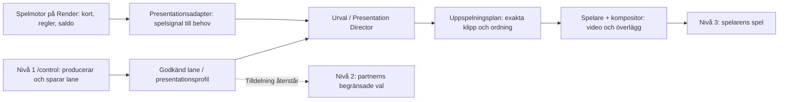

# Scoutgaming: nivåer, begrepp och presentationsruntime

## Studioflöde, 9 oktober 2026

Sammansättning (/control/preview) är navet. Innehåll (/control/clips) samlar
klipp och når bibliotek, händelser samt talinställningar med dealer/situation.
Publicering (/control/lanes) fryser sparade presentationer i bolagspaket.
Bolag och team nås på /control/lanes?tab=companies; ingen separat datakopia skapas.
Presentationslane och spellane behåller sina tekniska ID:n. Spelarplatser box0–6
och dealer-up/dealer-hole är skilda destinationer; UI-översättningen ändrar inte
handIndex, card, replik-ID eller mediasynk.

useStudioSession.save() returnerar true endast när aktuell draft kvitterats.
Dubbelanrop, fel, revisionskonflikt eller redigering under väntan stoppar
Spara och fortsätt. Filregistreringens prepare/Blob/commit och revisionsskydd
är kvar även när användaren bara behöver välja fil en gång.

Repot är `Jakeminator123/scoutgaming` på `main`. `github-work` vidarebefordrar dit.
Starta med `node lab/start.mjs`. OpenClaw-anslutning beskrivs i
[anslutningsguiden](../open-claw/lab/docs/LOCAL-CONNECTION-SV.md).
Mobile Phone Lane använder Astrids porträttvideo i det riktiga spelet:
<http://127.0.0.1:4200/blackjack>.
Lab på <http://127.0.0.1:4201/activity> öppnar samma läge via **Anslut**.

I molnet finns personal på [/control](https://www.scoutgaming.tech/control),
operatör på [/partner](https://www.scoutgaming.tech/partner) och spel på
[/play/blackjack](https://www.scoutgaming.tech/play/blackjack), samma origin
www.scoutgaming.tech. Apex `scoutgaming.tech` är en 308 till www.
Vercelprojektet `scoutgaming` visar gränssnitten med två Services från samma
repo/main: `web` bygger `apps/croupier-frontend`, `studio` bygger `lab`.
Båda kör i Frankfurt. `/control` och `/partner` skrivs om till labb-servicen;
`/studio` är den servicens basePath, inte en fjärde produkt och inte namnet i
gränssnittet. Övriga webbdokument går till web. Render-tjänsten `croupier-v2`
äger auktoritativ spelmotor och live-transport via den bevarade exakta ingressgränsen.
Produktion och isolerad native-QA har labbets admin-API på Vercel och sparad
policy/metadata/journaler i Neon, med separata scopes. Medier ligger i privat
Blob. Produktionsimport och policybyte är genomförda; aktuell driftversion
och avvecklingsstatus finns i [driftkartan](CLOUD-MIGRATION.md).
**Anslut & följ spelet** använder BO-inloggning och den faktiska spelflikens
native-kvitton även utan Partner-konfiguration. Privat Blob levereras via
behöriga mediarutter. Tal och lipsync-worker har varsin autentiserad native
Node-WebSocket-ingress på Vercel och behåller Render som sessionsägare.

Aktuell speluppspelning, QA-version och acceptansgränser redovisas i
[handoffen](JOHN-HANDOFF.md). QA:s AI-flaggor är OFF; journaler och
reservationer bevaras. Faktisk leverantörskostnad är fortsatt okänd/null.

## Tre nivåer och gemensamma begrepp

| Nivå | Adress | Ansvar och faktisk status |
| --- | --- | --- |
| 1 · intern personal | `/control` | Gemensam ingång på sidmallen. Översikt, Dealers & klipp `/control/clips`, Klippbibliotek `/control/videos`, Bakgrundszoner `/control/zones`, Händelser `/control/events` (översikt utan `?event=`, redigerare med), Förhandsvisning `/control/preview` (lagerprov, material i `test-videoeditor/preview/site`), Lanes `/control/lanes` (publicera paket samt kortet Bolag för bolag, roller och medlemskap; Renders `/blackjack?operator=` och Vercels `/play/blackjack?operator=` läser paketet), Agentmodeller `/control/openclaw`, Chatt `/control/openclaw?tab=chat`, Administration `/control/administration` med djuplänkar `?tab=`, Uppspelning `/control/activity`, Probe `/control/probe`, Guide & hjälp `/control/guide`. `/control/tree` leder till Händelser. `/control/operator-chat` leder till chattfliken. `/control/backgrounds` leder till `/control/zones`. `/studio` är labbets basePath, inte ytans namn. Kräver intern admin. |
| 2 · Partnerportal | `/partner`, `/partner/login`, `/partner/{operatorSlug}` | Operatör (Unibet m.fl.). Intern admin utan `partner_session` ser fixturförhandsvisning, inte `/control`. Operatör loggar in via `/partner/login` med `partner_session` och scoped snapshot (partner-API:t svarade 503 i produktion 7–8 okt tills `e97f32df`). Bolag, roller och medlemskap skapas i kortet Bolag på `/control/lanes`; ny e-post får aktiveringslänk till `/partner/set-password`. Bolagets utseende (`branding`, bordsfärg) läses och skrivs inom lanen av en medlem med `presentations.configure`. Spelare, transaktioner och rapporter är inte anslutna (N2.4). |
| 3 · Spelaryta | `/play`, `/play/profil`, `/play/historik`, `/play/blackjack` | Spellobby, egen profil (namn, saldo, valuta) och egen historik. Profilen kan redigeras (namn och språk) när `006-player-profile.sql` körts mot spel-Neon. Lobbyn visar Spelar hos från `?operator=`. Renders `/blackjack?operator=` och Vercels `/play/blackjack?operator=` begränsar lane och dealer till paketet; dealerraden följer paketet. Acceptans av dealermedia i rehearsal: `?dealer=<namn>&rehearsal=1`. Historiksidan anropar `POST /api/history`, se raden under. |
| 3 · Spelarresultat | `/api/history` | Spelare. Egna aggregerade resultat. Samma session som `/api/player`. |

### Lagring

| Projekt | Region | Innehåll |
| --- | --- | --- |
| `wandering-hill-60561912` | eu-central-1, Frankfurt | Produktion: databasen `croupier_game` med schemana `croupier_game`, `croupier_auth` och `croupier_studio`. Samma projekt: QA-databaserna `croupier_game_qa` och `croupier_studio_qa_abc92154cb15`. |
| `blue-king-49830878` (`croupier-preview-neon`) | us-east-1 | Äldre tom förhandsvisning. |

En **lane** är en presentationsprofil: klippuppsättningar, varianter, idle,
bakgrund och urvalsregler som spelaren får använda. En lane är varken ett
spelarkonto, en videofil eller själva spelmotorn. Nuvarande sparade profiler
och lane-ID:n behålls. Ett **operatörspaket** är vilka lanes, spel/bord och varumärkesval en operatör
tilldelas. Fixturförhandsvisningen använder exempeldata. Operatörens snapshot
kan visa ett sparat pakets revision. Renders `/blackjack?operator=` och Vercels `/play/blackjack?operator=` läser det publicerade paketet; slugen bärs genom spelarinloggningen och dealerraden följer paketet.

Diagrammets namn beskriver ansvar. Det inför inga nya tjänster eller påstår
att ett nytt generellt planformat redan är installerat. I koden ligger mycket
av urvalet i `presentation-runtime/selection.mjs`, befintliga adaptrar och
Webs spelare. Spelmotorn bestämmer utfallet; presentationen visar det.
Valfri OpenClaw-rådgivning får bara föreslå redan tillåtna klipp. Rådet måste
valideras och skuggläge spelar inte förslaget. Studio-assistentens hjälp med
inställningar och dealerns spelarchatt är skilda roller.

**Gemensamma visningsnamn:** Händelsekategori (tidigare Eventgrupp),
Klippuppsättning (tidigare Linje), Villkor (Trigger), Urvalsregler (Policy).
Tekniska event-ID:n, schemafält och `line`-nycklar ändras inte av namnbytet.
En presentationshändelse gäller det som ska visas; en administrativ händelse
gäller exempelvis kontoåtkomst och hör inte till klippurvalet.
Ordlistans källa är `lab/policies/studio-contract.json` och visas i användarguiden.

### Adresser och begränsningar

`/partner` har två lägen. Utan `partner_session` är ingången en adminskyddad
fixturförhandsvisning; demonstrationer är inte anslutna kunder. Det finns ingen
automatisk standardkund. Operatör loggar in på `/partner/login` och når bara
egna aktiva medlemskap. Adminens val bland anslutna kunder väntar på
onboarding-UI. Kundlistan ska komma från aktiva, serververifierade
organisationsanslutningar, inte fixturelistan, API-nycklar, ett varumärkesnamn
eller URL:en. Båda lägena kräver färsk serverkontroll. T2 är påbörjad, inte klar.

Partnerns meny använder exempelvis `/partner/demo-north/presentation`,
`/partner/demo-north/tables` och `/partner/demo-north/lanes`.
Gamla kortformer och hashbokmärken läses som kompatibilitet och leder till
den aktuella adressen; menyn skapar inga nya länkar med `#theme` eller `#tx`.
Nivå 1 använder verktygen under `/control`. Gamla interna klipp-, tal-,
medie- och kontoadresser leder dit; oanslutna prototypvyer får en förklaring
i adminingången. Kevin-komponentens exempelvyer renderas bara för nivå 2
(`/partner`), inte i kontrollpanelen. `/studio` är labbets basePath, inte
det interna produktionsverktyget och inte namnet i gränssnittet. Gamla
speladresser går vidare till `/play/blackjack` i det gemensamma molnprojektet. Lokal och äldre fristående
runtime behåller sitt befintliga `/blackjack`-kontrakt.
Signerad launch använder samma serverkontroll och game-session som tidigare;
en giltig direktstart behöver inte gå via lobbyn.

Nivå 2:s marker, kort, bord och bakgrund är **lokala designprov**. Valen kan
visas i bordets förhandsvisning, men skickas inte till en publicerad lane eller
spelet. Bolagets utseende (`branding`, bordsfärg) läses och skrivs inom lanen av en medlem med `presentations.configure`; övriga designval är fortfarande lokala prov. Både en fast lane-notis och återkoppling vid designändring visar detta.
Klipp, masker, urvalsregler och publicering hör till nivå 1. En framtida
anslutning måste kontrollera operatör, tilldelad lane, sparad revision och
tillåtna fält på servern; ett dolt menyval eller en slug är ingen behörighet.

## Lokal byggcache och runtime

### Nya personalytor

Överföringen av backoffice använder `/control` (intern personal) och `/partner`
(operatörspersonal) på samma publika origin. Frontenden skriver om enbart
godkända dokumentvägar till motsvarande `/studio/control` och `/studio/partner`
under labbets basePath. `/studio` är inte personalens produktnamn.
Befintliga labbvägar och spelkontrakt behålls. API-anrop har inga allmänna nya alias.

Den interna förhandsvisningen är `/studio/api/partner-preview`: enbart GET,
native admin-auktorisering på varje anrop, och uttryckliga fixtures för Demo
North eller Demo South. Ingen global adminläsning eller produktionsdatabas
används som reservdatakälla. SSR gör samma färska kontroll. Spelare nekas
denna förhandsvisning. Operatörens inloggning är separat: `/partner/login`
sätter `partner_session`, och `/partner` samt `/partner/{operatorSlug}` visar
då scoped snapshot (`preview: false`). Spelare, transaktioner och rapporter är
inte anslutna. T2 är påbörjad, inte klar.
Kontrollpanelens länkar till befintliga interna verktyg behåller deras ordinarie
auktorisering. Det gamla backofficets rolltabell i klienten styr inte åtkomst.

Privata `random/` undantas uttryckligen från byggtraces, liksom lokal QA-data.
Detta kompletterar mappens lokala Git-ignore och ändrar inga medieregister.

### Byggutdata

Next skriver byggutdata under respektive apps `.next` och disponibel byggcache
under `.next/cache`. TypeScript kan skriva `tsconfig.tsbuildinfo`.
Lab-regressionen använder byggd runtime; cache och runtime är olika saker.
Cache hör till den checkout där bygget körs. Vercels byggcache hanteras separat.
`lab/data/platform-private`, SDK/sourcepins, QA-receipts, kostnadsjournaler,
konton och media är beständig arbetsdata och ingick inte i cacheborttagningen.
Om hela Lab-runtime behöver byggas om används `npm --prefix lab run build` med
projektets kompatibla Node och aktuell workergräns. Detta startar ingen server.
Kör inte dubbla tunga byggen i samma checkout och radera inte `.next` under
pågående bygge, server eller regression. Följ sessionsvakt och agent-talk.

## Gemensam kontoåtkomst

Spelets `/api/auth/login` och labbets `/studio/api/auth/login` (basePath) använder
samma serverresolver för befintliga CRAIG- och player_accounts-credentials.
Inloggningsnamn/e-post normaliseras; exakt en kandidat i båda registren krävs
innan hashkontroll. Klienten väljer varken kontoägare eller behörighet.
Admin/superadmin ger effektiv admin; äldre reader/staff och spelarkonton
ger effektiv spelare. Studio/Backoffice kräver admin på alla administrativa
ytor och actions, med färsk lagrad roll/fingerprint/auth_epoch.

Kapabiliteten `sharedCredentials:true` i `/api/auth/session` binder den nya
gemensamma frontendloggen till installerad backend. Saknad signal bevarar
de tidigare entry-/modalprotokollen; ingen lösenordsfallback eller klientroll
läggs till. En misslyckad kapabilitetsläsning blockerar login-POST. Detta
behövs när Vercel och Render uppdateras vid olika tidpunkter.

Cookies behåller separata game-/backoffice-audiences. Adminlogin kan utfärda
båda via befintlig signerare på samma tillåtna origin; spelarlogin rensar
BO/Lab-cookie. En gemensam credential gör inte cookies giltiga på andra
QA-/produktionshostar. Både namnrymder, live roll och epoch kontrolleras före
utfärdande, och Origin/Host/CSRF består.

Spelarlösenord hanteras i native Backoffice via signerad Render-command
`players/password`. Game-Neon äger salt/hash och sessioner; Render låser
konto/spelare, återkallar och väntar på runtimecancel. `passwordChangeAllowed`
visas endast för konton med eget spelarlösenord. CRAIG-konton använder
befintliga invitations-/resetlänkar, även när deras äldre roll är game-only.
Ingen kontoflytt, plånboksjustering eller schemaändring ingår.
## Ägarskap och ordning

Spelmotorn och Web behåller kort, shoe, wallet, resultat och presentationsordning.
`presentation-runtime/selection.mjs` väljer exakt familj och tillåten variant
med samma triggers, regler, slump och Director-kontrakt som Händelser (`/control/events`).
Labbets tidigare moduler återexporterar den gemensamma implementationen.

Web använder `PerformancePlayer.playLocalClip` för hashverifierade MP4-filer
från `media/dealers/astrid/runtime/presentation`. En film äger ytan i taget. Den tidigare Astridmotorn,
dess talmedia och supervisor laddas inte i det lokala läget. Lab monterar ingen
parallell följningsspelare för någon dealer vid anslutning, återanslutning
eller **Ny observation**. En separat Lab-preview kräver ett uttryckligt val
och har egna kvitton; fristående editorprov är fortfarande möjliga.

Det autentiserade `/api/presentation/select` slår upp dealinstruktionen i
serverns publicerade `native_presentations` för aktuell spelare och version.
Browserns kort/handindex används inte. Dolt hålkort maskeras även i urvalet.
Exakt familj gäller för både standard och variant; en annan box/replik lånas
aldrig. Ingen tredje server eller alternativ spelmotor har tillkommit.

## Sparad policy och chatt

Personalens arbetsyta är `/control`. `/partner` är antingen intern fixturförhandsvisning eller operatörens inloggade snapshot. Native administration använder
befintliga konton och deras rollkontroller. **Dealer & klipp** visar exakta
klippflöden för alla fyra dealers och behåller Studiofamiljerna. Äldre
BO-tilldelningar är historik och används inte som parallell policykälla.
Endast en exakt match i dealer, situation/destination och registrerad fil
kan importeras uttryckligen till Lab-utkastet. Osäkra tal-/stagedkopplingar
finns kvar för granskning och lånas aldrig till en annan replik/plats.

`legacyClipPolicy` styr originalmotorernas befintliga rörelseval och exakt
verifierade staged-destinationer. Dessa läses vid sidstart; ladda om mellan
händer efter sparning. Inspelat tal följer sitt befintliga exakta audio/video-par.
Astrids `presentation=local` använder fortsatt `mediaPolicy`/`idlePolicy`.
Projekt, versioner och historik använder revisionsstyrd Neon-lagring i både
produktion och isolerad native-QA. Äldre `lab/data` bevaras som lokal historik;
`/var/data/studio` är ingen aktiv produktionspolicykälla.
Medieregistren återanvänds med bevarade fil-ID och bytes.

Helpern ger Web och Lab samma isolerade projektkatalog. Spara ändringar i
Händelser (`/control/events`). Nästa deal/replik läser sparad policy; idlepolicyn läses vid
sidstart, så ladda om spelfliken efter idleändringar. Osparade editorändringar
är inte produktens policy. En ny helperkörning börjar med en ny testkatalog.

Välj **Standard**, **Regler**, **Slump**, **OpenClaw** eller **OpenClaw · skugga**
i spelfliken. Tom variantmapp ger standard utan modellanrop. Den anslutna
Studio-profilen startar med OpenClaw/active; utan den är startläget Standard/off.
Idleråd bygger på färsk chatt och samma befintliga begränsningar och tillåtna
varianter, inklusive `idle_insulted`. Skugga kan aldrig spela AI-förslaget.

Chatta i spelfliken. Serverbunden identitet, synliga kort, minne och den
befintliga Cartesia/RunPod-vägen är kvar. `--generated-speech` krävs för
genererad läppsynk. Ett talpaket får förberedas under deal men får uppspelning
först efter en ny faktiskt renderad primär-idle. Deal avbryter pågående tal.
Sena chatt-/idlecallbacks får inte avbryta en ny deal eller öppna talgrinden.

Produktens taladapter behåller sin separata credential. Presentationsadaptern
använder samma befintliga Director-credential som Lab, genom de serverbundna
`CROUPIER_PRESENTATION_DIRECTOR_URL/TOKEN`; den är inte en ny smalare token.
Helperns nätvakt tillåter samma konfigurerade Director-origin för Web. Ingen
modellnyckel skickas till browsern och ingen Render-/modellkonfiguration ändras.

## Kvitton och begränsningar

Native-observationen rapporterar urval, faktisk start, presenterad videobild,
slut, avbrott och reserv. Ett valt klipp räknas inte som spelat. MP4-slut kräver
verkligt `ended` och presenterad bild. Avbrott/stall slutar aldrig med falskt
completion-kvitto. Lab kan valfritt spegla spelfliken med browserns bilddelning.

**Uppspelning och spår** visar aktiv native-session, presentationsläge,
sparad/kvitterad revision och event → familj/variant/orsak → start/bild/slut.
Nya urval har egna kvittorader; sena slutkvitton kan inte godkänna nästa klipp.
Genererat tal visar sin egen besluts-/genererings-/uppspelningskedja. Partner-SSE
är tydligt märkt diagnostik. Registrering, preview och runtimebindning är
separata statusar från spelarens faktiska kvitto.

Hela 1080×1920-filmen visas med `object-fit: contain`, även på dator.
Spelkorten är auktoritativa 2D-överlägg. Råfilmerna har ännu ingen kalibrerad
pickup/release/land-kontakt; DOM-kortets landningskvitto anger uttryckligen
`calibratedContact: false`. Filmens slut är inte bevis för handkontakt.
Saknat eller otillgängligt exakt klipp ger synlig **2D-reserv**.

Inspelade fria chattsvar är text-only när deras exakta text/video-paket inte
är verifierat. Native-eventrepliker använder sina exakt registrerade filmer och
inbäddat ljud. Genererad läppsynk kräver fortsatt mänsklig granskning.
Inga mediabytes, kalibreringar eller visuella godkännanden ändras här.

Sparade `gameLanes`/`gameLane` styr renderer, dealer och mediesamling.
Mobile Phone Lane är förval. Äldre `original` migreras vid läsning till Mobile;
gamla `dealer`/`presentation`-parametrar återaktiverar inte den pensionerade lanen.
En uttryckligen registrerad `indexed-video`-lane kan använda den gemensamma
indexspelaren för dealerbanken. Ingen automatisk videofallback införs.
Källkontrakt: `web/public/game-lanes.mjs`.

Verifiering och kvarstående arbete dokumenteras vid leverans i
[JOHN-HANDOFF.md](JOHN-HANDOFF.md).

## Kamera och mikrofon

Record aktiverar lokal lyssning efter ”Astrid”; Play styr spelljudet.
Efter aktiveringsordet skickas turen vid 1 150 ms tystnad. Ljudbufferten är
högst tre sekunder i RAM; turen högst 30 sekunder. Kamerabilder tas först
efter aktivering. Dold flik, spelarbyte och Record av avbryter. Första
aktiveringen begär samtycke. Text/bilder visas i en tillfällig logg via
fem sekunders långtryck, inte i normalvyn.

Webbläsarens lokala talstöd krävs för aktiveringsordet. Produktservern
använder Whisper `whisper-1` via audio/translations för engelsk text;
Cartesia ger utgående röst. Nycklar finns enbart på servern. Modell- och
bildåtkomst måste verifieras separat. Syntetiska adapter-/bildprov är
inte slutgodkännande av fysisk mikrofon/kamera eller exakt läppsynk.

Källkontrakt: `lab/policies/studio-contract.json` (sex eventtyper/16 grupper),
`media/dealers/astrid/runtime/presentation/lab-video-manifest.json` och `presentation-runtime/`.
Studio följer native-kvitton; Partner-SSE är kompletterande instruktioner.
Transportanslutning är inte speldata, valt klipp är inte spelat klipp.
