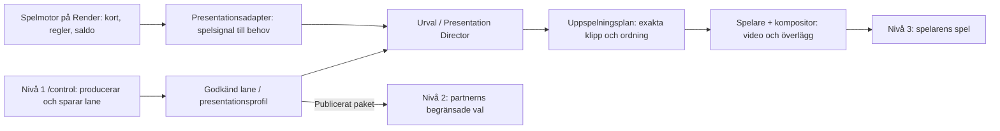

# Scoutgaming: nivåer, begrepp och presentationsruntime

## Medieformat för roulette och blackjack

Aktuellt produktionsbeslut 12 oktober 2026: Jakob levererar roulettevideo
separat. Inga nya kodgenererade hjul-/kulanimationer, parallax eller gester
byggs. Följande format är produktionsunderlaget; nya dealerklipp är ännu
inte inspelade eller visuellt accepterade.

### Gemensam bakgrund och lager

Rumsbakgrunden är spelneutral: inga inbakade bord, dealers, satsningar eller
resultat. Samma registrerade tillgång kan tillåtas i både ett blackjackrum
och ett rouletterum. Publicering och bolagets tillåtna lager gäller fortsatt;
roulette väljer bara en publicerad bakgrund, inklusive spelarens redan
sparade tillåtna val. Ingen valfri URL från query/localStorage får hämtas.

| Material | Leverans | Anmärkning |
| --- | --- | --- |
| Bakgrund, master | 3840 × 2160 PNG/WebP, 16:9 | Samma kamera, ljus och perspektiv för båda spelen. |
| Bakgrund, webbvideo | 1920 × 1080 MP4/H.264, 30 fps CFR, kvadratiska pixlar, SDR Rec.709, utan ljud | Låst kamera, försiktig miljörörelse. Fast utsnitt och stillbildsreserv. |
| Roulettebord, master | 1920 × 1080 transparent PNG; gärna äkta 4K-original senare | Spelets egen geometri. Ingen extra keystone-förvrängning. |
| Roulettebord, video | 1920 × 1080 MP4/H.264, 30 fps CFR, utan ljud | Identisk registrering med bordets PNG och mask; ingen svart rektangel får täcka rummet. |
| Bordsmask | PNG med alfakanal, samma bildyta som bordsvideon | Opakt visar bordet, transparent visar underliggande lager. RGB-färgen ignoreras. En svartvit bild utan alpha fungerar **inte** som denna runtime-mask. |
| Dealer | Godkänd keystonebild och en enda frilagd idle-master | Samma klipp för mobil och desktop; ingen separat tagning per skärm. |

Vanlig H.264/MP4 behandlas som opak video. En statisk PNG-alfamask stöds
för ett bord vars ytterkontur är konstant. Rörliga objekt måste hålla sig
inom masken; en silhuett som ändras kräver en annan, synkroniserad masklösning
som **inte** ingår här. Ingen grönnyckling av den gröna bordfilten.
Källa för webbformat: [MDN, video codecs](https://developer.mozilla.org/en-US/docs/Web/Media/Guides/Formats/Video_codecs).

Lagerordning: bakgrund → frilagd dealer → spelbord → separata spelkontroller.
Detta placerar kroppen bakom bordet. Händer ovanpå bordet behöver godkänd
handmask eller en kontaktpose som inte skyms; ingen sådan ny mask är levererad.
Befintliga inspelningar med inbakat blackjackbord återanvänds inte som en
frilagd roulette-dealer. Ingen dealeridentitet hårdkodas eller publiceras om.

### Roulette: bordets koordinater och aktuella referens

Koordinater gäller en logisk 1920 × 1080-scen, origo uppe till vänster.
Bordets bildyta placeras vid **x=192, y=216, bredd=1536**, med proportionerlig
höjd. En exakt 16:9-leverans blir 864 px hög. I kompositionsformatet motsvarar
detta `desktop.table={width:0.8,x:0,y:0.2}`, `tableFront=true`.
Obs: `x=0` i Studio är centrerad förskjutning, inte bildens vänsterkant.

| Ankare i slutscenen | Produktionsmål, px |
| --- | --- |
| Bakgrund | x=0, y=0, bredd=1920, höjd=1080 |
| Bordets bildyta | x=192, y=216, bredd=1536, höjd≈864 |
| Bordets främre mittpunkt | x=960, y≈1080 |
| Dealerns mittlinje, bakom bordet till höger i bild | x≈1410 |
| Dealerns ögon | x≈1410, y≈150 |
| Båda händerna, kontaktområde på bakre högra kanten | x=1240–1480, y=405–455 |

Detta är kompositionsmål, inte bevisad kontaktkalibrering för befintliga
klipp. Dealerplaceringen följer den publicerade kompositionens desktopvärden.
En ny take kalibreras och granskas mot ankaren före publicering.

Den användarlevererade `roulette-bord.png` ligger oförändrad i
`web/public/roulette/assets/roulette-bord.png`: 1672 × 941 RGBA,
SHA-256 `dcf2fe0eb5332bce7d599f3e41bc210b14a3bc9605444acc41634a2c2e28976b`.
Detta är en designreferens, inte granskad nummergrafik eller resultatvisning.
Proportionerna är nästan 16:9; aktuell höjd blir cirka 864,46 px. Inför MP4
passas originalet proportionerligt in på exakt 1920 × 1080 och alpha-masken
exporteras från samma registrering. Uppskalning skapar inte ny bilddetalj.

Mobilen visar hela samma 16:9-scen ovanför separata, läsbara satsningsknappar.
Vid 1080 px scenbredd multipliceras alla scenkoordinater med 0,5625;
vid faktisk CSS-bredd W används W/1920. Ingen beskärning av bordets sidor,
sträckning eller separat dealerfilm. Bordets tryckta siffror är dekorativa;
serverns kvitto och de tillgängliga spelkontrollerna är auktoritativa.

### Roulette: croupier som keystonebild och idle-video

1. Skapa först en stillbild i scenens 1920 × 1080-mall med referensbordet
   som registreringshjälp. Dealern står bakom bordet **till höger för betraktaren**, med
   överkroppen lätt vänd mot mitten och blicken mot spelaren. Spelaren står också; kameran ser snett ned mot bordet.
2. Utgångspunkt för scenbygge: bord 240 × 150 cm, höjd 95 cm, hjul cirka
   80 cm. Kamera cirka 165 cm över golvet och 25° nedåtvinkel. Dessa är
   föreslagna arbetsmått, inte uppmätta mått ur bilden. Referensens perspektiv
   och kontaktpunkter styr slutlig kamerakalibrering. Lås kameran därefter.
3. Leverera både sammansatt kontrollbild och frilagd dealer-PNG. Runtime-
   materialet kan vara 1080 × 1920, med 2160 × 3840-original om källan medger.
   Hela huvud, armbågar, händer och kropp en bit under bordskanten ska finnas
   kvar. Spara beskärningsruta och ankare så den frilagda personen går att
   placera tillbaka exakt i kontrollbilden. Ingen inbakad roulette-/blackjack-
   geometri i dealerfilen. Ett grönt original måste registreras och nycklas
   genom befintligt godkänt compositingflöde.
4. Idle utgår från den godkända keystonebilden: en 8–10 sekunders master,
   30 fps CFR, utan ljud/tal. Endast naturlig andning och diskreta blinkningar.
   Händerna vilar stabilt; inga kort, marker, hjulrörelser eller nya gester.
   Samma ljus, fokus, skala och kontur i första och sista bilden. En generator
   garanterar inte sömlöshet; kontrollera och justera skarven vid behov.

**Prompt för keystonebild (engelska):**

> Photorealistic adult casino croupier standing behind the rear-right corner of the supplied roulette table, on the viewer's right. The torso is turned slightly toward the center of the table and the gaze meets the standing player. Use a locked 1920 by 1080 composition: the dealer's eyes are approximately at pixel (1410,150); both hands rest naturally on the rear-right contact area around x=1240–1480, y=405–455. Match the reference perspective, camera and lighting; the wheel and betting field remain unobstructed. Relaxed shoulders, calm attentive expression, realistic anatomy and stable fingers. Soft neutral key light from camera left, warm room lighting. Keep the complete head, elbows, hands and lower torso available. Deliver a composition reference and a separate isolated dealer layer with identical framing; the roulette table is a placement reference only and is not baked into the isolated dealer layer.

**Separat prompt för idle från den godkända bilden:**

> The locked-off camera remains perfectly still. The croupier stays behind the table on the viewer's right and maintains the approved reference pose, with gentle breathing and a subtle natural blink. Lips remain gently closed. Both hands and every finger stay at their original resting contact points. The framing, exposure, focus and lighting remain constant. A calm neutral resting pose at both ends of the clip, suitable for an unobtrusive idle loop.

Acceptans: två följande uppspelningar på mobil och desktop; kontrollera
skarv, händer, kroppens ocklusion, hudkanter, ljus och frånvaro av inbakat bord.
Spara källa, filhash, dimensioner, fps, längd, alpha/key-inställningar,
beskärning, kontaktankare och granskningsnotering. Ändrad mediahash behöver
ny visuell acceptans. Det här dokumentet godkänner inte någon dealer-take.

### Mottagen videospecifikation och uppmätt leverans

Källfilerna finns lokalt i `C:/Users/jakem/Desktop/videoskapare/roulette/bord/`.
PNG:n är kopierad byteidentiskt till runtime-sökvägen ovan. MP4-originalet
ligger kvar i källmappen och är inte uppladdat, registrerat eller publicerat
av denna ändring. Den sammanförda JSON-filen nedan är metadata, inte en
beställning att generera fler animationer.

Den bifogade `roulette_specifikation.json` är sammanförd som källunderlag i
[media-specification.json](../web/games/roulette/media-specification.json).
Originalets beställningsstatus och önskemål är bevarade under
`receivedSpecification`; aktuella filfakta finns under `verification` och
Jakobs nuvarande riktning under `currentDecision`. Dokumentets äldre förslag
om kodstyrd rotor är inte ett uppdrag: inga egna nya animationer byggs.

`lyxigt_europeiskt_roulettebord.png` och `roulette-bord.png` är byteidentiska.
Båda är 1672 × 941, 2 229 281 byte och har SHA-256 ovan. Alphakontrollen
bekräftar 526 913 helt transparenta, 295 helt opaka och 1 046 144 delvis
transparenta pixlar; vanligaste icke-nollvärdet är 253. Ingen färgprofil är
inbäddad. sRGB är ett arbetsantagande, inte verifierad källmetadata.

| `roulette-bord-start-stop.mp4` | Uppmätt fil |
| --- | --- |
| Dimensioner | 1916 × 1080; inte exakt 1920 × 1080 |
| Container / codec / pixel-format | MP4 / H.264 / yuv420p |
| Bildfrekvens | 24 fps, 361 bildrutor; samtliga frame durations 0,041667 s |
| Längd | 15,041667 s |
| Storlek | 10 317 238 byte |
| Ljud / alpha | Ingen ljudström / ingen alfakanal |
| SHA-256 | `7702cec6f0ec5ec2e1767608781588e8f6b182a0fbc652a952706f8288314195` |

30 fps och 1920 × 1080 ovan är föreslaget gemensamt leveransformat, inte krav
att interpolera den mottagna filmen. Behåll originalet i 24 fps. Nästa export
bör ha fast, gemensam bildyta. Ändra inte hastigheten för att få 30 fps.

Bildrutor 0, 180 och 360 har inspekterats: svart bakgrund är inbakad och
rotorn är olika i början/mitten/slutet. Detta bevisar inte perfekt låst kamera,
stabila siffror genom hela filmen, pixelidentisk slutruta eller sömlös loop.
Källspecifikationen markerar dessutom originalets hjulsiffror/nummerföljd som
ogranskade och delvis felaktiga. Varken PNG eller MP4 är godkänd resultatgrafik.

Denna 1916 × 1080-video och originalets PNG har olika proportioner. Runtime-
maskens proportionskontroll ska neka en direkt felregistrerad kombination;
släpp inte igenom den genom att höja toleransen. Förbered en separat mask mot
**videons verkliga bildruta**, kontrollera bordets kanter vid start/mitt/slut
mot valda bakgrunder och behåll PNG:n som reserv. Svart får inte nycklas bort
över hela bilden eftersom bordet också innehåller svarta detaljer.

Filmen är mottagen och analyserad, men inte aktiverad i spelrummet eller
kopplad till serverutfall. Runtime visar fortfarande den bifogade PNG:n.
Ny dealer ska produceras bakom bordet **till höger i bild**, enligt ankaren
och prompterna ovan; detta ersätter tidigare förslag om centrerad dealer.

### Runtime och nästa MP4-leverans

`web/public/roulette/media.mjs` väljer tills vidare enbart den bifogade PNG:n.
`ROULETTE_TABLE_MASK` är null för denna PNG, som redan har alpha. Vid framtida
MP4-leverans registreras dess exakta tillgång och en matchande PNG-alpha via
`mountPublishedScene(...,{table,tableMask,layout:'desktop',settings})`.
En ny lokal fil behöver även läggas i den explicita HTTP-/proxylistan; ingen
sökväg eller URL får hämtas direkt från användarinmatning. En administrerbar
bordsvideo/mask i det frysta publiceringskontraktet är en separat integration;
ingen ny Studio-maskkontroll eller publicering är gjord i den här ändringen.

Den gemensamma `published-scene.mjs` läser redan bild och MP4/WebM för
bakgrunder och bord. Roulette använder samma publicerade bakgrunds-ID:n som
blackjack. Tillagda layout-/maskalternativ är frivilliga; befintliga anrop
behåller sin mobila standardkomposition. Video pausas i dold flik, utanför
bild och vid reducerad rörelse, med möjlighet till ett uttryckligt Spela-val.
Vid mediefel visar rouletten PNG-reserven och spelkontrollerna fungerar.

En framtida film med snurrande roulette kan användas som dekorativ bakgrund.
Den får inte föreställa den aktuella rundans slututfall om den inte är kopplad
till samma bekräftade serverresultat. Ingen sådan koppling implementeras här.
Resultatrutan uppdateras direkt från kvittot. RNG, insats, plånbok och exakt
återförsök med oförändrat requestId/version/bets ändras inte.

### Blackjack: formatmall att fylla i

Avsiktligt reserverad, ännu inte kalibrerad eller godkänd. Gemensamma
bakgrunds- och videokrav ovan kan återanvändas. Kopiera inte roulettes
bordsgeometri eller kontaktankare till blackjack.

| Uppgift | Blackjackvärde |
| --- | --- |
| Keystonebild / referensfil | — |
| Bildformat / originaldimensioner | — |
| Bordsmått och kamerakalibrering | — |
| Bordets placering i 1920 × 1080 | — |
| Dealer, beskärning och handankare | — |
| Idle-video, codec, fps och längd | — |
| Bordsvideo och alpha-mask | — |
| Gemensamma bakgrunds-ID:n | — |
| Mobil-/desktopacceptans och hash | — |

### Kort överlämningsprompt till N1-/backoffice-agenten

> Fortsätt utveckla Scoutgamings interna kontrollrum på nivå 1. Läs AGENTS.md
> och behåll den aktuella kanoniska vägen `/control`; inför inte `/admin` som
> en parallell produkt. Roulette har nu en gemensam 16:9-scen med PNG-bord,
> spelneutrala publicerade bild-/MP4-bakgrunder och förberedd statisk alfamask
> för framtida bordsvideo. Läs medieformaten i docs/LOCAL-PRESENTATION-RUNTIME.md
> och den uppmätta leveransen i web/games/roulette/media-specification.json.
> Utgå från spelbolag → tillgängligt spel → spelrum → tillåten sammansättning
> och dealer. Håll spelneutral bakgrund, spelspecifikt bord och frilagd dealer
> separata. Visa mediaformat, beskärning/ankare, mask, hash och acceptansstatus
> före förhandsvisning/publicering. Mottagen MP4 är en ogranskad prototyp;
> bordsvideo/mask återstår att integrera i det frysta publiceringskontraktet.
> Återanvänd befintliga revisioner, behörigheter och livscykelkontroller och
> undersök blackjack-legacy innan ändringar. Hårdkoda ingen dealer, ändra inte
> aktiva publiceringar automatiskt och bygg inga nya hjul-/kulanimationer.

## Bakgrundens uppspelning, 12 oktober 2026

Sammansättningens valfria `backgroundPlayback` följer med det frysta paketet
och Studio-provet. Saknat fält behåller den tidigare bild-/videobasen.
`web/public/background-playback-policy.mjs` validerar enbart data: tillåtna
bakgrundsvideors ID, befintliga `speak.*`-händelser eller intervall, maxlängd,
tid mellan starter och rullande gränser för starter/sekunder. Varje regel har
egna gränser. Referenser omfattas av befintliga lagergrants, även vid arkivering.

`background-playback.mjs` är gemensam scheduler för spel och Studio-prov.
Ett separat ljudlöst videoelement visas över den fortsatta grundloopen.
Slut, laddningsfel, paus eller maxlängd återställer basen och frigör texturen.
Bakgrundsladdning inväntas aldrig av dealerns klippförberedelse; kort, tal,
sko och plånbok behåller sina ägare. Spelhändelser fungerar även med talet
avstängt. Dold flik stoppar effekten; missade tillfällen köas inte.

Nya skrivningar kräver runtime capability 8, `backgroundPlayback: rules-v1`,
innan beständig lagring sker. Ingen SQL-migration eller omskrivning av äldre
publiceringar behövs. Bordets förstora/förminska/procentfält använder samma
befintliga `composition.mobile/desktop.table.width` (0,1–4).

Verifiering: 9 faktiska Chrome-prov av
Studio-komponenten passerar, inklusive två följande bakgrundsfilmer, verkligt
slut, fel, tidsgräns och bevarad minutbudget. Syntetiskt material används;
det är inte visuell acceptans av en ny dealer eller läppsynk. Tester för
kontrakt, budget, transport, capability och gränssnitt ingår i ordinarie hook.
Privata bild-/maskinkvitton: `lab/data/platform-private/background-playback-20261012`.
Ingen produktdata ändrades. A20/A21 ska bevara dessa konsumenter och publika
moduladresser vid den kommande atomära källflytten.

## Endast registrerad dealeruppspelning, 12 oktober 2026

Astrid, Vera, Amira och Mei ingår inte längre i ett lokalt dealerutbud.
Amira är avvecklad som aktiv identitet. De andra namnen har samma krav som
andra registrerade dealers: sparad dealerpost, uttryckligt tillåtet val och
egen grundloop. Nya projekt och tom serverkonfiguration skapar ingen dealer
eller spelbana. Historiska namn och paketscheman kan läsas för material och
historik, men ger inte rätt att starta en gammal indexed-video-spelare.

Spelstart binder dealer, spelbana och publicerat paket före uppspelning.
Ett saknat paket/grundklipp är ett fel, aldrig ett skäl att låna en annan
dealers klipp. Frysta paket tar med de faktiskt valda registrerade dealerserna,
även Astrid/Vera/Mei, med egna mediereferenser. Rumsadaptern måste vara aktiv,
tillåten och registrerad i paketet. Allt spelarval går till samma moderna
presentationsspelare; gamla dealer-URL:er och legacy-config svarar 410.

presentation-startup.mjs håller scenen dold under laddning och visar tydligt
fel vid utebliven första bildruta. Navigering till ett sparat spelarval
avbryter den gamla sidans initiering. local-presentation.css laddas i HTML-
huvudet för att undvika den tidigare sena växlingen från inbakad scen.

Rehearsal är fortsatt ett provläge i den riktiga spelaren, inte en separat
lokal dealerbank. Prov av två efterföljande repliker och visuell läppsynk
måste göras på de faktiska registrerade klippen. Molnkatalogens äldre klipp
bevaras som material; lokal arkivsökning sker endast när ett verktyg/test
uttryckligen anger archiveDir. Den gamla LAB_VIDEO_ARCHIVE-inställningen
återskapar inte lokala standarddealers. Serverns konfigurerade tjänster för
genererat tal bevaras; det finns ingen automatisk fallback till lokal talbank.

## Adresser och verktyg efter repo-ordning våg 2, 12 oktober 2026

`/casino.html` svarar 308 till `/play` för GET och HEAD. Query följer med.
Kasinogolvet och dess GLB-filer är borta. `/v2` är kvar som 307-omdirigering,
inte en egen spelare. De fem granskningssidorna svarar 404. Registrerad video
spelas på den gemensamma scenen. Studios originalmediareserv är pensionerad;
ett hanterat klipp utan spelbar fil visar den befintliga statustexten.
Partnerns levande vyer (översikt, spelrum, integration och skal) renderas från
`lab/components/kevin-bo/views/*.jsx`. En riktig operatörsögonblicksbild
utvärderar inte `original-views.jsx`.

3D-, rigg-, ansikts-, Blender-, GLB- och hårspåret är borta ur klient, pipeline
och Astrids indexerade rigg. `vendor/three` står kvar: `performance-player.mjs`
importerar `three.module.js`. Katalogstyrda composited-talklipp står kvar
eftersom `media/catalog/legacy.json` refererar dem. `media/game/staging`,
Amiras staging och tre avslutade Astrid-experiment är borta. Astrids
kalibrering, godkännandeanteckningar och osäkra mappar står kvar.

Spelar-UI-bygget är `apps/croupier-frontend/tools/player-ui-build.mjs`.
`ops/vercel-entry` och `ops/caddy/bettalotto-game-auth.Caddyfile` är borta.
Vercel-projektet `github-work-vercel-entry` finns inte. A18: bettalotto.se
svarar 301 till `https://croupier.scoutgg.dev/` och använder inte den
borttagna Caddy-filen. Aktuell Caddy-drift: `kevin/croupier-scoutgg/drift/`.

### Verktyg som finns kvar

Manuella byggare, enda källa till media som produkten läser:

- `pipeline/build-previews.sh` — förhandsvisningar av röstrepliker
- `pipeline/encode.sh` — Annex-B
- `pipeline/build-hands.sh` — handmattor
- `pipeline/build-contact-review.mjs` och `pipeline/prepend-contact-entry.mjs` — uppmätta kontaktkandidater

Läppsynk och kalibrering: `sync-existing.py`, `sync-audio-warp.py`,
`auto-phrase-warp.py`, `measure-lipsync.py`, `measure-onset.py`,
`retime-video-map.py`, `retime-video-warp.py`, `apply-lipsync.py`,
`trim-speak-start.py`, `mouth-crops.json` och `encode.sh`.

Krok och CI: `audit-dealer-sync.mjs`, `audit-performance.mjs`,
`audit-astrid-actor.mjs`, `build-lab-video-manifest.mjs`, `build-index.mjs`,
`pack-contact-media.mjs`.

## Egen talprofil för registrerade dealers, 11 oktober 2026

Dealerpostens privata speechProfile v2 sparar önskemålet enabled/preparation,
röstleverantör/voiceId/modelId och egen videoId/SHA-256/offsetMs. ElevenLabs kan
även ha explicit language och allowlistade settings; båda ingår i profilhashen. V1 preparation
fortsätter att fungera. Endast video-frame kan väljas för aktivering. Profilen
följer inte med det publika partnerpaketet; servern läser den aktuella profilen
och omvaliderar bolagets publicering och sessionens ägare inför talarbetet.

web/dealer-speech-reference.mjs läser exakt egen video ur det privata registret,
kontrollerar källans bytehash och verkliga längd och extraherar en begränsad
1080x1920 PNG med FFmpeg. Tillfälliga filer städas. Bildcachen är innehållsbunden
och ersätter inte nya åtkomstkontroller. Röst- eller referensbyte ger ny
profileRevision. Frame 0 kan väljas när den granskade posen är lämplig.

Streamdescriptor v2 binder dealerId/profileRevision/imageSha256 och bär enbart
validerad compositing-metadata från referensvideon. Spelaren återanvänder
bolagets befintliga lagerkomposition för varje faktisk videobildruta. Exakt
genererat ljud och tillhörande videobildrutor följer samma uppspelningsklocka;
ingen separat munanimation eller matchning på ungefärlig längd används. Fullbildsklipp behåller inbakad miljö. Sessionens verifierade
worker-handshake behövs för teknisk beredskap; reviewStatus förblir pending
fram till separat visuell kontroll. Befintliga Astrid-v1/fullfile-kontrakt
behålls. Rörlig avatarberedning stöds inte av denna version.

## Genererade svar och svarsbibliotek, 12 oktober 2026

Obetald kontroll av röstbehörighet och beredning av exakt dealerreferens kan
överlappa modellens textsvar. Betald TTS/GPU väntar på exakt text och färska
kontroller av spelare, runda, publicering och profil. Positiv röstbehörighet
cachas högst 60 sekunder med leverantör/röst/modell och nyckelhash; misslyckade
kontroller cachas inte. Profil- och ägarkontroller görs även vid cacheträff.
Referenscachen rymmer fyra innehållsbundna bilder. Detta ersätter inte GPU-
kallstart, och ingen förbättrad live-latens är slutgodkänd från adaptertester.

Färdiga streamade dealersvar sparas efter sista mediebildrutan som privat WAV,
MP4 och exakt text/profilhash. Separat metadata ligger i
`croupier/reply-library/<miljo-arbetsyta-hash>/<dealer>/<uuid>.json`; ljud/video
ligger i dealerfamiljens `runtime/conversation-replies`, avskilt från bank,
grundloopar, källor och staging. Lagring blockerar inte första ljud/bildruta.
Infångning och väntande Blob-sparningar delar högst 64 MiB i processen; större,
avbrutna eller ofullständiga par arkiveras inte och lagringsfel loggas utan text,
nycklar eller privata Blob-adresser. Spelarens mikrofonljud ingår aldrig.

Studio visar `/control/replies?dealer=<id>` bakom N1. Biblioteket erbjuder
tio kontrollerade kategorier, revideringssäkra ändringar och privat media-proxy.
Miljö/arbetsyta/dealer omvalideras vid läsning. Media behåller exakta hashvärden;
`reviewStatus=pending` innebär att sparning inte är godkänd läppsynk. Ingen
automatisk återanvändning eller import av gamla klipp aktiveras här.

## Dealerbibliotek och molnkatalog, 11 oktober 2026

/control/clips och /control/videos delar DealerMediaLibrary. Alla registrerade
dealers får samma kategorier och bulkintag: välj upp till 50 filer, granska och
mappa varje fil till ett exakt händelse-/situationsfack. Box 1–7 motsvarar
box0–6. Grundloop, talreplik och dealer-up/dealer-hole förblir skilda fack.
Registrering i biblioteket sparas direkt; val av aktivt klipp i projektet och
publicering är separata steg under Spelinställningar och Publicering.

MP4/WebM samt MP3/WAV stöds upp till 128 MB per fil. Ljud måste klassificeras
med mediaType=audio och exakt talreplik; det kan aldrig kopplas som videoklipp
eller räknas som godkänd lipsynk. Uppladdning använder privat Blob-grant,
SHA-256-readback och autentiserad commit. En batch återförsöker inte osäkra
commits automatiskt och laddar inte om redan sparade rader.

Ta bort flyttar egna uppladdningar till Borttagna med återställbar metadata.
API:t kontrollerar samma origin, aktuell admin, bytehash och föregående
klassificering i transaktion. Aktuella dokumentreferenser stoppar borttagning;
historik och Blob-bytes bevaras. Gemensamma original skrivs inte över eller
raderas genom biblioteket.

Neon äger dealerposter, klippmetadata och projektkopplingar; privat Blob äger
mediebytes. Native Studio läser gemensam driftmetadata från
media/catalog/presentation.json och media/catalog/legacy.json tillsammans med
media/layout.json och media/blob-index.json. Ingen lokal dealermapp skapas när
en dealer registreras. Originalens media/dealers-mappar är fortsatt underlag
för lokala pipelines och kalibrering, men behövs inte i Studios molnartefakt.
tools/build-runtime-media-catalog.mjs bygger katalogen explicit;
--check och isolerade tester med helt frånvarande dealer-mappar verifierar den.
Saknad eller felaktig katalog ersätts aldrig med tyst tomt register.
Katalogens version 2 bevarar originalens exakta JSON-byte, så talgranskningens
SHA-256- och storlekskontroller gäller även utan lokala dealerfiler. Native
grundloop, talmetadata och klippinventering läser samtliga katalogen.

Verifiering: riktade API-/UI-/bulk-/ljudtester och audit-dealer-sync --probe
bevarar regressionen för fyra originaldealers. Inga inspelade byte byttes.
Detta innebär inget nytt visuellt lipsynkgodkännande eller prov av automatisk
talaktivering för PAOW. Ljudet i biblioteket är en källa, ingen ny TTS-profil.

## Studioflöde, 9 oktober 2026

Sammansättning (/control/preview) är navet. Innehåll (/control/clips) samlar
klipp och når bibliotek, händelser samt talinställningar med dealer/situation.
Publicering (/control/lanes) fryser sparade presentationer i bolagspaket.
Bolag och team nås på /control/lanes?tab=companies; ingen separat datakopia skapas.
Presentationslane och spellane behåller sina tekniska ID:n. Spelarplatser box0–6
och dealer-up/dealer-hole är skilda destinationer; UI-översättningen ändrar inte
handIndex, card, replik-ID eller mediasynk.

useStudioSession.save() returnerar true endast när aktuell draft kvitterats.
Dubbelanrop, fel, revisionskonflikt eller redigering under väntan stoppar
Spara och fortsätt. Filregistreringens prepare/Blob/commit och revisionsskydd
är kvar även när användaren bara behöver välja fil en gång.

## Rum och pakettransaktion, 9 oktober 2026

Rumsschema 2 skiljer presentationslane från spellane: {schemaVersion:2,id,
name,operatorId,presentationLaneId,gameLaneId,state}. Ägaren i administrationen,
paketets tables/lanes, fryst presentation och verklig spellane måste stämma.
Explicit table-query kräver live-rum; annars 404 eller 503, aldrig en annan
lane som reserv. Äldre rum och ingångar utan table läses fortsatt.

Runtime capability v2 annonserar rooms=operator-owned-v2. Native-grinden
tillåter tidigare v1-funktioner men kräver v2 före rumsskrivning, även rollback.
Skapa spelrum kör förberedande mediakontroller före skrivtransaktionen och
kontrollerar därefter projekt-, administrations- och paketrevision samt använda
mediarecords under samma scope. Rum, eventuell ny spellane och paket skrivs
atomiskt. Samma idempotencyKey återger ett verifierat befintligt resultat;
ändrad avsikt ger konflikt. Separata presentationLaneId och gameLaneId är giltiga.

OperatorStore.publishPackage låser operatören innan aktuell revision jämförs
och ny paketrevision läggs in. expectedRevision=null kräver första paketet.
withTransactionClient används bara inom samma aktiva skrivtransaktion/scope;
scopefel, databasfel och fångade publiceringsvalideringsfel poisonar hela
transaktionen. Inga provideranrop får ske under SQL-låset.

## Egna dealers och fryst grundloop

Neon lagrar sparat projekt, administration, mediaregister och bolagspaketens
revisioner. Privat Blob lagrar själva filmerna och bilderna. UI-utkast är inte
publicering. Registrering, rättigheter och aktuellt paket läses på servern.

Paket v1 och dess envelope behåller sin tidigare byteform. Paket v2 lägger till
registeredDealers med eget ID, visningsnamn och normal sexfälts-mediarecord för
grundloopen. Fältet fryser UUID, SHA-256, storlek, MIME, sökväg och klassificering
inklusive klippets metadata. Providerkontroll sker efter en sammanhängande
read-only snapshot och före SQL-skrivlås. Ingen klient skickar en egen betrodd
mediareferens till publishern.

Capability-endpointens standardsvar är v2. Headern
X-Presentation-Capability-Version: 3 förhandlar stöd för saved-registry-idle-v1
och operator-package-v2. Varje v2-paket kräver detta stöd, även om listan är tom.
Originalfyras oförändrade v1-paket kräver inte formatbyte.

Spelklienten hämtar en publicerad egen grundloop genom rum, bolag, aktuell
paketrevision och dealer. En äldre flik får revisionskonflikt efter ompublicering.
Ingen tyst övergång till senaste Studio-klipp sker. Händelseklipp utan fryst
media hoppas över och serverns kortflöde fortsätter. N2 visar endast verkliga
ägares tilldelade rum och länkar med operator + table.

Repot är `Jakeminator123/scoutgaming` på `main`. `github-work` vidarebefordrar dit.
Starta med `node lab/start.mjs`. OpenClaw-anslutning beskrivs i
[anslutningsguiden](../open-claw/lab/docs/LOCAL-CONNECTION-SV.md).
Mobile Phone Lane använder Astrids porträttvideo i det riktiga spelet:
<http://127.0.0.1:4200/blackjack>.
Lab på <http://127.0.0.1:4201/activity> öppnar samma läge via **Anslut**.

I molnet finns personal på [/control](https://www.scoutgaming.tech/control),
operatör på [/partner](https://www.scoutgaming.tech/partner) och spel på
[/play/blackjack](https://www.scoutgaming.tech/play/blackjack), samma origin
www.scoutgaming.tech. Apex `scoutgaming.tech` är en 308 till www.
Vercelprojektet `scoutgaming` visar gränssnitten med två Services från samma
repo/main: `web` bygger `apps/croupier-frontend`, `studio` bygger `lab`.
Båda kör i Frankfurt. `/control` och `/partner` skrivs om till labb-servicen;
`/studio` är den servicens basePath, inte en fjärde produkt och inte namnet i
gränssnittet. Övriga webbdokument går till web. Render-tjänsten `croupier-v2`
äger auktoritativ spelmotor och live-transport via den bevarade exakta ingressgränsen.
Produktion och isolerad native-QA har labbets admin-API på Vercel och sparad
policy/metadata/journaler i Neon, med separata scopes. Medier ligger i privat
Blob. Produktionsimport och policybyte är genomförda; aktuell driftversion
och avvecklingsstatus finns i [driftkartan](CLOUD-MIGRATION.md).
**Anslut & följ spelet** använder BO-inloggning och den faktiska spelflikens
native-kvitton även utan Partner-konfiguration. Privat Blob levereras via
behöriga mediarutter. Tal och lipsync-worker har varsin autentiserad native
Node-WebSocket-ingress på Vercel och behåller Render som sessionsägare.
I molnet startar Cartesia först efter att RunPod-jobbet är accepterat, medan
workern kopplar upp. Ljudet buffras i spelprocessen och släpps till reläet
först efter autentiserad spelarbiljett. Avbrott från ägare, spelare eller
stängning stoppar hämtningen direkt.
Workerns socket går via samma publika ingress. Ingresshemligheten lämnar inte
Render, och en redan betald GPU-session stängs efter 60 sekunders tystnad.

Aktuell speluppspelning, QA-version och acceptansgränser redovisas i
[handoffen](JOHN-HANDOFF.md). QA:s AI-flaggor är OFF; journaler och
reservationer bevaras. Faktisk leverantörskostnad är fortsatt okänd/null.

## Tre nivåer och gemensamma begrepp

| Nivå | Adress | Ansvar och faktisk status |
| --- | --- | --- |
| 1 · intern personal | `/control` | Gemensam ingång på sidmallen. Översikt, Innehåll `/control/clips`, Klippbibliotek `/control/videos`, Händelser `/control/events` (översikt utan `?event=`, redigerare med), Sammansättning `/control/preview` (lagerprov, material i `packages/presentation/preview/site`), Publicering `/control/lanes` (publicera paket samt kortet Bolag för bolag, roller och medlemskap; Renders `/blackjack?operator=` och Vercels `/play/blackjack?operator=` läser paketet), Agentmodeller `/control/openclaw`, Chatt `/control/openclaw?tab=chat`, Administration `/control/administration` med djuplänkar `?tab=`, Uppspelning `/control/activity`, Tal vid inaktivitet `/control/probe`, Guide & hjälp `/control/guide`. `/control/tree` leder till Händelser. `/control/operator-chat` leder till chattfliken. `/control/backgrounds` leder till `/control/zones`. `/studio` är labbets basePath, inte ytans namn. Kräver intern admin. |
| 2 · Partnerportal | `/partner`, `/partner/login`, `/partner/{operatorSlug}` | Operatör (Unibet m.fl.). Intern admin utan `partner_session` ser fixturförhandsvisning, inte `/control`. Operatör loggar in via `/partner/login` med `partner_session` och scoped snapshot (partner-API:t svarade 503 i produktion 7–8 okt tills `e97f32df`). Bolag, roller och medlemskap skapas i kortet Bolag på `/control/lanes`; ny e-post får aktiveringslänk till `/partner/set-password`. Bolagets utseende (`branding`, bordsfärg) läses och skrivs inom lanen av en medlem med `presentations.configure`. Spelare, transaktioner och rapporter är inte anslutna (N2.4). |
| 3 · Spelaryta | `/play`, `/play/profil`, `/play/historik`, `/play/blackjack` | Spellobby, egen profil (namn, saldo, valuta) och egen historik. Profilen kan redigeras (namn och språk) när `006-player-profile.sql` körts mot spel-Neon. Lobbyn visar Spelar hos från `?operator=`. Renders `/blackjack?operator=` och Vercels `/play/blackjack?operator=` begränsar lane och dealer till paketet; dealerraden följer paketet. Acceptans av dealermedia i rehearsal: `?dealer=<namn>&rehearsal=1`. Historiksidan anropar `POST /api/history`, se raden under. |
| 3 · Spelarresultat | `/api/history` | Spelare. Egna aggregerade resultat. Samma session som `/api/player`. |

### Lagring

| Projekt | Region | Innehåll |
| --- | --- | --- |
| `wandering-hill-60561912` | eu-central-1, Frankfurt | Produktion: databasen `croupier_game` med schemana `croupier_game`, `croupier_auth` och `croupier_studio`. Samma projekt: QA-databaserna `croupier_game_qa` och `croupier_studio_qa_abc92154cb15`. |
| `blue-king-49830878` (`croupier-preview-neon`) | us-east-1 | Äldre tom förhandsvisning. |

En **lane** är en presentationsprofil: klippuppsättningar, varianter, idle,
bakgrund och urvalsregler som spelaren får använda. En lane är varken ett
spelarkonto, en videofil eller själva spelmotorn. Nuvarande sparade profiler
och lane-ID:n behålls. Ett **operatörspaket** är vilka lanes, spel/bord och varumärkesval en operatör
tilldelas. Fixturförhandsvisningen använder exempeldata. Operatörens snapshot
kan visa ett sparat pakets revision. Renders `/blackjack?operator=` och Vercels `/play/blackjack?operator=` läser det publicerade paketet; slugen bärs genom spelarinloggningen och dealerraden följer paketet.

Diagrammets namn beskriver ansvar. Det inför inga nya tjänster eller påstår
att ett nytt generellt planformat redan är installerat. I koden ligger mycket
av urvalet i `presentation-runtime/selection.mjs`, befintliga adaptrar och
Webs spelare. Spelmotorn bestämmer utfallet; presentationen visar det.
Valfri OpenClaw-rådgivning får bara föreslå redan tillåtna klipp. Rådet måste
valideras och skuggläge spelar inte förslaget. Studio-assistentens hjälp med
inställningar och dealerns spelarchatt är skilda roller.

**Gemensamma visningsnamn:** Händelsekategori (tidigare Eventgrupp),
Klippuppsättning (tidigare Linje), Villkor (Trigger), Urvalsregler (Policy).
Grundloop är det svenska namnet för idle. Basklipp och variationer är innehåll i samma vänteläge, inte ett andra parallellt system. Tekniska event-ID:n, schemafält och `line`-nycklar ändras inte av namnbytet.
En presentationshändelse gäller det som ska visas; en administrativ händelse
gäller exempelvis kontoåtkomst och hör inte till klippurvalet.
Ordlistans källa är `lab/policies/studio-contract.json` och visas i användarguiden.

### Adresser och begränsningar

`/partner` har två lägen. Utan `partner_session` är ingången en adminskyddad
fixturförhandsvisning; demonstrationer är inte anslutna kunder. Det finns ingen
automatisk standardkund. Operatör loggar in på `/partner/login` och når bara
egna aktiva medlemskap. Adminens val bland anslutna kunder väntar på
onboarding-UI. Kundlistan ska komma från aktiva, serververifierade
organisationsanslutningar, inte fixturelistan, API-nycklar, ett varumärkesnamn
eller URL:en. Båda lägena kräver färsk serverkontroll. T2 är påbörjad, inte klar.

Partnerns meny använder exempelvis `/partner/demo-north/presentation`,
`/partner/demo-north/tables` och `/partner/demo-north/lanes`.
Gamla kortformer och hashbokmärken läses som kompatibilitet och leder till
den aktuella adressen; menyn skapar inga nya länkar med `#theme` eller `#tx`.
Nivå 1 använder verktygen under `/control`. Gamla interna klipp-, tal-,
medie- och kontoadresser leder dit; oanslutna prototypvyer får en förklaring
i adminingången. Kevin-komponentens exempelvyer renderas bara för nivå 2
(`/partner`), inte i kontrollpanelen. `/studio` är labbets basePath, inte
det interna produktionsverktyget och inte namnet i gränssnittet. Gamla
speladresser går vidare till `/play/blackjack` i det gemensamma molnprojektet. Lokal och äldre fristående
runtime behåller sitt befintliga `/blackjack`-kontrakt.
Signerad launch använder samma serverkontroll och game-session som tidigare;
en giltig direktstart behöver inte gå via lobbyn.

Inloggad nivå 2 projicerar `readPackagePresentation` från bolagets frysta paket;
namn, dealer, tre lager och tillgångarnas MIME-typ kommer från samma format som
spelklienten. Snapshoten exponerar inte det komprimerade `_scoutPresentation`.
Bord, Bakgrund, Presentationslanes och branding använder den anslutna
inställningspanelen i stället för Kevins lokala SVG-/bildprototyper. Provbord
länkar till `/play/blackjack?operator=...&table=...`, med vanlig spelarinloggning.
`presentations.configure`, operatörsscope, exakt paketrevision och den enskilda
lanens allowed/default/operatorAdjustable gäller fortfarande vid varje skrivning.
Dealerval måste dessutom fungera i samtliga publicerade kompatibla live-rum för
presentationen. Samma klient/transaktion låser scope och operatör, läser aktuell
administrationsrevision, kontrollerar medlemskap/roll igen och sparar via paket-CAS.
Behörighetsfel och revisionskonflikt behåller 403 respektive 409; ett misslyckat
commit rullar tillbaka. Klientens kvitto uppdaterar både snapshot och revision.

Presentationens dealer/bord/bakgrund/färg gäller bara dess branding.lane i
spelklienten. Utan uttryckligt lane-ID gäller befintlig första-presentation-default;
andra rum använder sin egen frysta presentation. Bolagsgemensam branding bevaras.
Storlek och placering ägs av nivå 1 och fryses i paketet; nivå 2 inför ingen
separat geometriöverlagring.
`composition` följer spelklientens per-clip-gräns. Fullbildslanes behåller sina
medier och avvisar nya val av separat bord/bakgrund/bordsfärg. Äldre paket utan
fryst lagerformat måste återpubliceras före redigering i dessa vyer.
Marker/kort har ännu inga publicerade designval; deras lokala prototyper visas
bara i den tydligt märkta fixturen. Klipp, masker, urvalsregler och publicering
hör till nivå 1. `package.tables` behåller sina befintliga rum-ID:n; denna
projektion kontrollerar faktiskt ägarskap och kompatibel spellane i administrationen.
Rum-writern beskrivs ovan; en paketsträng ensam bevisar inget ägarskap.

`lab/app/page.tsx` omdirigerar den tekniska roten `/studio` med 308 till
`/control/clips` och behåller query. Tidigare återexporterades klippsidan direkt;
dubbelinnehållet var samma React-vy. BasePath, API och tillgångar består.

## Render: skilj deploystatus från tillgänglighet

En misslyckad ny deploy kan lämna den tidigare fungerande instansen i trafik.
Därför bevisar en senare HTTP 200 inte att den misslyckade versionen blev frisk;
jämför deploy-ID och commit-SHA i Render. Se [Renders deploymodell](https://render.com/docs/deploys).
GitHubs tidigare timeout vid ffmpeg/jq-installation är en separat CI-händelse.

`GET /__cloud/version` ger efter utrullning {schemaVersion: 1, provider: "render", commitSha} från Renders värdhanterade `RENDER_GIT_COMMIT`, fryst vid gatewaystart. Endast exakt 40 hextecken accepteras; saknad/felaktig metadata ger 503 med render_version_unavailable. Svaret cachas inte. HEAD ger samma status utan kropp. Klientheaders och query-parametrar kan inte ersätta versionen. Kvitto visar aktiv runtime-SHA; deploy-ID och misslyckade byggloggar hämtas fortfarande i Render. En 404/421 från äldre runtime bevisar inte att senaste kod är utrullad.

Ny kontroll 9 oktober 2026 kl. 20:10:37 UTC: /__cloud/version svarade 200 med schemaVersion 1, provider render och exakt commitSha 2aef765cdcbbac5358b6e13d2fd4c1d5647e521f. Exakt-SHA CI 37984230871 har alla tre jobb SUCCESS och www visar samma SHA:s READY-deployment dpl_J87rSNEKWbwEhSCzw6yqrBBr6ZKv. Aktiv runtime-SHA är därmed verifierad. Privat deploy-ID och orsaken till tidigare deployfel är fortfarande okända; inga starttimeouter har ändrats.

Ingressrättningen är levererad i 71176ebbe9a8705740fa5e12ab9d92c6b1b6b364. Exakt-SHA CI 37988543940 har tre SUCCESS-jobb; Render kvitterade 71176ebb 20:50:36 UTC och spelar-HTTP gav 200 för rätt rum/paketrevision 1/Johanna och samtliga tre medier 20:52:52 UTC. Efter loopprovet 21:12:54 UTC kvitterar Render 16cf8b60bed964f71882bd6c6dad795e55b0924b, samma körbara kod med två MD-ändringar. Den versionens CI 37989618536 har tre SUCCESS-jobb; www/Vercel samma READY dpl_4EWqQbSznGYH8uXQH8twGPprntNc.

Naturliga Johanna-cykler verifieras i samma spelarflik med 100 läsprover och originalbilder: tre startgränser 20:56:42.408/20:56:52.377/20:57:02.987 UTC och duration 10,041667 s ger två hela varv. Tiderna är konservativt avgränsade av följande bildfiler. Faktisk videosrc är Blob; sourcebindningen följer frusen config och SHA-verifierad bufferfetch, och ska inte beskrivas som direkt observerad HTTP-source i DOM.

Egen idleomstart gör ny frusen config-GET innan nästa video förbereds. local-film-player håller senaste actorFrame och tar bort video vid end/error/abort; kompositorn kan fortsätta måla bakgrunden bakom den hållna bilden. DOM-gap cirka fem sekunder senare i provet bevisar varken blank bild eller fortsatt dealeravkodning. Ändrade RGB-regionhashar kan även bero på bakgrunden. Återkomsten med readyState 1 → 4 passar en ny preparation, men exakt orsak kräver lifecycle- och requesttider. Tvåvarvsprovet är verifierat; långtidsstabilitet och läppsynkacceptans är separata öppna kontroller. Ingen idle-/media-/spelarkod ändrades efter ingressleveransen.

Spelarsidan /play/blackjack med operator och table skickar en signerad HTML-begäran till Render /blackjack utan launch. Ingressen har ett snävt undantag för just den canonical GET/HEAD-vägen med Accept text/html, giltig operator och godkända odubblerade queryvärden. Samtliga host/origin/proto/signaturkontroller och Webserverns vanliga spelarautentisering kvarstår. Anonym operator-HTML utan launch får 421. Regressionen provar riktig Vercel-proxy och headerbyggare genom den verkliga gatewayen till en isolerad Web-fixtur; fixtureprocesserna städas efter provet.

Ordinarie spelar-API den 9 oktober 20:29:52 UTC gav 200 för fryst Johns-paket: configurationSource operator-package-v2, projekt studio-9d4c5375-870d-4d04-a547-a0c947e9690a, paketrevision 1, befintligt rum room-06f0722d-74bf-49ca-8546-f6328ac69909, Johanna och grundloop f1e92965-940b-4722-9910-063ff409d110 med originalhash bb0b11931d108d9afef72dd40b4d45a0e864dc12409969be1b315c1c3ebcfbd3. Klippet använder green-screen med threshold 0.23, softness 0.15 och despill 0. Paketbindningens läskvitto är separat från faktisk videouppspelning.

Tidigare kontroll den 9 oktober: publik health gav 200 och presentationscapability v3,
men ingen commit-SHA. Befintliga verktyg ger ännu inte privata Render-deployloggar
eller liveinställningar; orsaken till det rapporterade första felet är obelagd.
`ops/cloud/process-group.mjs` väntar högst 30 sekunder per delprocess på web och
Studio innan gatewayens publika port startas. Processernas stdout/stderr ignoreras,
och `container-entry.mjs` ger ett generiskt startfel. Detta är en möjlig
starttidsgräns och en diagnostiklucka, inte bevis på den aktuella felorsaken.

För insyn och omdeploy: anslut det officiella [Render MCP](https://render.com/docs/mcp-server)
med OAuth enligt avsnittet Codex Desktop and CLI och välj rätt Render-workspace.
Det ger verktyg för deployhistorik, enskilda deploykvitton, filtrerade loggar och
ny deploy. Bekräfta att vald tjänst är croupier-v2. Dela inga API-nycklar i chatten.
En deploy-hook ensam ger inte samma logg- och historikåtkomst.

Nästa felsökningsunderlag är det misslyckade och lyckade deploy-ID:t, deras SHA
samt första felkoden/tidsstämpeln. Mät startstegen innan tidsgränser ändras.
Vid bättre diagnostik ska endast sanerade steg, tider, exitkoder och version
loggas; inga miljövärden, authheaders eller anslutningssträngar.

## Lokal byggcache och runtime

### Nya personalytor

Överföringen av backoffice använder `/control` (intern personal) och `/partner`
(operatörspersonal) på samma publika origin. Frontenden skriver om enbart
godkända dokumentvägar till motsvarande `/studio/control` och `/studio/partner`
under labbets basePath. `/studio` är inte personalens produktnamn.
Befintliga labbvägar och spelkontrakt behålls. API-anrop har inga allmänna nya alias.

Den interna förhandsvisningen är `/studio/api/partner-preview`: enbart GET,
native admin-auktorisering på varje anrop, och uttryckliga fixtures för Demo
North eller Demo South. Ingen global adminläsning eller produktionsdatabas
används som reservdatakälla. SSR gör samma färska kontroll. Spelare nekas
denna förhandsvisning. Operatörens inloggning är separat: `/partner/login`
sätter `partner_session`, och `/partner` samt `/partner/{operatorSlug}` visar
då scoped snapshot (`preview: false`). Spelare, transaktioner och rapporter är
inte anslutna. T2 är påbörjad, inte klar.
Kontrollpanelens länkar till befintliga interna verktyg behåller deras ordinarie
auktorisering. Det gamla backofficets rolltabell i klienten styr inte åtkomst.

Privata lokala kopior (env-säkerhetskopior och bildmappar) undantas uttryckligen från byggtraces i `lab/next.config.mjs`, liksom lokal QA-data.
Git-ignore för de mapparna står kvar. Detta ändrar inga medieregister.

### Byggutdata

Next skriver byggutdata under respektive apps `.next` och disponibel byggcache
under `.next/cache`. TypeScript kan skriva `tsconfig.tsbuildinfo`.
Lab-regressionen använder byggd runtime; cache och runtime är olika saker.
Cache hör till den checkout där bygget körs. Vercels byggcache hanteras separat.
`lab/data/platform-private`, SDK/sourcepins, QA-receipts, kostnadsjournaler,
konton och media är beständig arbetsdata och ingick inte i cacheborttagningen.
Om hela Lab-runtime behöver byggas om används `npm --prefix lab run build` med
projektets kompatibla Node och aktuell workergräns. Detta startar ingen server.
Kör inte dubbla tunga byggen i samma checkout och radera inte `.next` under
pågående bygge, server eller regression. Följ sessionsvakt och agent-talk.

## Gemensam kontoåtkomst

Spelets `/api/auth/login` och labbets `/studio/api/auth/login` (basePath) använder
samma serverresolver för befintliga CRAIG- och player_accounts-credentials.
Inloggningsnamn/e-post normaliseras; exakt en kandidat i båda registren krävs
innan hashkontroll. Klienten väljer varken kontoägare eller behörighet.
Admin/superadmin ger effektiv admin; äldre reader/staff och spelarkonton
ger effektiv spelare. Studio/Backoffice kräver admin på alla administrativa
ytor och actions, med färsk lagrad roll/fingerprint/auth_epoch.

Kapabiliteten `sharedCredentials:true` i `/api/auth/session` binder den nya
gemensamma frontendloggen till installerad backend. Saknad signal bevarar
de tidigare entry-/modalprotokollen; ingen lösenordsfallback eller klientroll
läggs till. En misslyckad kapabilitetsläsning blockerar login-POST. Detta
behövs när Vercel och Render uppdateras vid olika tidpunkter.

Cookies behåller separata game-/backoffice-audiences. Adminlogin kan utfärda
båda via befintlig signerare på samma tillåtna origin; spelarlogin rensar
BO/Lab-cookie. En gemensam credential gör inte cookies giltiga på andra
QA-/produktionshostar. Både namnrymder, live roll och epoch kontrolleras före
utfärdande, och Origin/Host/CSRF består.

Spelarlösenord hanteras i native Backoffice via signerad Render-command
`players/password`. Game-Neon äger salt/hash och sessioner; Render låser
konto/spelare, återkallar och väntar på runtimecancel. `passwordChangeAllowed`
visas endast för konton med eget spelarlösenord. CRAIG-konton använder
befintliga invitations-/resetlänkar, även när deras äldre roll är game-only.
Ingen kontoflytt, plånboksjustering eller schemaändring ingår.
## Ägarskap och ordning

Spelmotorn och Web behåller kort, shoe, wallet, resultat och presentationsordning.
`presentation-runtime/selection.mjs` väljer exakt familj och tillåten variant
med samma triggers, regler, slump och Director-kontrakt som Händelser (`/control/events`).
Labbets tidigare moduler återexporterar den gemensamma implementationen.

Web använder `PerformancePlayer.playLocalClip` för hashverifierade MP4-filer
från `media/dealers/astrid/runtime/presentation`. En film äger ytan i taget. Den tidigare Astridmotorn,
dess talmedia och supervisor laddas inte i det lokala läget. Lab monterar ingen
parallell följningsspelare för någon dealer vid anslutning, återanslutning
eller **Ny observation**. En separat Lab-preview kräver ett uttryckligt val
och har egna kvitton; fristående editorprov är fortfarande möjliga.

Det autentiserade `/api/presentation/select` slår upp dealinstruktionen i
serverns publicerade `native_presentations` för aktuell spelare och version.
Browserns kort/handindex används inte. Dolt hålkort maskeras även i urvalet.
Exakt familj gäller för både standard och variant; en annan box/replik lånas
aldrig. Ingen tredje server eller alternativ spelmotor har tillkommit.

## Sparad policy och chatt

Personalens arbetsyta är `/control`. `/partner` är antingen intern fixturförhandsvisning eller operatörens inloggade snapshot. Native administration använder
befintliga konton och deras rollkontroller. **Dealer & klipp** visar exakta
klippflöden för alla fyra dealers och behåller Studiofamiljerna. Äldre
BO-tilldelningar är historik och används inte som parallell policykälla.
Den oanvända BO-importpanelen och dess list-/spelvägsmetadata är borttagna
från klippkontrollerna. Aktiva val görs direkt bland exakta registrerade
klipp. Sparade BO-data och granskningsspärrar bevaras; osäkra tal-/stagedkopplingar
lånas aldrig till en annan replik/plats.

`legacyClipPolicy` styr originalmotorernas befintliga rörelseval och exakt
verifierade staged-destinationer. Dessa läses vid sidstart; ladda om mellan
händer efter sparning. Inspelat tal följer sitt befintliga exakta audio/video-par.
Astrids `presentation=local` använder fortsatt `mediaPolicy`/`idlePolicy`.
Projekt, versioner och historik använder revisionsstyrd Neon-lagring i både
produktion och isolerad native-QA. Äldre `lab/data` bevaras som lokal historik;
`/var/data/studio` är ingen aktiv produktionspolicykälla.
Medieregistren återanvänds med bevarade fil-ID och bytes.

Helpern ger Web och Lab samma isolerade projektkatalog. Spara ändringar i
Händelser (`/control/events`). Nästa deal/replik läser sparad policy; idlepolicyn läses vid
sidstart, så ladda om spelfliken efter idleändringar. Osparade editorändringar
är inte produktens policy. En ny helperkörning börjar med en ny testkatalog.

Välj **Standard**, **Regler**, **Slump**, **OpenClaw** eller **OpenClaw · skugga**
i spelfliken. Tom variantmapp ger standard utan modellanrop. Den anslutna
Studio-profilen startar med OpenClaw/active; utan den är startläget Standard/off.
Idleråd bygger på färsk chatt och samma befintliga begränsningar och tillåtna
varianter, inklusive `idle_insulted`. Skugga kan aldrig spela AI-förslaget.

Chatta i spelfliken. Serverbunden identitet, synliga kort, minne och den
befintliga Cartesia/RunPod-vägen är kvar. `--generated-speech` krävs för
genererad läppsynk. Ett talpaket får förberedas under deal men får uppspelning
först efter en ny faktiskt renderad primär-idle. Deal avbryter pågående tal.
Sena chatt-/idlecallbacks får inte avbryta en ny deal eller öppna talgrinden.

Produktens taladapter behåller sin separata credential. Presentationsadaptern
använder samma befintliga Director-credential som Lab, genom de serverbundna
`CROUPIER_PRESENTATION_DIRECTOR_URL/TOKEN`; den är inte en ny smalare token.
Helperns nätvakt tillåter samma konfigurerade Director-origin för Web. Ingen
modellnyckel skickas till browsern och ingen Render-/modellkonfiguration ändras.

## Kvitton och begränsningar

Native-observationen rapporterar urval, faktisk start, presenterad videobild,
slut, avbrott och reserv. Ett valt klipp räknas inte som spelat. MP4-slut kräver
verkligt `ended` och presenterad bild. Avbrott/stall slutar aldrig med falskt
completion-kvitto. Lab kan valfritt spegla spelfliken med browserns bilddelning.

**Uppspelning och spår** visar aktiv native-session, presentationsläge,
sparad/kvitterad revision och event → familj/variant/orsak → start/bild/slut.
Nya urval har egna kvittorader; sena slutkvitton kan inte godkänna nästa klipp.
Genererat tal visar sin egen besluts-/genererings-/uppspelningskedja. Partner-SSE
är tydligt märkt diagnostik. Registrering, preview och runtimebindning är
separata statusar från spelarens faktiska kvitto.

Hela 1080×1920-filmen visas med `object-fit: contain`, även på dator.
Spelkorten är auktoritativa 2D-överlägg. Råfilmerna har ännu ingen kalibrerad
pickup/release/land-kontakt; DOM-kortets landningskvitto anger uttryckligen
`calibratedContact: false`. Filmens slut är inte bevis för handkontakt.
Saknat eller otillgängligt exakt klipp ger synlig **2D-reserv**.

Inspelade fria chattsvar är text-only när deras exakta text/video-paket inte
är verifierat. Native-eventrepliker använder sina exakt registrerade filmer och
inbäddat ljud. Genererad läppsynk kräver fortsatt mänsklig granskning.
Inga mediabytes, kalibreringar eller visuella godkännanden ändras här.

Sparade `gameLanes`/`gameLane` styr renderer, dealer och mediesamling.
Mobile Phone Lane är förval. Äldre `original` migreras vid läsning till Mobile;
gamla `dealer`/`presentation`-parametrar återaktiverar inte den pensionerade lanen.
En uttryckligen registrerad `indexed-video`-lane kan använda den gemensamma
indexspelaren för dealerbanken. Ingen automatisk videofallback införs.
Källkontrakt: `web/public/game-lanes.mjs`.

Verifiering och kvarstående arbete dokumenteras vid leverans i
[JOHN-HANDOFF.md](JOHN-HANDOFF.md).

## Kamera och mikrofon

Record aktiverar lokal lyssning efter den valda dealerns namn (Astrid, Vera,
Amira, Mei, PAOW, Dragge eller en publicerad dealerpost); Play styr spelljudet.
Kamera väljs separat och är av från början. `/api/dealer/observation` och
`/api/dealer/transcription` delar spelarens autentisering och validerar
registrerade dealers mot aktuell publicering. De gamla Astrid-adresserna finns
kvar för kompatibilitet. Uppspelning/chatt kan pausa namnväckningen med synlig
status; ett upptaget bord blockerar den inte ensamt. Mobilens chattlogg är
hopfälld och textfältet öppnas med Chatt.
Efter aktiveringsordet skickas turen vid 1 150 ms tystnad. Ljudbufferten är
högst tre sekunder i RAM; turen högst 30 sekunder. Kamerabilder tas först
efter aktivering. Dold flik, spelarbyte och Record av avbryter. Första
aktiveringen begär samtycke. Text/bilder visas i en tillfällig logg via
fem sekunders långtryck, inte i normalvyn.

Webbläsarens lokala talstöd krävs för aktiveringsordet. Produktservern
använder Whisper `whisper-1` via audio/translations för engelsk text;
Dealerprofilen väljer Cartesia eller ElevenLabs för utgående röst. Nycklar
finns enbart på servern. Modell- och
bildåtkomst måste verifieras separat. Syntetiska adapter-/bildprov är
inte slutgodkännande av fysisk mikrofon/kamera eller exakt läppsynk.

Källkontrakt: `lab/policies/studio-contract.json` (sex eventtyper/16 grupper),
`media/dealers/astrid/runtime/presentation/lab-video-manifest.json` och `presentation-runtime/`.
Studio följer native-kvitton; Partner-SSE är kompletterande instruktioner.
Transportanslutning är inte speldata, valt klipp är inte spelat klipp.
