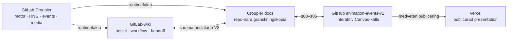
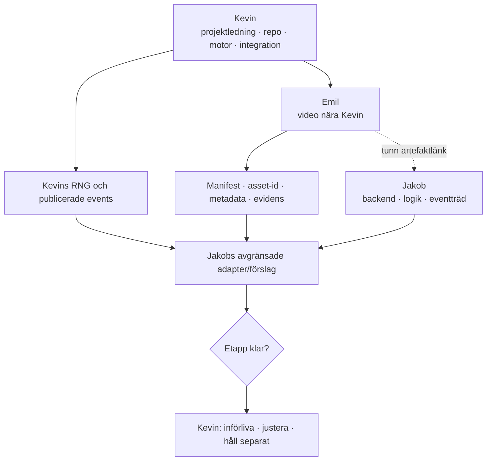

# Canvas och publiceringsflöde · V3

Den riktiga interaktiva canvasen hör till GitHub-repot
[`Jakeminator123/animation-events-v1` · `v3-9-days-mvp`](https://github.com/Jakeminator123/animation-events-v1/tree/v3-9-days-mvp).
V3 byggs på en separat branch så att den publicerade V2-versionen kan ligga kvar
tills V3 har granskats.

## V2-upplägget som V3 behåller

1. Sju redigerbara textsidor: `s00`–`s06`.
2. En självbärande `index.html` med navigation, visuella flöden och samma
   sakmodell som textsidorna.
3. Ett GitHub-repo som versionsstyr canvas och dokumentation.
4. En GitLab-wiki som gör samma V3 tillgänglig för Kevin, Jakob, Emil och
   deras agenter.
5. En repo-nära kopia här i Croupier så att dokumentationen kan granskas mot
   koden den beskriver.

## Källor med olika ansvar

GitHub/Vercel får aldrig bli källa för spelutfall. GitLab-wikin får aldrig
låtsas att ett canvasförslag redan finns i runtime.

## V3:s huvudflöde

## Publiceringsregel

- Den publicerade V2-versionen och V2-arkivet ändras inte.
- V3 granskas på sin GitHub-branch innan eventuell promotion till `main` och
  Vercel.
- Wiki och Croupier-kopia uppdateras i samma leverans som GitHub-canvasen.
- En publicerad canvas är presentation; commit- och filreferenser i
  [runtime-verifieringen](RUNTIME-EVIDENCE.md) är det tekniska kvittot.
