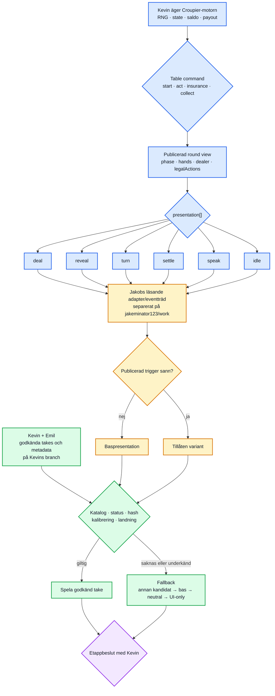
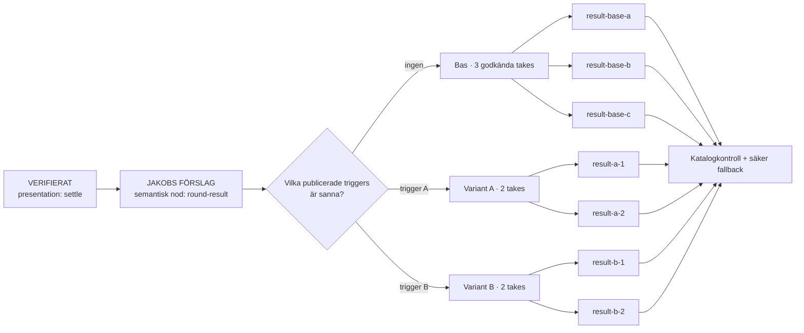

# Canvas · V3-eventträdet

> Diagrammet skiljer verifierad Croupier-runtime från Jakobs förslag och Kevin + Emils videoflöde. Det är en mänsklig dokumentationsyta och ändrar inga branches eller agentregler.

## Helheten

## Ett avgränsat exempel: resultat med flera videor

Det här exemplet visar formen användaren efterfrågade: ett event kan leda till tre basvideor eller två varianter med två videor vardera. Antalen, namnen och triggernivåerna är **Jakobs förslag**, inte nuvarande runtime.

## Färgförklaring

- **Blå:** verifierat i Croupier på revisionen i `RUNTIME-EVIDENCE.md`.
- **Gul:** Jakobs separata förslag.
- **Grön:** Kevin + Emils video-/assetflöde och fallback.
- **Lila:** mänsklig etappgrind där Kevin fattar integrationsbeslut.
