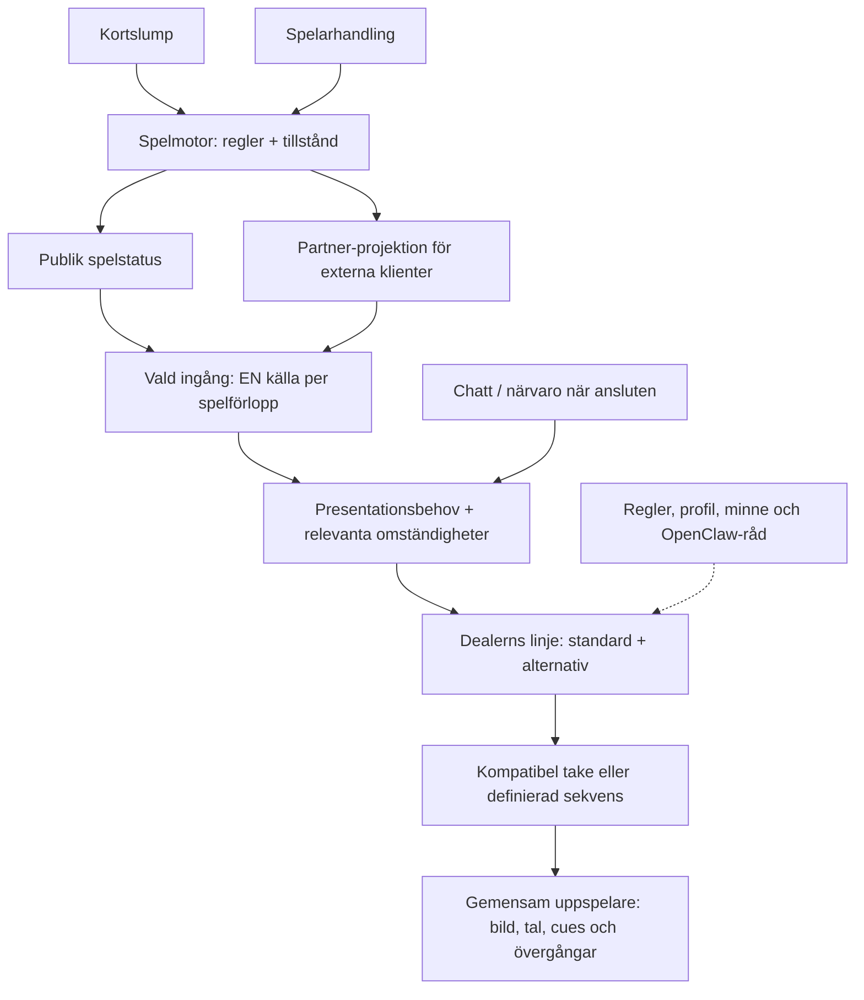

# Samsyn: signaler, presentationsbehov, linjer och takes

Uppdaterad 20 september 2026. Kodgrund: labbet vid `dcab124`, Kevins
`codex/restore-casino-environment` vid `626554d`, `main` vid `b147659`.
Spelmotorn och Partner-projektionen är identiska i dessa revisioner; klientens
Astrid-uppspelning skiljer sig. Detta är kodkontroll, inte ny drift- eller media-QA.

**Status:** begrepp och föreslagen riktning. Inga tekniska ID:n, sparade projekt,
spelregler, spelare, talvägar eller media ändras av detta dokument.
Användarguiden finns fortfarande i [Guide](http://127.0.0.1:4188/guide).
Detta är dess fördjupning, inte en andra guide.

## Vad vi menar

- **RNG/slump:** bidrar med kortordningen. **Spelfakta** är större: serverns
  publicerade kort, händer, fas, godkända handlingar och resultat efter reglerna.
  Ett klick på Hit är ett önskemål; serverns accepterade svar är spelfakta.
- **Signal:** något inträffar eller ändras i spelet, hos spelaren eller i
  uppspelaren. Det finns inget färdigt gemensamt signalregister i dagens produkt.
- **Presentationsbehov:** vad som ska visas/göras, exempelvis dela ett kort,
  markera spelarens tur, reagera på resultat eller vänta.
- **Situation:** bara de omständigheter som behövs för att utföra behovet rätt.
  Inte ett obligatoriskt extra mappsteg för alla behov.
- **Linje:** behållaren för standard och alternativa uttryck för ett behov hos
  vald dealer. Standardlinje är alltså inte en videofil.
- **Variant:** ett valbart uttryck, exempelvis neutral eller varm. En trigger
  gör ett alternativ valbart; den är inte automatiskt en extra scen efteråt.
- **Take:** en konkret inspelning/animation. En variant kan i förslaget ha flera
  likvärdiga takes. Dagens labbvariant har högst en videoreferens och en 2D-reserv.
- **Tidsmarkör/cue:** en punkt inne i en rörelse, till exempel pickup, release,
  land eller rest. Det är uppspelarens synkdata, inte ett nytt blackjackevent.

## Karta: var signalerna kommer ifrån



Diagrammets gemensamma ingång/urval är **förslaget**, inte en redan inkopplad
produktkedja. Kevins klient använder idag `/api/table` och bygger koreografin
själv. Partner är den andra integrationsvägen, inte allas obligatoriska källa.
En framtida adapter behöver föregående/ny publik status och accepterat kommando;
en statusåterläsning är inte en ny runda som ska spelas om. Samma händelse får
inte framföras både från Partner-svaret/SSE och från statusjämförelsen.
Privat kortordning och dolt kortinnehåll ska inte skickas till urvalsmodellen.

Spelarminne/profil är sammanhang, inte nya motor-events. Bestående minne och
gemensam multiplayernärvaro är inte verifierade i den granskade produktkedjan.
Den sparar ett bord per spelar-ID; sju boxar betyder inte sju olika spelare.

## Karta: vad redigeraren ska visa

```text
Spel → Blackjack
└── Vald dealer: Astrid / Vera / Amira / Mei (delat upplägg, eget material)
    ├── Kortutdelning · deal
    │   ├── Genvägar: vänster / mitten / höger / croupier
    │   └── Relevanta fält: exakt box, hand, kortposition, öppet/dolt, sekvens
    ├── Kortvändning · reveal → vilket befintligt dolt kort
    ├── Spelarens tur · turn → aktiv box/hand
    ├── Resultatpresentation · settle → fakta för en eller flera händer
    ├── Vänteläge · idle → basloop, små inslag, säkra övergångar
    └── Talspår → standardfras eller genererat svar (ny ensam talägare: mål)

För valt presentationsbehov, med endast relevanta situationsfält:
Linje
├── Standardvariant → kompatibel take A/B/C (takepool: förslag)
└── Alternativ variant → villkor → kompatibel take D/E

Take / definierad sekvens → media + eventuellt tal + cues + övergångar
```

Trädet är en redigeringsvy, inte nya mappar för varje möjlig kombination.
Gemensamma definitioner återanvänds mellan dealers. Triggers, profil och minne
visas där de påverkar valet; de är inte obligatoriska steg mellan varje videofil.
Spelsplit, blandning, inträde och social reaktion behöver också inventeras från
sina verkliga källor; de sex Partner-typerna är inte hela produktens signalmodell.

## Är de 16 gamla grupperna användbara?

Ja, som befintliga genvägar och migreringsankare, inte som komplett kontrakt:

- **speak × 4:** goodluck, insurance, double och övrigt. Grupperna sorterar
  replikbehov; de är inte fyra universella talfilmer. `speak.other` innehåller
  flera exakta repliker. Flytta mentalt talet till ett eget spår, radera inte
  Partner-fältet eller gamla sparade ID:n för den skull.
- **deal × 4:** spelare vänster/mitten/höger samt croupier. Under dem finns
  olika situationer, inte nödvändigtvis olika uttrycksvarianter.
- **reveal × 1:** visa croupierns befintliga hålkort; inte ny utdelning.
- **turn × 1:** markera aktiv hand; både UI och eventuell dealerreaktion.
- **settle × 5:** blackjack, dealer bust, vinst, push, övrigt. Detta är
  resultatfilter, inte fem oberoende motor-events eller fem fria uttryck.
  Flera villkor kan vara sanna samtidigt. Bevara hela resultatet; låt inte
  första matchande labbgrupp bli sanningen om rundan.
- **idle × 1:** vänteläge. Flera bas-/blickklipp kan ingå utan nya spel-events.

Motorn har tio interna eventnamn; Partner har sex presentationstyper; labbet
har sexton grupper. Inget av dessa antal anger hur många filmer som behövs.

### Deal: vad betyder 2 + 3 + 2?

Partner/labb grupperar box 0–1 till vänster, 2–4 till mitten, 5–6 till höger.
Det är sju platser. Croupiern är en separat mottagare. Kevins native-klient
använder också faktiskt skärmmål och take-kompatibilitet; 2+3+2 är inte en
garanti för hur alla filmrörelser kan återanvändas.

Exempel: **box 5, ursprunglig hand, andra kortet, öppet kort**. Boxen, handen
och kortpositionen avgör vilka takes som kan fungera. Därefter kan uttrycket
vara standard eller ett tillåtet alternativ. Kortets valör/färg kommer från
spelet och kan ritas separat; varje valör behöver inte en unik film.

`handIndex` kan flyttas vid split. `shoeDraw` identifierar draget i skon, inte
kortnummer i handen. Kortposition, split och rörelsens start-/slutpose måste
beaktas där de påverkar kompatibiliteten. Dagens labbintake kontrollerar inte
hela denna täckning. Varken "en film per riktning räcker" eller "varje
kombination måste ha en unik film" är styrkt utan granskade takes.

### Idle: ett annat slags behov

Idle behöver normalt ingen box eller kortposition. Här är basloop, små
blickinslag, repetitionsregler och när nästa handling får bryta in relevanta.
Kevins Astrid-spelare har redan en sådan specifik idle-scheduler med separata
medier och ready-pose-gränser. Labbets råvideopreview spelar däremot en fil
en gång. En generell redigerbar sekvens-/loopfunktion är ännu inte införd.

## Tal: beslutad riktning, inte genomförd avstängning

Jakob vill ersätta Kevins gamla talväg helt i den nya integrationen. Mål:
**en enda talägare**, med förinspelade standardfraser och OpenClaw/ElevenLabs
för tillåtna genererade svar. `speak.line` kan fortfarande vara inkommande
replikavsikt, utan att aktivera den gamla ljudbanken parallellt.

Denna dokumentationsändring stänger inte av någon produktkod. Vid övergången
behöver gammal talägare stängas av i vald integrationsväg för alla fyra dealers,
men kortljud, atmosfär, resultat och Partner-kontrakt ska inte raderas av misstag.
Dubbel talning måste testas. Nytt ljud över gammal talvideo är inte godkänd
läppsynk: använd tyst kompatibel rörelse eller ett exakt matchat talpaket.

## Minsta sammanhängande förändring av labbet — förslag

1. **Återanvänd, döp inte om allt.** Visa presentationsbehov överst och de
   sexton grupperna som genvägar. Behåll tekniska ID:n och sparade kopplingar
   tills en uttrycklig migration finns. Testexempel ska kallas testexempel.
2. **En panel för ett val.** Visa relevanta situationsfält, standard/alternativ
   och deras media i samma inspector. Tomma situationsnivåer utelämnas. Lägg
   testkälla och beslutsdetaljer i testläget, inte som extra parallella paneler.
3. **En gemensam urvalsordning.** Verifiera först situation/take-kompatibilitet,
   sedan variantvillkor, sedan regel eller OpenClaw-val, slutligen konkret take.
   Standard måste också fungera för situationen. Saknad täckning visas som
   sådan; labbets märkta 2D-reserv är inte automatiskt produktens fallback.
4. **Börja med en riktig vertikal kedja.** Jämför ett lokalt statusbaserat
   start/hit/split-förlopp och motsvarande Partner-förlopp mot samma förväntade
   kort, ordning och mål. Ingen dubblering vid återläsning. Spela via befintlig
   produktspelare innan vi säger att labbet återger Kevins runtime.
5. **Utöka endast bevisade behov.** Tre likvärdiga standardtakes kan senare ha
   vikterna 1:1:1 (en tredjedel var). Det är presentationsslump, inte spel-RNG.
   Takepooler, viktade val, generell idle-sekvens och efterföljande sociala
   reaktioner kräver små separata implementationer, inte nya motor-events.

Ingen ny mappstruktur, runtimeadapter, takepool, talavstängning eller loop
införs här. Körbara kontraktsfält, scheman och tester ändras först med respektive implementation.
Detta begränsar nästa arbete till en verifierbar kedja i stället för fler knappar.

## Kodankare

- [Motorns interna händelser](../../web/public/blackjack.mjs),
  [publik status och kommandon](../../web/shoe-game.mjs),
  [Partner-projektion](../../web/partner-presentation.mjs).
- Kevin `626554d`: [status, val och koreografi](https://gitlab.com/scout-gg/croupier/-/blob/626554d/web/public/app.mjs),
  [exakta takevillkor](https://gitlab.com/scout-gg/croupier/-/blob/626554d/web/public/astrid-green-dealer.mjs),
  [idle-scheduler](https://gitlab.com/scout-gg/croupier/-/blob/626554d/web/public/astrid-idle-scheduler.mjs),
  [uppspelare och cues](https://gitlab.com/scout-gg/croupier/-/blob/626554d/web/public/performance-player.mjs).
- Labb: [befintligt kontrakt](../../lab/policies/studio-contract.json),
  [test med exempel-event](../../lab/lib/studio-server.mjs),
  [video/2D-preview](../../lab/components/stage.tsx).
- [Detaljerat daterat eventregister](2026-09-20-eventregister-och-mental-modell.md)
  behålls som källunderlag; denna text preciserar begreppen och nästa riktning.
