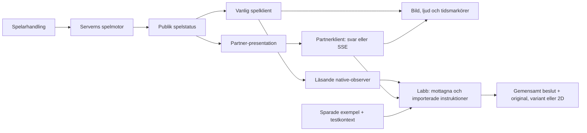

# Systemkarta — från spelfakta till uppspelning

Samlad 25 september 2026. Kartan utgår från Jakobs `jakeminator123/work`,
efter Kevin-integrationen den 22 september. Den beskriver den granskade koden
och skiljer den från labbprov och återstående produktintegration.
[Källregistret](KALLOR.md) anger revisioner, kontroller och begränsningar.

Börja i [Kort start för Jakob och agenter](START-HAR.md). Här finns nu även
[miljö-/API-förklararen](05-openclaw-rost-och-drift/MILJO-OCH-API.md),
[livejämförelsens status och acceptans](06-arbetssatt-och-verifiering/LIVEJAMFORELSE.md)
och [dokumentordningen med flytt- och återställningslista](06-arbetssatt-och-verifiering/DOKUMENTORDNING.md).

**Vad hände → vad behöver presenteras → vilket material passar → vad spelades?**

**Två produktvägar finns.** Vanliga klienten använder `/api/table` och
samordnar presentationen själv. Partnerklienten använder `/api/v1/table`,
får `presentation[]` och kan få samma lista via `/api/v1/events`.
Native-svaret innehåller nu även samma publika presentationskontrakt. En
opt-in-observer i spelfliken ger labbet det mottagna svaret, publik bordsvy och
instrumenterade playback-/chattsignaler. Labbet kan testa exempel och återspela
mottagna/importerade instruktioner.
Labbets exempelhändelser och mottagna/importerade instruktioner går genom
samma presentationsbeslut med OpenClaw som valbart mellanled. Det betyder
inte att originalspelarens befintliga presentation eller produktchatt redan
har flyttats till OpenClaw.
Native-publicering till Partner sker efter commit för verifierad launch-session.
Observerad klientuppspelning och SSE-instruktioner är olika bevis. En öppen
SSE-transport utan rundposter ska inte visas som fungerande speltrafik.
Aktuell Bettalotto-deploy och visuell/läppsynkad acceptans kräver egna prov.
[Samlad leverans och gränser](06-arbetssatt-och-verifiering/LIVEJAMFORELSE.md).

Originalet `/` och Kevins nya `/v2/` är separata renderingslägen över samma
spelregler. BO granskar och binder material; labbet jämför presentation från
mottagna publika fakta. Kartans tidigare granskningar av den 20–21 september
behåller sina datum och får inte läsas som verifiering av V2 eller dagens drift.

## Välj fråga

- [1. Spelmotor och data](01-spelmotor-och-data/README.md) — kort, regler,
  status, Partner in/ut, eventström och wallet.
- [2. Events, triggers och urval](02-events-triggers-urval/README.md) —
  sex presentationstyper, sexton genvägar, villkor och modellråd.
- [3. Dealers, video och takes](03-dealers-video-takes/README.md) —
  rätt mål, exakt tal, kompatibelt material och faktisk aktivering.
- [4. Studio, JSON och lagring](04-studio-json-och-lagring/README.md) —
  projekt, schema, videobank och lokala prov.
- [5. OpenClaw, röst och drift](05-openclaw-rost-och-drift/README.md) —
  rådgivare, social chatt, ljud och avgränsad runtimekunskap.
- [6. Arbetssätt och verifiering](06-arbetssatt-och-verifiering/README.md) —
  vilken källa som gäller och vad olika kontroller faktiskt bevisar.

## Tre statusar genom hela kartan

**Kodkontrollerat** betyder att implementation eller data har lästs.
**Labb** är en avgränsad lokal funktion, ofta med simulerad kontext.
**Förslag** återstår att införa. Daterade test- och driftkvitton anger vad
som fungerade då; de fastställer inte dagens driftsatta revision.

Blackjack och fyra dealers finns. Roulette är en platshållare. Startprojektets
256 variantposter och 64 eventrörelser räknar labbreferenser, inte godkända
dealerfilmer. Ett manifest visar tillgångar; det visar inte vilken film
aktuella BO-bindningar och produktspelaren väljer.

Fördjupa med [signaler, situationer och takes](02-events-triggers-urval/SIGNALER-OCH-TAKES.md),
[detaljerat eventregister](02-events-triggers-urval/EVENTREGISTER.md),
[aktiv sprint](../../../docs/animation-events/README.md) och
[öppna fynd](../../../docs/findings/REGISTER.md).
Den aktiva kartan behöver inte det personliga arkivet som läskälla.
