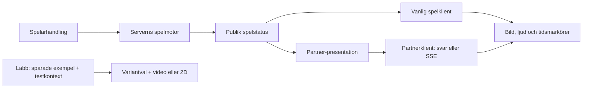

# Systemkarta — från spelfakta till uppspelning

Uppdaterad 20 september 2026 inför V4. Kartan beskriver den granskade koden
och skiljer den från labbprov och återstående produktintegration.
[Källregistret](KALLOR.md) anger revisioner, kontroller och begränsningar.

**Vad hände → vad behöver presenteras → vilket material passar → vad spelades?**

**Två produktvägar finns.** Vanliga klienten använder `/api/table` och
samordnar presentationen själv. Partnerklienten använder `/api/v1/table`,
får `presentation[]` och kan få samma lista via `/api/v1/events`.
Labbet testar fortfarande sparade exempel. En gemensam adapter och en
läsande livemonitor är förslag.

## Välj fråga

- [1. Spelmotor och data](01-spelmotor-och-data/README.md) — kort, regler,
  status, Partner in/ut, eventström och wallet.
- [2. Events, triggers och urval](02-events-triggers-urval/README.md) —
  sex presentationstyper, sexton genvägar, villkor och modellråd.
- [3. Dealers, video och takes](03-dealers-video-takes/README.md) —
  rätt mål, exakt tal, kompatibelt material och faktisk aktivering.
- [4. Studio, JSON och lagring](04-studio-json-och-lagring/README.md) —
  projekt, schema, videobank och lokala prov.
- [5. OpenClaw, röst och drift](05-openclaw-rost-och-drift/README.md) —
  rådgivare, social chatt, ljud och avgränsad runtimekunskap.
- [6. Arbetssätt och verifiering](06-arbetssatt-och-verifiering/README.md) —
  vilken källa som gäller och vad olika kontroller faktiskt bevisar.

## Tre statusar genom hela kartan

**Kodkontrollerat** betyder att implementation eller data har lästs.
**Labb** är en avgränsad lokal funktion, ofta med simulerad kontext.
**Förslag** återstår att införa. Daterade test- och driftkvitton anger vad
som fungerade då; de fastställer inte dagens driftsatta revision.

Blackjack och fyra dealers finns. Roulette är en platshållare. Startprojektets
256 variantposter och 64 eventrörelser räknar labbreferenser, inte godkända
dealerfilmer. Ett manifest visar tillgångar; det visar inte vilken film
aktuella BO-bindningar och produktspelaren väljer.

Fördjupa med [signaler, situationer och takes](../2026-09-20-situationer-variantfamiljer-och-takes.md),
[detaljerat eventregister](../2026-09-20-eventregister-och-mental-modell.md),
[aktiv sprint](../../../docs/animation-events/README.md) och
[öppna fynd](../../../docs/findings/REGISTER.md).
Den aktiva kartan behöver inte det personliga arkivet som läskälla.
